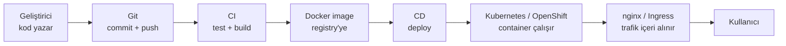

# 0.1 Koddan Canlıya: Uçtan Uca Akış

## Nedir?
Bir geliştiricinin bilgisayarında yazdığı kodun, kullanıcıların erişebildiği canlı (production) ortamda çalışır hâle gelene kadar geçtiği adımların tamamıdır. Bu kitaptaki araçların çoğu bu zincirin bir halkasıdır.

## Hangi problemi çözer?
Elle yapılan kurulumlar hataya açıktır: "benim makinemde çalışıyordu", "sunucuda hangi sürüm var bilmiyorum", "dün akşamki değişiklik her şeyi bozdu" gibi sorunlar çıkar. Uçtan uca akış, her adımı **tekrarlanabilir**, **izlenebilir** ve **otomatik** hâle getirir.

## Nasıl çalışır?



| Adım | Ne olur? | Araç örnekleri | Bölüm |
|---|---|---|---|
| 1. Kod yazmak | Python ortamı kurulur, kod yazılır | venv, uv, VS Code | [2](../02-python-ortam/01-neden-sanal-ortam.md) |
| 2. Versiyonlamak | Değişiklik kaydedilir, uzak repoya gönderilir | Git, GitHub, GitLab | [3](../03-git/01-git-nedir.md) |
| 3. Test ve build (CI) | Testler otomatik koşar, paket oluşturulur | GitHub Actions, Jenkins | [6](../06-ci-cd/01-ci-cd-nedir.md) |
| 4. Paketlemek | Uygulama ve bağımlılıkları tek image olur | Docker | [4](../04-docker/01-docker-nedir.md) |
| 5. Saklamak | Image bir depoya yüklenir | Docker Hub, Harbor, Quay | [4.7](../04-docker/07-registry-docker-hub.md) |
| 6. Yayına almak (CD) | Yeni sürüm ortama dağıtılır | ArgoCD, OpenShift Pipelines | [6](../06-ci-cd/05-gitops-argocd.md) |
| 7. Çalıştırmak | Container'lar yönetilir, ölçeklenir | Kubernetes, OpenShift | [5](../05-kubernetes/01-kubernetes-nedir.md) |
| 8. Dışarı açmak | İstek uygulamaya yönlendirilir | nginx, Ingress, Route | [8](../08-nginx/02-nginx-nedir.md) |
| 9. İzlemek | Log ve metrikler toplanır | Prometheus, Grafana | 14 |

**Kitapta bu akışın adımları**
| Adım | Ne olur? | Bölüm |
|---|---|---|
| Geliştirme ortamı | Linux, terminal, ağ, localhost, sanal makine | [1](../01-linux/01-linux-nedir.md) |
| Bağımlılıklar | Sanal ortam, paket yönetimi | [2](../02-python-ortam/01-neden-sanal-ortam.md) |
| Kodun saklanması | Git, branch, Pull Request | [3](../03-git/01-git-nedir.md) |
| Paketleme | Docker image, registry | [4](../04-docker/01-docker-nedir.md) |
| Çalıştırma | Kubernetes / OpenShift | [5](../05-kubernetes/01-kubernetes-nedir.md) |
| Otomasyon | CI/CD, GitOps | [6](../06-ci-cd/01-ci-cd-nedir.md) |
| Dış dünyaya açılma | API, nginx, Cloudflare | [7](../07-api/01-api-nedir.md), [8](../08-nginx/01-web-sunucusu-nedir.md) |
| Model olarak canlıya alma | MLflow, serving, izleme, model riski | [13](../13-mlops/01-ml-yasam-dongusu.md) |
| İzleme | Log, metrik, alarm | [14](../14-gozlemlenebilirlik/01-log-metrik-trace.md) |
| Güvenlik | Kimlik, yetki, secret, şifreleme | [15](../15-guvenlik/01-authn-authz.md) |

## Mini örnek
Bir Streamlit dashboard'u için akış şöyle görünür:

```bash
# 1-2. Kodu yaz ve gönder
git add app.py
git commit -m "Yeni grafik eklendi"
git push origin main

# 3-6. Bundan sonrası otomatik:
#   CI testleri koşar -> Dockerfile'dan image build edilir
#   -> image registry'ye yüklenir -> CD yeni sürümü OpenShift'e dağıtır

# 7-8. Kontrol
oc get pods            # yeni pod'lar çalışıyor mu?
curl https://dashboard.sirket.local/health
```

## Nerede kullanılır?
- Bankada iç kullanıma açılan dashboard'lar ve API'ler
- Zamanlanmış ETL işlerinin (CronJob) sunucuya dağıtılması
- ML modellerinin servis olarak yayına alınması

## Benzerleri ve farkları
- **Elle deploy:** Sunucuya SSH ile bağlanıp dosya kopyalamak. Küçük işler için hızlıdır ama tekrarlanamaz ve iz bırakmaz.
- **Low-code platformlar (Dataiku vb.):** Akışın bir kısmını platform kendi içinde yönetir; altta yine benzer adımlar vardır.

## İlgili sayfalar
- [0.2 Veriden rapora](02-veriden-rapora.md)
- [0.3 Sözlük](03-sozluk.md)
- [6.2 Pipeline aşamaları](../06-ci-cd/02-pipeline-asamalari.md)
