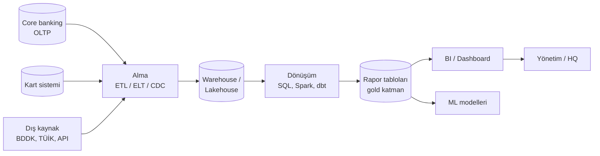

# 0.2 Veriden Rapora: Uçtan Uca Akış

## Nedir?
Bir işlemin (örneğin bir kredi kullandırımı) kaynak sistemde oluştuğu andan, yönetimin önündeki rapora bir rakam olarak yansıdığı ana kadar geçen yoldur. Kitabın Kısım III'ü bu yolu anlatır.

## Hangi problemi çözer?
Kaynak sistemler (core banking, kart, CRM) işlem yapmak için tasarlanmıştır; analiz için değil. Doğrudan bu sistemlerden rapor almak hem onları yavaşlatır hem de farklı sistemlerdeki veriyi birleştirmeyi zorlaştırır. Veri akışı; veriyi **toplar**, **temizler**, **birleştirir** ve **analize uygun** bir yerde saklar.

## Nasıl çalışır?

| Katman | Görevi | Örnek |
|---|---|---|
| Kaynak | İşlemin gerçekleştiği yer | Core banking, kart, CRM, dış veri |
| Alma (ingestion) | Veriyi kaynaktan çekmek | Gece batch, CDC, API çağrısı |
| Depolama | Analiz için saklamak | Oracle DWH, PostgreSQL, lakehouse |
| Dönüşüm | Temizleme, birleştirme, hesaplama | SQL, Spark, dbt |
| Sunum | Hazır tablolar | Rapor tabloları, feature tabloları |
| Tüketim | Raporu okumak, karar almak | Power BI, Grafana, Streamlit, modeller |

**Schema-on-write** (yazarken şema zorla) ve **schema-on-read** (okurken şema uygula) bu yolun hangi noktasında veri kalitesi kontrolü yapılacağını belirler. Ayrıntılar: [9.11](../09-veri-depolama/11-schema-on-write-read.md) ve [11.2](../11-veri-akisi/02-akista-schema.md).

**Kitapta bu akışın adımları**
| Adım | Ne olur? | Bölüm |
|---|---|---|
| Kaynak sistemler ve depolama | OLTP, SQL, NoSQL, nesne depolama, lakehouse | [9](../09-veri-depolama/01-oltp-olap.md) |
| SQL derinlemesine | Transaction, lock, index, plan, partition | [9.16](../09-veri-depolama/16-transaction-isolation.md) |
| İşleme | SQL, pandas, Spark, Polars, DuckDB, Dask | [10](../10-veri-isleme/01-sql.md) |
| Taşıma ve dönüşüm | ETL/ELT, konnektörler, CDC, dbt, orkestrasyon, Kafka | [11](../11-veri-akisi/01-etl-elt.md) |
| Modelleme ve raporlama | Boyutsal model, SCD, BI, dashboard | [12](../12-bi/01-bi-nedir.md) |
| Model ve analitik | Feature store, MLOps, model riski | [13](../13-mlops/01-ml-yasam-dongusu.md) |
| Yönetişim ve kalite | Katalog, lineage, sahiplik, sınıflandırma, kalite | [16](../16-veri-yonetisimi/01-veri-yonetisimi-nedir.md) |
| Dosya formatları | CSV, JSON, Parquet, kodlama, finans formatları | [17](../17-formatlar/01-genel-bakis.md) |

## Mini örnek
BDDK'nın aylık bülten verisinden "sektör kredi büyümesi" raporuna giden yol:

1. **Kaynak:** BDDK web sitesindeki aylık Excel dosyaları
2. **Alma:** Python ETL betiği dosyaları indirir
3. **Depolama:** Ham tablolar PostgreSQL'e yazılır
4. **Dönüşüm:** SQL ile aylık, yıllık değişim (MoM, YoY) hesaplanır
5. **Sunum:** `kredi_metrics` tablosu
6. **Tüketim:** Dashboard'da grafik, yönetime haftalık özet

## Nerede kullanılır?
- Yasal raporlama (BDDK, TCMB)
- Yönetim raporları ve KPI takibi
- Risk ve fraud modellerinin beslenmesi

## Benzerleri ve farkları
- **Koddan canlıya akış** ([0.1](01-koddan-canliya.md)) uygulamanın yolunu, bu sayfa **verinin** yolunu anlatır. İkisi birleşir: ETL kodu da Git → CI/CD → Kubernetes yolundan geçerek çalıştırılır.

## İlgili sayfalar
- [0.1 Koddan canlıya](01-koddan-canliya.md)
- [0.3 Sözlük](03-sozluk.md)
