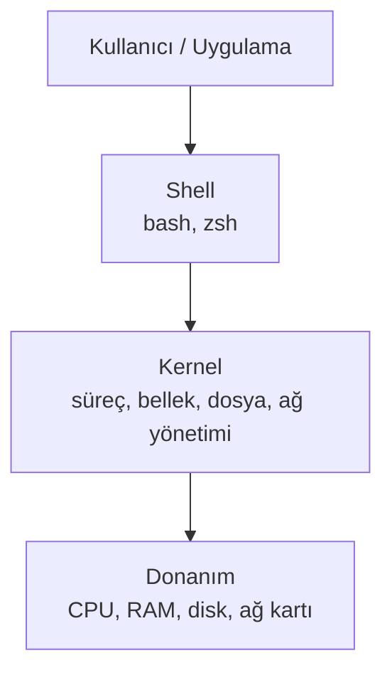

# 1.1 Linux Nedir, Neden Sunucuların Çoğu Linux?

## Nedir?
Linux, açık kaynaklı bir işletim sistemi çekirdeğidir (kernel). Bu çekirdeğin üzerine araçlar eklenerek **dağıtımlar** (distribution) oluşturulur: Ubuntu, Debian, Red Hat Enterprise Linux (RHEL), CentOS/Rocky, Alpine gibi.

## Hangi problemi çözer?
Sunucuların yıllarca kesintisiz, düşük maliyetle ve uzaktan yönetilerek çalışması gerekir. Linux:
- **Ücretsiz ve açık kaynaktır**, lisans maliyeti yoktur (kurumsal destek ayrıca satın alınabilir, ör. RHEL).
- **Kararlıdır**, aylarca yeniden başlatılmadan çalışabilir.
- **Terminalden tamamen yönetilebilir**; grafik arayüz gerekmez.
- **Container teknolojisinin temelidir.** Docker ve Kubernetes, Linux çekirdeğinin özelliklerini (namespaces, cgroups) kullanır.

## Nasıl çalışır?



- **Kernel:** Donanımı yönetir; programlara CPU, bellek ve disk dağıtır.
- **Shell:** Yazdığımız komutları kernel'e ileten yorumlayıcı. En yaygını `bash`.
- **"Her şey bir dosyadır":** Diskler, cihazlar, süreç bilgileri bile dosya gibi görünür (`/dev`, `/proc`).

Yaygın dağıtımlar:

| Dağıtım | Nerede görülür? | Paket yöneticisi |
|---|---|---|
| Ubuntu / Debian | Geliştirici makineleri, bulut sunucuları | `apt` |
| RHEL / Rocky / CentOS | Kurumsal sunucular, bankalar | `dnf` / `yum` |
| Alpine | Küçük Docker image'ları | `apk` |

## Mini örnek
```bash
uname -a              # kernel sürümü
cat /etc/os-release   # hangi dağıtım?
whoami                # hangi kullanıcıyım?
uptime                # sunucu ne kadardır açık?
df -h                 # disk doluluğu
free -h               # bellek kullanımı
```

## Nerede kullanılır?
- Veritabanı, ETL ve uygulama sunucuları
- Docker container'larının içi (image'lar genellikle Linux tabanlıdır)
- Kubernetes / OpenShift node'ları (OpenShift'te RHEL CoreOS)

## Benzerleri ve farkları
- **Windows Server:** Active Directory, .NET ve bazı kurumsal yazılımlar için kullanılır. Grafik arayüz ağırlıklıdır.
- **macOS:** Unix tabanlıdır, bu yüzden terminal komutlarının çoğu Linux ile aynıdır.
- **WSL (Windows Subsystem for Linux):** Windows içinde gerçek bir Linux ortamı çalıştırır; şirket bilgisayarında Linux öğrenmenin kolay yolu.

## İlgili sayfalar
- [1.2 Temel komutlar](02-temel-komutlar.md)
- [4.1 Docker nedir](../04-docker/01-docker-nedir.md)
