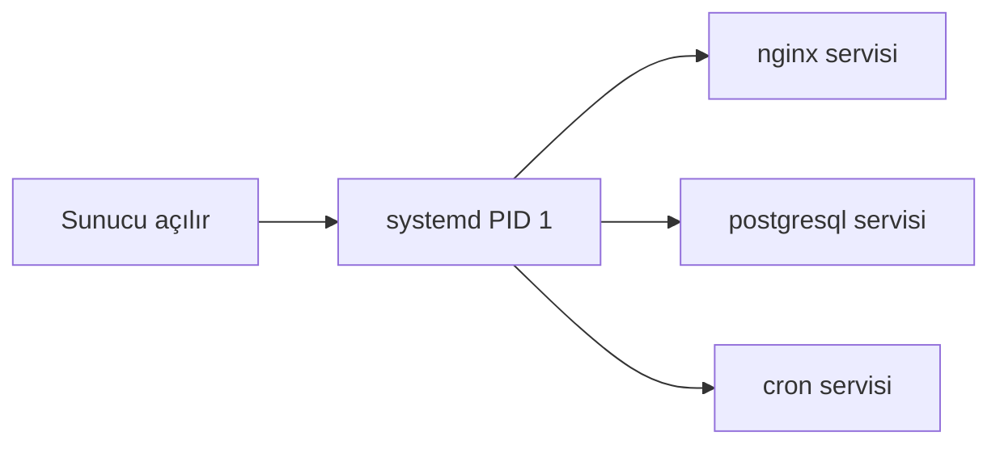

# 1.4 Süreçler ve Servisler

## Nedir?
- **Süreç (process):** Çalışmakta olan bir programdır. Her sürecin benzersiz bir numarası (**PID**) vardır.
- **Servis (service / daemon):** Arka planda sürekli çalışan, sunucu açılınca otomatik başlayan süreçtir (nginx, postgresql, sshd).

## Hangi problemi çözer?
Bir uygulamanın çalışıp çalışmadığını görmek, takılan bir işi durdurmak, CPU ve bellek kullanan programı bulmak ve servisleri yönetmek için gerekir.

## Nasıl çalışır?
- Her süreç bir **ebeveyn** süreçten doğar; ilk süreç `systemd`'dir (PID 1).
- Süreçlere **sinyal** gönderilerek durdurulurlar:
  - `SIGTERM` (15): "Kapanır mısın?" Program temizlik yapıp kapanır. `kill`'in varsayılanı.
  - `SIGKILL` (9): Zorla öldürür; program temizlik yapamaz. Son çare.
- **systemd** servisleri yönetir; `systemctl` komutuyla konuşulur.



## Mini örnek

**Süreçleri görmek**
```bash
ps aux                     # tüm süreçler
ps aux | grep python       # python süreçleri
top                        # canlı CPU/bellek tablosu (q ile çık)
htop                       # daha okunaklı top (kuruluysa)
```

**Süreç durdurmak**
```bash
kill 12345                 # nazikçe durdur (SIGTERM)
kill -9 12345              # zorla durdur (SIGKILL)
pkill -f etl_job.py        # isme göre durdur
```

**Arka planda çalıştırmak**
```bash
python etl.py &                        # arka planda başlat
nohup python etl.py > etl.log 2>&1 &   # terminal kapansa da sürsün
jobs                                   # arka plandaki işler
```

**Servis yönetimi**
```bash
systemctl status nginx          # çalışıyor mu?
sudo systemctl start nginx      # başlat
sudo systemctl stop nginx       # durdur
sudo systemctl restart nginx    # yeniden başlat
sudo systemctl enable nginx     # açılışta otomatik başlasın
journalctl -u nginx -f          # servis loglarını canlı izle
```

**Port'u kim dinliyor?**
```bash
ss -tulpn | grep 8501          # 8501 portunu hangi süreç kullanıyor
```

## Nerede kullanılır?
- Takılan bir ETL betiğini durdurmak
- Sunucu yavaşladığında CPU yiyen süreci bulmak (`top`)
- "Port already in use" hatasında portu tutan süreci bulmak (`ss`)
- Bir Streamlit uygulamasını sunucu açılışında otomatik başlatmak (systemd servisi)

## Benzerleri ve farkları
- **Container dünyasında** süreç yönetimini Docker/Kubernetes üstlenir: çöken container otomatik yeniden başlatılır ([5.4](../05-kubernetes/04-deployment.md)). Bu yüzden container içinde systemd kullanılmaz.
- **Windows:** Görev Yöneticisi ve Services.

## İlgili sayfalar
- [1.8 cron](08-cron.md)
- [1.5 Environment variable'lar](05-environment.md)
