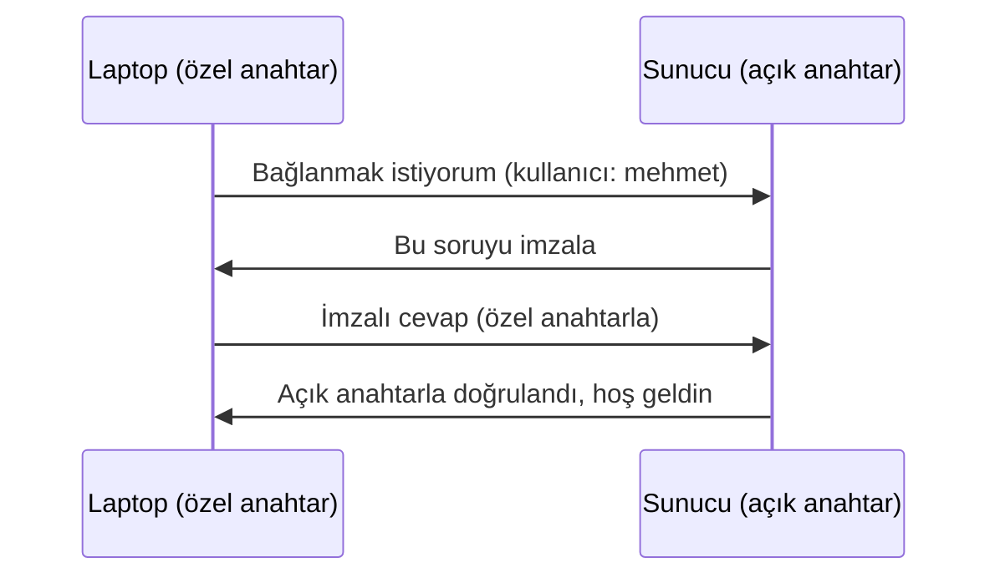

# 1.6 SSH ve Uzak Sunucuya Bağlanma

## Nedir?
**SSH (Secure Shell)**, başka bir makinenin terminaline şifreli bir bağlantı üzerinden erişmeyi sağlayan protokoldür. Varsayılan portu **22**'dir.

## Hangi problemi çözer?
Sunucular veri merkezindedir; başına oturulmaz. SSH ile:
- Uzaktaki sunucuda komut çalıştırırız,
- Dosya kopyalarız (`scp`, `rsync`),
- Trafik şifreli olduğu için şifreler ve veri ağda okunamaz.

## Nasıl çalışır?
İki kimlik doğrulama yolu vardır:
1. **Şifre ile:** Basit ama daha az güvenli.
2. **Anahtar çifti (key pair) ile:** Önerilen yol.
   - **Özel anahtar (private key):** Sizde kalır, kimseyle paylaşılmaz (`~/.ssh/id_ed25519`).
   - **Açık anahtar (public key):** Sunucuya konur (`~/.ssh/authorized_keys`).
   - Sunucu, açık anahtarla bir soru şifreler; sadece özel anahtar sahibi cevaplayabilir.



## Mini örnek

**Anahtar oluşturmak ve sunucuya eklemek**
```bash
ssh-keygen -t ed25519 -C "mehmet@laptop"     # anahtar çifti oluştur
ssh-copy-id mehmet@10.0.0.5                  # açık anahtarı sunucuya ekle
```

**Bağlanmak**
```bash
ssh mehmet@10.0.0.5
ssh -p 2222 mehmet@etl-sunucu.local          # farklı port
ssh mehmet@10.0.0.5 "df -h"                  # tek komut çalıştırıp çık
```

**Kısayol: `~/.ssh/config`**
```
Host etl
    HostName 10.0.0.5
    User mehmet
    IdentityFile ~/.ssh/id_ed25519
```
Artık sadece `ssh etl` yazmak yeterli.

**Dosya kopyalamak**
```bash
scp rapor.csv etl:/data/inbox/              # yerelden sunucuya
scp etl:/var/log/app.log ./                 # sunucudan yerele
scp -r klasor/ etl:/data/                   # klasör
rsync -avz klasor/ etl:/data/klasor/        # sadece değişenleri gönderir
```

**Port yönlendirme (tunnel)**
```bash
# Sunucudaki 5432 portundaki PostgreSQL'e laptoptan localhost:15432 ile eriş
ssh -L 15432:localhost:5432 etl
```

## Nerede kullanılır?
- ETL ve uygulama sunucularına bağlanmak
- Git'in GitHub/GitLab ile SSH üzerinden konuşması (`git@github.com:...`)
- Dışarıya kapalı bir veritabanına tünel üzerinden erişmek

## Benzerleri ve farkları
- **Telnet:** Eski ve şifresiz; kullanılmamalı.
- **RDP:** Windows'a grafik arayüzle uzaktan bağlanma.
- **`oc rsh` / `kubectl exec`:** Kubernetes'te container'ın içine bağlanma; SSH yerine geçer ([5.14](../05-kubernetes/14-kubectl-komutlari.md)).
- **Bastion / jump host:** Bankalarda sunuculara genellikle doğrudan değil, araya konmuş bir geçiş sunucusu üzerinden bağlanılır (`ssh -J`).

**Dikkat:** Özel anahtar dosyasının izni `600` olmalıdır, aksi hâlde SSH anahtarı reddeder.

## İlgili sayfalar
- [1.3 İzinler](03-izinler.md)
- [3.6 GitHub ve Pull Request](../03-git/06-github-pull-request.md)
- [1.9 Ağ temelleri](09-ag-temelleri.md)
