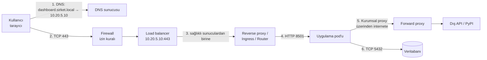

# 1.9 Ağ Temelleri: DNS, Port, Firewall, Proxy, Load Balancer

## Nedir?
Bir isteğin kullanıcıdan uygulamaya, uygulamadan veritabanına ulaşması için gereken temel ağ kavramları. Kitabın diğer bölümlerinde sık geçen "bağlanamıyorum", "timeout", "connection refused" sorunlarının çoğu bu katmanlardan birindedir.

## Hangi problemi çözer?
Veri ve uygulama ekiplerinin en sık karşılaştığı sorunları anlamayı ve ilgili ekiple (ağ, güvenlik, platform) doğru dille konuşmayı sağlar:
- "Sunucu adını çözemiyor" → DNS
- "Connection refused" → servis o portta dinlemiyor
- "Timeout" → firewall engelliyor veya yönlendirme yok
- "SSL hatası" → proxy / sertifika ([8.6](../08-nginx/06-https-tls.md))

## Nasıl çalışır?

**Bir isteğin yolculuğu**


### IP adresi ve alt ağ
- **IP adresi:** Ağdaki bir cihazın adresi. IPv4: `10.20.5.10`.
- **Özel (private) IP aralıkları:** `10.0.0.0/8`, `172.16.0.0/12`, `192.168.0.0/16` — kurum içi ağlar; internette yönlendirilmez.
- **CIDR gösterimi:** `10.20.5.0/24` → ilk 24 bit ağ, `10.20.5.0`–`10.20.5.255` arası (256 adres).
- **NAT:** Özel IP'li cihazların ortak bir genel IP ile dışarı çıkması.

### DNS (Domain Name System)
İnsanların hatırladığı adları IP adreslerine çevirir.
| Kayıt | Anlamı | Örnek |
|---|---|---|
| `A` / `AAAA` | Ad → IPv4 / IPv6 | `pg.sirket.local → 10.20.7.15` |
| `CNAME` | Ad → başka ad (takma ad) | `rapor.sirket.local → dashboard.apps.ocp.sirket.local` |
| `PTR` | IP → ad (ters çözümleme) | |
| `SRV` | Servis ve port bilgisi | AD/Kerberos keşfi |
| `TXT` | Serbest metin (doğrulama vb.) | |

DNS cevapları **TTL** süresi boyunca önbellekte tutulur; değişiklikler hemen yayılmayabilir. Kubernetes'in de kendi iç DNS'i vardır (`servis.namespace.svc.cluster.local`, [5.7](../05-kubernetes/07-service.md)).

### Port ve protokol
Bir sunucudaki servisler port numaralarıyla ayrılır. **TCP** güvenilir bağlantı (HTTP, veritabanları), **UDP** hızlı ama garantisiz iletim (DNS, bazı akış protokolleri).

| Port | Servis |
|---|---|
| 22 | SSH |
| 53 | DNS |
| 80 / 443 | HTTP / HTTPS |
| 389 / 636 | LDAP / LDAPS |
| 88 | Kerberos |
| 1521 | Oracle |
| 5432 | PostgreSQL |
| 3306 | MySQL |
| 1433 | SQL Server |
| 27017 | MongoDB |
| 6379 | Redis |
| 9092 | Kafka |
| 6443 | Kubernetes / OpenShift API |
| 8080, 8000, 8501, 3000, 9090 | Sık kullanılan uygulama portları (genel, Uvicorn, Streamlit, Grafana, Prometheus) |

### Firewall (güvenlik duvarı)
Kaynak IP/ağ, hedef IP/ağ, port ve protokole göre trafiğe **izin veren veya engelleyen** kurallar.
- Kurumlarda varsayılan "her şey kapalı"dır; yeni bir bağlantı için **firewall talebi** açılır: kaynak (ör. OpenShift worker ağı `10.30.0.0/16`), hedef (`pg.sirket.local` / `10.20.7.15`), port (`5432/TCP`), gerekçe.
- Katmanlar: ağ firewall'u, sunucu firewall'u (`firewalld`, `iptables`), Kubernetes **NetworkPolicy**, bulutta security group.
- Belirti: Firewall engellediğinde genellikle **timeout** alınır (paket sessizce düşürülür); servis kapalıysa **connection refused** alınır.

### Proxy
| Tür | Yön | Örnek |
|---|---|---|
| **Forward proxy** | İçeriden dışarı; kurum çalışanları ve sunucular internete proxy üzerinden çıkar | `HTTPS_PROXY=http://proxy.sirket.local:8080` ([2.6](../02-python-ortam/06-kurum-ici-paket.md)) |
| **Reverse proxy** | Dışarıdan içeri; uygulamaların önünde | nginx, Ingress, OpenShift Router ([8.4](../08-nginx/04-reverse-proxy.md)) |

Kurumsal forward proxy'ler çoğu zaman TLS trafiğini inceleyip kendi sertifikasıyla yeniden imzalar; bu yüzden kurum CA sertifikasının araçlara tanıtılması gerekir.

### Load balancer (yük dengeleyici)
Trafiği birden çok sunucuya dağıtır ve sağlıksız olanları devreden çıkarır ([8.5](../08-nginx/05-load-balancing.md)).
- **L4:** IP/port düzeyinde (TCP) — F5, HAProxy TCP modu, Kubernetes Service.
- **L7:** HTTP düzeyinde (URL, header) — nginx, Ingress, uygulama yük dengeleyicileri.
- **VIP (sanal IP):** Arkasında birden çok sunucu olan tek erişim adresi.

### VPN ve özel bağlantılar
Uzaktan çalışanların veya veri merkezleri/bulut arasının şifreli bağlantısı (site-to-site VPN; bulutta AWS Direct Connect, Azure ExpressRoute gibi özel hatlar).

## Mini örnek
**Bağlantı sorunu teşhis kontrol listesi**
```bash
# 1. Ad çözülüyor mu?
nslookup pg.sirket.local          # veya: dig pg.sirket.local +short
getent hosts pg.sirket.local      # sistemin gerçekten kullandığı çözümleme

# 2. Ağ yolu açık mı? Port erişilebilir mi?
nc -vz pg.sirket.local 5432       # "succeeded" / "refused" / zaman aşımı
curl -v telnet://pg.sirket.local:5432   # nc yoksa alternatif
traceroute pg.sirket.local        # yol nerede kesiliyor?

# 3. Hedef sunucuda servis dinliyor mu?
ss -tulpn | grep 5432             # (hedef sunucuda)

# 4. HTTP katmanı
curl -v https://dashboard.sirket.local/health
curl -v --proxy http://proxy.sirket.local:8080 https://pypi.org/simple/

# 5. TLS / sertifika
openssl s_client -connect dashboard.sirket.local:443 -servername dashboard.sirket.local </dev/null
```

| Belirti | Muhtemel katman |
|---|---|
| `Name or service not known`, `NXDOMAIN` | DNS |
| `Connection timed out` | Firewall, yönlendirme, yanlış IP |
| `Connection refused` | Hedefte servis çalışmıyor / yanlış port / yanlış arayüzde dinliyor (`127.0.0.1`) |
| `No route to host` | Ağ yönlendirmesi veya host firewall'u |
| `SSL: CERTIFICATE_VERIFY_FAILED` | Kurum CA'sı tanıtılmamış, proxy araya giriyor |
| HTTP `502/504` | Reverse proxy ile uygulama arası ([8.8](../08-nginx/08-log-hatalar.md)) |
| `407 Proxy Authentication Required` | Forward proxy kimlik istiyor |

**Kubernetes'te pod içinden test**
```bash
kubectl run nettest --rm -it --image=nicolaka/netshoot -- bash
# içeride: nslookup, nc -vz, curl, dig ...
```

**NetworkPolicy:** Sadece `kredi-api` pod'larının veritabanına erişmesine izin vermek
```yaml
apiVersion: networking.k8s.io/v1
kind: NetworkPolicy
metadata:
  name: db-erisim
  namespace: veri-prod
spec:
  podSelector:
    matchLabels: { app: postgres }
  ingress:
    - from:
        - podSelector:
            matchLabels: { app: kredi-api }
      ports:
        - port: 5432
```

## Nerede kullanılır?
- Yeni bir uygulamanın veritabanına/servise erişim taleplerinde (firewall, DNS kaydı)
- "Lokalimde çalışıyor, sunucuda/pod'da çalışmıyor" sorunlarının teşhisinde
- OpenShift'teki uygulamaların kurum içi sistemlere (Oracle, AD, SFTP) erişiminin planlanmasında
- Dış veri kaynaklarına (BDDK, TÜİK, API'ler) proxy üzerinden erişimde

## Benzerleri ve farkları
- **OSI modeli:** Ağ katmanlarının 7 katmanlı referans modeli; günlük pratikte L3 (IP), L4 (TCP/UDP port) ve L7 (HTTP) ayrımı yeterlidir.
- **Service mesh (Istio):** Servisler arası trafikte şifreleme (mTLS), yönlendirme ve gözlemlenebilirliği uygulama kodunu değiştirmeden sağlar.
- **Zero trust ağ:** Ağ konumuna değil, kimliğe ve bağlama dayalı erişim ([15.6](../15-guvenlik/06-rbac-en-az-yetki.md)).

## İlgili sayfalar
- [8.4 Reverse proxy](../08-nginx/04-reverse-proxy.md)
- [5.7 Kubernetes Service ve DNS](../05-kubernetes/07-service.md)
- [1.6 SSH](06-ssh.md)
- [Ağ cheat sheet'i için Linux / bash](../ekler/linux-bash-cheatsheet.md)
- [1.10 localhost ve port dinleme](10-localhost.md)
