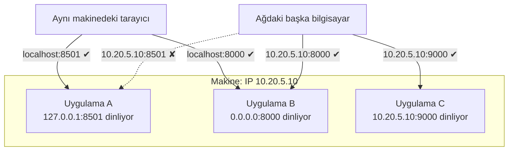

# 1.10 localhost, 127.0.0.1, 0.0.0.0 ve Port Dinleme

## Nedir?
- **localhost**, "bu makinenin kendisi" anlamına gelen özel bir addır. Neredeyse her sistemde **127.0.0.1** (IPv4) ve **::1** (IPv6) adreslerine çözülür.
- Bu adreslere **loopback (geri döngü) arayüzü** denir: Gönderilen paket ağ kartından dışarı hiç çıkmaz, işletim sistemi içinde aynı makineye geri döner. `127.0.0.0/8` aralığının tamamı loopback'tir.
- **0.0.0.0**, bir sunucu programı **dinlemeye (listen)** başlarken kullanıldığında "bu makinenin **tüm** ağ arayüzlerinde dinle" anlamına gelir. Bir istemcinin bağlanacağı gerçek bir adres değildir.
- **Port**, aynı makinedeki farklı servisleri ayıran numaradır (`5432` PostgreSQL, `8501` Streamlit, `8888` Jupyter). Bir programın bir portu "dinlemesi" ya da "o porta bağlanması" (**bind**) o porta gelen bağlantıları kabul etmeye hazır olması demektir.

## Hangi problemi çözer?
Bu kavramlar şu klasik sorunların cevabıdır:
- "Bilgisayarımda `http://localhost:8501` açılıyor ama arkadaşım IP'mle açamıyor."
- "Sunucuda uygulama çalışıyor ama dışarıdan erişilemiyor."
- "Docker container'ı veritabanına `localhost` ile bağlanamıyor."
- "Port 8000 is already in use" / "Address already in use" hatası.
- Geliştirme sırasında bir servisi güvenli şekilde **sadece kendi makinende** açık tutmak.

## Nasıl çalışır?

**Dinleme adresi kimlerin erişebileceğini belirler**

| Dinleme adresi | Kim erişebilir? | Ne zaman? |
|---|---|---|
| `127.0.0.1` / `localhost` | Sadece aynı makine | Geliştirme; nginx veya tünel arkasındaki uygulama ([8.4](../08-nginx/04-reverse-proxy.md)) |
| `0.0.0.0` (IPv6: `::`) | Makineye ulaşabilen herkes (firewall izin veriyorsa) | Container içindeki uygulamalar, sunucuya doğrudan erişim |
| Belirli bir IP (`10.20.5.10`) | O ağ arayüzüne ulaşabilenler | Çok ağ kartlı sunucularda |

**Firewall ayrı bir katmandır:** Uygulama `0.0.0.0`'da dinlese bile işletim sistemi firewall'u (ufw, firewalld, Windows Defender Firewall) veya ağ firewall'u portu engelleyebilir ([1.9](09-ag-temelleri.md)).

**Port numaraları**
| Aralık | Anlamı |
|---|---|
| 0–1023 | İyi bilinen portlar (22 SSH, 80 HTTP, 443 HTTPS); Linux'ta dinlemek için yönetici yetkisi gerekir |
| 1024–49151 | Kayıtlı portlar (5432 PostgreSQL, 1521 Oracle, 3306 MySQL, 6379 Redis, 8080, 8501 Streamlit, 8888 Jupyter, 3000 Grafana, 5000 MLflow) |
| 49152–65535 | Geçici (ephemeral) portlar: istemcinin giden bağlantıları için işletim sisteminin seçtiği portlar |

Aynı adres ve portta aynı anda **tek bir** program dinleyebilir; ikincisi "Address already in use" hatası alır.

**"localhost" kimin localhost'u?**
| Nerede çalışıyorsunuz? | `localhost` neyi gösterir? |
|---|---|
| Kendi dizüstü bilgisayarınız | Dizüstü bilgisayarınız |
| SSH ile bağlandığınız sunucu | **O sunucu** (bilgisayarınız değil) |
| Docker container'ı içinde | **Container'ın kendisi** (host makine değil) ([4.6](../04-docker/06-network.md)) |
| Kubernetes pod'u içinde | Pod (aynı pod'daki diğer container'lar da dahil) |
| Sanal makine içinde | Sanal makine ([1.11](11-sanal-makine.md)) |
| Uzak masaüstü (VDI) içinde | Uzak masaüstü makinesi |

Kubernetes'te başka bir servise `localhost` ile değil, **servis adıyla** (`postgres.veri.svc.cluster.local:5432`) bağlanılır ([5.7](../05-kubernetes/07-service.md)).

**localhost'a dışarıdan güvenli erişim**
- **SSH port yönlendirme:** Sunucuda sadece `127.0.0.1`'de dinleyen Jupyter'e kendi bilgisayarınızdan ulaşmak ([1.6](06-ssh.md)).
- **kubectl / oc port-forward:** Cluster içindeki bir servisi geçici olarak kendi makinenizin localhost'una getirmek.
- **Tünel:** Cloudflare Tunnel, ngrok ([8.14](../08-nginx/14-tunnel-zero-trust.md)).

## Mini örnek
**Hangi port, hangi adreste dinleniyor?**
```bash
ss -tlnp                         # Linux: TCP dinleyen portlar ve süreçler
# LISTEN 0 128  127.0.0.1:8501   users:(("streamlit",pid=4211))   ← sadece yerel
# LISTEN 0 128    0.0.0.0:8000   users:(("uvicorn",pid=4302))     ← herkese açık

lsof -i :8501                    # macOS / Linux: portu kim kullanıyor?
netstat -ano | findstr :8501     # Windows
kill 4211                        # portu meşgul eden süreci sonlandır (dikkatle)
```

**Uygulamaların dinleme adresini seçmek**
```bash
streamlit run app.py --server.address 127.0.0.1 --server.port 8501
uvicorn main:app --host 0.0.0.0 --port 8000          # container içinde genellikle 0.0.0.0 gerekir
jupyter lab --ip 127.0.0.1 --port 8888 --no-browser
python -m http.server 8080 --bind 127.0.0.1
```

**Docker'da port yayınlamak**
```bash
docker run -p 8501:8501 dashboard            # host'un tüm arayüzlerinde 8501 açılır
docker run -p 127.0.0.1:8501:8501 dashboard  # sadece host'un localhost'unda
```
Container içindeki uygulama `127.0.0.1`'de dinliyorsa `-p` ile yayınlansa bile dışarıdan erişilemez; container içinde `0.0.0.0` olmalıdır.

**Uzak sunucudaki localhost'a SSH tüneli**
```bash
# Sunucuda: jupyter lab --ip 127.0.0.1 --port 8888
ssh -L 8888:127.0.0.1:8888 kullanici@analiz-sunucu.sirket.local
# Kendi bilgisayarınızda: http://localhost:8888
```

**Bağlantıyı test etmek**
```bash
curl -I http://127.0.0.1:8501          # yerelden
curl -I http://10.20.5.10:8501         # başka makineden
nc -vz pg.sirket.local 5432            # TCP portu açık mı?
```

**Hata → neden**
| Hata | Olası neden |
|---|---|
| `Connection refused` | O adres/portta dinleyen yok; uygulama `127.0.0.1`'de dinliyor ve siz başka makineden geliyorsunuz |
| `Timeout` | Firewall paketi düşürüyor veya yönlendirme yok |
| `Address already in use` | Port başka bir süreçte (eski bir oturum, başka bir uygulama) |
| Container `localhost:5432`'ye bağlanamıyor | Veritabanı container'da değil host'ta veya başka container'da; servis/container adını kullanın |

**`/etc/hosts` dosyası:** DNS'e sormadan önce bakılan yerel ad tablosu. Test için bir adı geçici olarak başka IP'ye yönlendirmek mümkündür (`10.20.5.10 dashboard-test.sirket.local`). Windows'ta `C:\Windows\System32\drivers\etc\hosts`.

## Nerede kullanılır?
- Yerel geliştirme: Streamlit, FastAPI, Jupyter, yerel PostgreSQL
- Güvenli sunucu tasarımı: uygulama `127.0.0.1`'de, önünde nginx veya tünel
- Docker ve Kubernetes'te ağ hatalarını ayıklamak
- Uzak sunuculardaki arayüzlere SSH tüneliyle erişmek

## Benzerleri ve farkları
- **Unix domain socket:** Aynı makinedeki süreçlerin port yerine dosya yolu üzerinden konuşması (`/var/run/postgresql/.s.PGSQL.5432`); TCP'den biraz daha hızlı ve dosya izinleriyle korunur.
- **host.docker.internal:** Docker Desktop'ta container içinden host makineye ulaşmak için özel ad.
- **Private IP:** `10.x.x.x`, `192.168.x.x` adresleri ağ içinde erişilebilir; localhost ise makineden hiç çıkmaz.

## İlgili sayfalar
- [1.9 Ağ temelleri](09-ag-temelleri.md)
- [1.6 SSH](06-ssh.md)
- [4.6 Docker network](../04-docker/06-network.md)
- [1.11 Sanal makine](11-sanal-makine.md)
