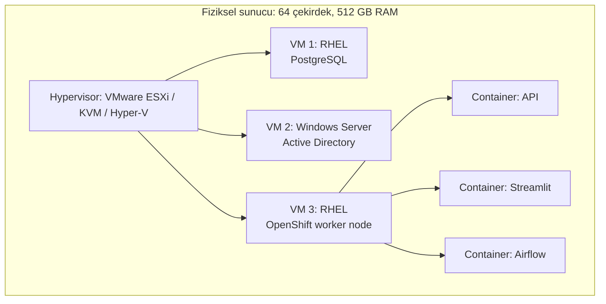

# 1.11 Sanal Makine (VM) ve Hypervisor

## Nedir?
**Sanal makine (virtual machine, VM)**, fiziksel bir bilgisayarın içinde yazılımla oluşturulmuş, kendi işletim sistemi, CPU çekirdekleri, belleği, diski ve ağ kartı varmış gibi çalışan **tam bir bilgisayardır**. Bir fiziksel sunucu üzerinde aynı anda onlarca VM çalışabilir; her biri diğerlerinden yalıtılmıştır.

**Hypervisor (sanallaştırma katmanı)**, fiziksel donanımı paylaştıran ve sanal makineleri çalıştıran yazılımdır.
| Tür | Nerede çalışır? | Örnekler |
|---|---|---|
| **Tip 1 (bare-metal)** | Doğrudan donanımın üzerinde; veri merkezleri | VMware ESXi (vSphere), Microsoft Hyper-V, KVM (Linux çekirdeğinin parçası), Xen, Nutanix AHV |
| **Tip 2 (hosted)** | Normal bir işletim sisteminin üzerinde bir uygulama olarak; dizüstü bilgisayarlar | VirtualBox, VMware Workstation / Fusion, Parallels, UTM |

Kavramlar:
- **Host:** Fiziksel makine (ve tip 2'de onun işletim sistemi).
- **Guest:** Sanal makinenin içindeki işletim sistemi.
- **Image / template:** Hazır kurulmuş VM kalıbı; yeni VM'ler bundan klonlanır.
- **Snapshot:** VM'in belirli bir andaki diskinin (ve isteğe bağlı belleğinin) kaydı; geri dönmek için.

## Hangi problemi çözer?
- **Donanımı verimli kullanmak:** Tek uygulamanın %5 kullandığı sunucular yerine, bir güçlü sunucuda birçok VM.
- **Yalıtım:** Bir VM'deki çökme veya güvenlik açığı diğerlerini doğrudan etkilemez.
- **Hızlı ortam kurmak:** Yeni sunucu ihtiyacı haftalar yerine dakikalar içinde şablondan karşılanır.
- **Farklı işletim sistemleri:** Windows dizüstü bilgisayarda Linux çalıştırmak; eski bir Windows sürümüne ihtiyaç duyan uygulamayı yaşatmak.
- **Geri alınabilirlik:** Riskli bir güncellemeden önce snapshot alıp sorun olursa geri dönmek.
- **Taşınabilirlik ve süreklilik:** Fiziksel sunucu arızalanınca VM'in başka bir host'ta kesintisiz veya kısa kesintiyle çalışmaya devam etmesi (live migration, HA).

## Nasıl çalışır?

**Fiziksel sunucu, VM ve container katmanları**

Kurumlarda sık görülen yapı: Fiziksel sunucular üzerinde hypervisor, onun üzerinde VM'ler; Kubernetes/OpenShift node'ları da çoğunlukla bu VM'lerdir ve container'lar onların içinde çalışır.

**VM ve container farkı**
| | Sanal makine | Container |
|---|---|---|
| Neyi sanallaştırır? | Donanımı | İşletim sistemi süreçlerini |
| İçinde ne var? | Tam işletim sistemi (çekirdek dahil) | Uygulama ve bağımlılıkları; host çekirdeğini paylaşır |
| Boyut | GB'lar | MB'lar–birkaç yüz MB |
| Açılış süresi | Dakikalar / onlarca saniye | Saniyeler |
| Yalıtım | Güçlü (donanım düzeyinde) | Daha zayıf (çekirdek ortak) |
| Farklı işletim sistemi | Evet (Linux host'ta Windows guest) | Hayır (Linux container Linux çekirdeği ister) |
| Tipik kullanım | Veritabanları, eski uygulamalar, Windows servisleri, Kubernetes node'ları | Mikroservisler, API'ler, ETL job'ları |

Ayrıntılı karşılaştırma: [4.1 Docker nedir](../04-docker/01-docker-nedir.md).

**Kaynak kavramları**
| Kavram | Açıklama |
|---|---|
| **vCPU** | VM'e verilen sanal işlemci çekirdeği; fiziksel çekirdekler zamanla paylaşılır |
| **Overcommit** | Host'taki fiziksel kaynaktan fazlasını VM'lere dağıtmak; herkes aynı anda yüklenirse yavaşlama |
| **Sanal disk** | Host'ta bir dosya (`.vmdk`, `.qcow2`, `.vhdx`) veya SAN üzerindeki alan |
| **Thin / thick provisioning** | Diskin baştan tamamen ayrılması veya kullanıldıkça büyümesi |
| **Sanal ağ / vSwitch** | VM'leri birbirine ve fiziksel ağa bağlayan yazılım ağı; VLAN'larla ayrılır |
| **Live migration (vMotion)** | Çalışan VM'i kapatmadan başka host'a taşımak |
| **HA (high availability)** | Host arızalanınca VM'in başka host'ta otomatik yeniden başlatılması |

**Snapshot yedek değildir:** Snapshot genellikle aynı depolamada durur ve uzun süre tutulduğunda performansı düşürür. Kalıcı koruma için ayrı bir **yedekleme** sistemi gerekir.

**Bulutta VM:** AWS EC2, Azure Virtual Machines, Google Compute Engine ve Türkiye'deki bulut sağlayıcılarının "sunucu" ürünleri aslında hypervisor üzerinde çalışan VM'lerdir. Kişisel projelerde kiralanan **VPS (Virtual Private Server)** de bir VM'dir.

**Masaüstü sanallaştırma (VDI):** Bankalarda yaygın olan "uzak masaüstü" ortamları (Citrix, VMware Horizon, Azure Virtual Desktop) kullanıcıya veri merkezinde çalışan bir VM'in ekranını gösterir. Veri kullanıcının cihazına inmez; bu yüzden hassas verilerle çalışan analistler için tercih edilir. VDI içindeki `localhost` VDI makinesinin kendisidir ([1.10](10-localhost.md)).

## Mini örnek
**Dizüstü bilgisayarda Linux VM (Multipass ile, en hızlı yol)**
```bash
multipass launch 24.04 --name lab --cpus 2 --memory 4G --disk 20G
multipass shell lab                    # VM içine gir
multipass list                         # IP adresini gör
multipass stop lab && multipass delete lab && multipass purge
```

**Windows'ta Linux: WSL2**
```powershell
wsl --install -d Ubuntu               # hafif bir Hyper-V VM'i içinde gerçek Linux çekirdeği
wsl -l -v                             # kurulu dağıtımlar ve sürümleri
```
WSL2, geliştiricilerin Windows'ta Linux araçlarını (bash, Docker, Python) kullanmasının en yaygın yoludur. Docker Desktop da Windows ve macOS'ta container'ları arka planda küçük bir Linux VM'i içinde çalıştırır.

**Linux'ta KVM ile VM yönetimi (virsh)**
```bash
virsh list --all                      # VM'ler ve durumları
virsh start analiz-vm
virsh snapshot-create-as analiz-vm guncelleme-oncesi
virsh snapshot-revert analiz-vm guncelleme-oncesi
virsh dominfo analiz-vm               # vCPU, bellek
```

**VM içinde olup olmadığınızı anlamak**
```bash
systemd-detect-virt                   # kvm, vmware, microsoft, oracle (VirtualBox), none
lscpu | grep -i hypervisor
nproc; free -h; df -h                 # VM'e verilen kaynaklar
```

**Kod olarak VM (kavramsal Terraform örneği)**
```hcl
resource "vsphere_virtual_machine" "etl_vm" {
  name     = "etl-prod-01"
  num_cpus = 8
  memory   = 32768

  disk {
    label = "disk0"
    size  = 200
  }

  clone {
    template_uuid = data.vsphere_virtual_machine.rhel9_template.id
  }
}
```

## Nerede kullanılır?
- Kurumsal veri merkezlerinde veritabanı sunucuları, uygulama sunucuları, Windows servisleri (AD, dosya sunucuları)
- Kubernetes/OpenShift cluster node'ları
- Analiz sunucuları: Python, R, Jupyter çalışan güçlü paylaşımlı VM'ler
- Geliştirme ve test ortamları; eğitim laboratuvarları
- VDI ile kullanıcı masaüstleri
- Kişisel projelerde VPS (web sitesi, ETL zamanlayıcı, bot)

## Benzerleri ve farkları
- **Container:** Daha hafif, daha hızlı; ama aynı çekirdeği paylaşır ([4.1](../04-docker/01-docker-nedir.md)).
- **Bare-metal (fiziksel) sunucu:** Sanallaştırma katmanı yok; en yüksek performans ve donanım erişimi (büyük veritabanları, GPU eğitim sunucuları).
- **OpenShift Virtualization / KubeVirt:** VM'leri Kubernetes üzerinde, pod'larla aynı platformda yönetmek.
- **MicroVM (Firecracker):** Container hızında açılan, VM yalıtımı sağlayan çok küçük sanal makineler; sunucusuz (serverless) platformların altyapısı.
- **Sanal ortam (venv/conda):** Adı benzese de sadece Python paketlerini ayırır; işletim sistemi veya donanım sanallaştırması değildir ([2.1](../02-python-ortam/01-neden-sanal-ortam.md)).

## İlgili sayfalar
- [4.1 Docker nedir](../04-docker/01-docker-nedir.md)
- [5.2 Kubernetes mimarisi](../05-kubernetes/02-mimari.md)
- [1.10 localhost ve port dinleme](10-localhost.md)
- [1.1 Linux nedir](01-linux-nedir.md)
