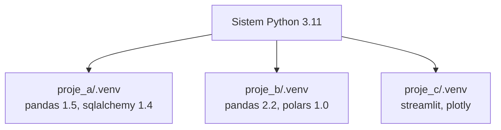

# 2.1 Neden Sanal Ortam Gerekir?

## Nedir?
**Sanal ortam (virtual environment)**, bir projeye ait Python paketlerinin, sistemdeki diğer projelerden ayrı bir klasörde tutulmasıdır. Her projenin kendi "paket dolabı" olur.

## Hangi problemi çözer?
Sanal ortam olmadan tüm paketler tek bir yere kurulur ve şu sorunlar çıkar:
- **Sürüm çakışması:** Proje A `pandas 1.5` ister, proje B `pandas 2.2`. İkisi aynı anda kurulamaz.
- **"Bende çalışıyordu":** Geliştiricinin makinesinde yıllar içinde birikmiş paketler vardır; sunucuda bunlar yoktur.
- **Sistemi bozmak:** Linux'ta işletim sistemi araçları da Python kullanır. Sistem Python'una paket kurmak bu araçları bozabilir (yeni dağıtımlar buna izin bile vermez: `externally-managed-environment` hatası).
- **Tekrarlanamazlık:** Hangi paketin hangi sürümünün gerektiği bilinmez.

## Nasıl çalışır?



- Sanal ortam, Python yorumlayıcısına bir bağlantı ve kendi `site-packages` klasörünü içerir.
- **Aktive edilince** (`activate`), PATH'in başına bu klasör eklenir; `python` ve `pip` artık ortamdakileri gösterir ([1.5 PATH](../01-linux/05-environment.md)).
- Ortam klasörü (`.venv`) **Git'e gönderilmez**; yerine paket listesi (`requirements.txt` veya `pyproject.toml`) gönderilir. Ortam bu listeden her yerde yeniden kurulur.

## Mini örnek
```bash
cd proje_a
python3 -m venv .venv           # ortamı oluştur
source .venv/bin/activate       # aktive et (Windows: .venv\Scripts\activate)
which python                    # -> .../proje_a/.venv/bin/python
pip install pandas==2.2.2
pip freeze > requirements.txt   # kurulu paketleri kaydet
deactivate                      # ortamdan çık
```

Başka bir makinede aynı ortamı kurmak:
```bash
git clone ... && cd proje_a
python3 -m venv .venv && source .venv/bin/activate
pip install -r requirements.txt
```

## Nerede kullanılır?
- Her Python projesi (ETL, dashboard, model)
- CI pipeline'larında testleri temiz ortamda koşmak
- Docker image'ı içinde de bağımlılıklar aynı paket listesinden kurulur

## Benzerleri ve farkları
| Yaklaşım | İzole ettiği şey |
|---|---|
| **venv** | Python paketleri ([2.2](02-venv-pip.md)) |
| **conda** | Python paketleri + Python sürümü + C/sistem kütüphaneleri ([2.3](03-conda.md)) |
| **uv / poetry** | venv + bağımlılık çözümü + kilit dosyası ([2.4](04-uv-poetry.md)) |
| **Docker** | Tüm işletim sistemi seviyesi ortam ([4.1](../04-docker/01-docker-nedir.md)) |

Sanal ortam ve Docker birbirinin alternatifi değil, tamamlayıcısıdır: sanal ortam geliştirme sırasında, Docker teslimatta kullanılır.

## İlgili sayfalar
- [2.2 venv ve pip](02-venv-pip.md)
- [2.5 Bağımlılık dosyaları](05-bagimlilik-dosyalari.md)
