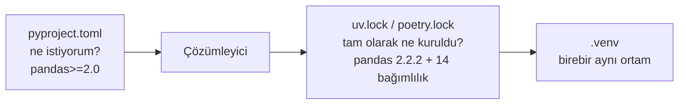

# 2.4 uv ve poetry

## Nedir?
Modern Python **proje yöneticileridir**. venv + pip'in ayrı ayrı yaptığı işleri tek araçta toplar ve **kilit dosyası** (lock file) üretir.

- **poetry:** Uzun süredir yaygın olan, `pyproject.toml` merkezli proje ve paket yöneticisi.
- **uv:** Astral firmasının Rust ile yazdığı, pip'ten 10–100 kat hızlı araç. Python sürümünü de kurabilir. Son yıllarda hızla yaygınlaştı.

## Hangi problemi çözer?
- **Tekrarlanabilirlik:** `requirements.txt` genellikle sadece doğrudan bağımlılıkları içerir; dolaylı bağımlılıklar her kurulumda farklı sürüme gidebilir. Kilit dosyası **tüm** bağımlılık ağacını tam sürüm ve hash ile sabitler.
- **Bağımlılık çözümü:** Birbiriyle uyumlu sürüm kombinasyonunu otomatik bulur.
- **Tek araç:** Ortam oluşturma, paket ekleme, çalıştırma, paketleme aynı komut setiyle yapılır.

## Nasıl çalışır?



- `pyproject.toml`: İnsan tarafından düzenlenen, esnek sürüm aralıkları.
- Kilit dosyası: Araç tarafından üretilir, elle düzenlenmez, **Git'e gönderilir**.

## Mini örnek

**uv**
```bash
pip install uv                       # veya resmi kurulum script'i
uv init bddk_etl && cd bddk_etl      # proje oluştur
uv python install 3.12               # Python sürümü kur
uv add pandas sqlalchemy             # bağımlılık ekle (pyproject + lock güncellenir)
uv add --dev pytest ruff             # sadece geliştirme bağımlılığı
uv run python etl.py                 # ortamı aktive etmeden çalıştır
uv sync                              # lock dosyasına göre ortamı kur
uv pip install -r requirements.txt   # pip uyumlu arayüz
```

**poetry**
```bash
poetry new bddk_etl && cd bddk_etl
poetry add pandas sqlalchemy
poetry add --group dev pytest
poetry install                       # lock'a göre kur
poetry run python etl.py
poetry shell                         # ortama gir (eklenti gerekebilir)
```

## Nerede kullanılır?
- Birden fazla kişinin geliştirdiği uzun ömürlü projeler
- Kütüphane veya paket yayınlama
- CI pipeline'larında hızlı ve tekrarlanabilir kurulum (uv özellikle CI süresini kısaltır)

## Benzerleri ve farkları
| | pip + requirements.txt | poetry | uv |
|---|---|---|---|
| Kilit dosyası | Yok (freeze ile elle) | `poetry.lock` | `uv.lock` |
| Hız | Orta | Orta | Çok hızlı |
| Python kurulumu | Yok | Yok | Var |
| Öğrenme eğrisi | Çok kolay | Orta | Kolay |
| pip uyumlu komutlar | — | Hayır | Evet (`uv pip`) |

**Öneri:** Yeni projede uv; eski projede ne kullanılıyorsa devam. Kurum içinde araç seçimi ekipçe yapılmalıdır, her projede farklı araç bakım yükünü artırır.

## İlgili sayfalar
- [2.5 Bağımlılık dosyaları](05-bagimlilik-dosyalari.md)
- [6.2 Pipeline aşamaları](../06-ci-cd/02-pipeline-asamalari.md)
