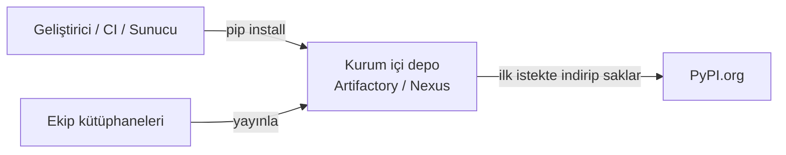

# 2.6 Kurum İçi Paket Deposu ve Proxy

## Nedir?
Bankalar gibi güvenlik gereksinimi yüksek kurumlarda sunucular internete doğrudan çıkamaz. Paketler, kurum içinde kurulmuş bir **paket deposu** (artifact repository) üzerinden indirilir. Bu depo internetteki PyPI'ın kontrollü bir kopyası veya aracısıdır.

Yaygın ürünler: **JFrog Artifactory**, **Sonatype Nexus**, GitLab Package Registry, Azure Artifacts.

## Hangi problemi çözer?
- **Güvenlik:** Kötü amaçlı veya taklit paketler (typosquatting: `pandsa` gibi) içeri alınmadan engellenebilir; paketler zafiyet taramasından geçer.
- **Erişim:** İnternete kapalı sunucular yine paket kurabilir.
- **Süreklilik:** PyPI'dan bir paket kaldırılsa bile kurum içi kopya kalır.
- **Kurum içi paketler:** Ekibin yazdığı ortak kütüphaneler (ör. `banka-db-utils`) burada yayınlanır.

## Nasıl çalışır?



- Depo, PyPI'a giden istekleri **önbelleğe alan bir aracı** (proxy repository) gibi çalışır.
- pip'e PyPI yerine bu adresi kullanması söylenir.
- Docker image'ları (Docker Hub yerine), npm, Maven paketleri de genellikle aynı üründen geçer.

## Mini örnek

**Tek komutta**
```bash
pip install pandas --index-url https://artifactory.sirket.local/api/pypi/pypi-remote/simple
```

**Kalıcı ayar: `pip.conf`** (Linux: `~/.config/pip/pip.conf`, Windows: `%APPDATA%\pip\pip.ini`)
```ini
[global]
index-url = https://artifactory.sirket.local/api/pypi/pypi-remote/simple
trusted-host = artifactory.sirket.local
```

**Ortam değişkeniyle (CI ve Docker için uygun)**
```bash
export PIP_INDEX_URL=https://artifactory.sirket.local/api/pypi/pypi-remote/simple
```

**uv ile**
```bash
export UV_INDEX_URL=https://artifactory.sirket.local/api/pypi/pypi-remote/simple
```

**Kurumsal HTTP proxy arkasında**
```bash
export HTTPS_PROXY=http://proxy.sirket.local:8080
export NO_PROXY=localhost,.sirket.local
```

**Kurum sertifikası (SSL hatası alınıyorsa)**
```bash
pip config set global.cert /etc/ssl/certs/sirket-ca.pem
```

## Nerede kullanılır?
- İnternete kapalı ETL ve uygulama sunucuları
- CI pipeline'ları ve Docker build'leri
- Ortak kurum içi kütüphanelerin dağıtımı

## Benzerleri ve farkları
- **Offline wheel klasörü:** Paketler `pip download` ile başka makinede indirilip taşınır, `pip install --no-index --find-links ./wheels` ile kurulur. Küçük ölçekte işe yarar, bakımı zordur.
- **Container registry (Harbor, Quay):** Aynı mantık Docker image'ları için ([4.7](../04-docker/07-registry-docker-hub.md)).

**Sık hata:** `SSLError: CERTIFICATE_VERIFY_FAILED`. Kurumsal proxy, trafiği kendi sertifikasıyla yeniden imzalar. Çözüm doğrulamayı kapatmak (`--trusted-host` her şey için) değil, kurum CA sertifikasını tanıtmaktır.

## İlgili sayfalar
- [2.2 venv ve pip](02-venv-pip.md)
- [4.7 Registry](../04-docker/07-registry-docker-hub.md)
