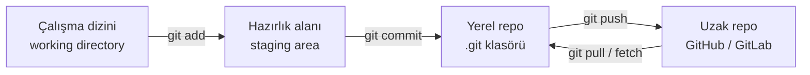

# 3.1 Git Nedir, Neden Kullanılır?

## Nedir?
**Git**, dosyalardaki değişikliklerin geçmişini tutan **dağıtık bir versiyon kontrol sistemidir** (distributed version control system). Projenin "zaman makinesi" gibidir: her kaydedilen an geri çağrılabilir.

2005'te Linus Torvalds tarafından Linux çekirdeğinin geliştirilmesi için yazıldı; bugün yazılım dünyasının standart aracıdır.

## Hangi problemi çözer?
Git olmadan karşılaşılan durumlar:
- `rapor_v2_son_SON_duzeltilmis.py` gibi dosya isimleri
- "Geçen hafta çalışıyordu, ne değişti?" sorusunun cevapsız kalması
- İki kişinin aynı dosyayı değiştirip birinin işinin kaybolması
- Hatalı değişikliği geri almanın imkânsız olması

Git ile:
- **Geçmiş:** Kim, neyi, ne zaman ve neden değiştirdi kaydedilir.
- **Geri alma:** Herhangi bir ana dönülebilir.
- **Paralel çalışma:** Herkes kendi dalında (branch) çalışır, sonra birleştirilir.
- **Denetim (audit):** Bankacılıkta "bu rapor kodunu kim değiştirdi" sorusunun cevabı hazırdır.

## Nasıl çalışır?

Git'te üç yerel alan ve bir uzak depo vardır:



- **Çalışma dizini:** Dosyaları düzenlediğimiz normal klasör.
- **Hazırlık alanı (staging):** Bir sonraki commit'e girecek değişikliklerin seçildiği ara alan.
- **Yerel repo:** Tüm geçmişin tutulduğu gizli `.git` klasörü.
- **Uzak repo (remote):** Ekibin paylaştığı merkezi kopya (genellikle `origin` adıyla).

**Dağıtık** olması şu demektir: Her geliştiricinin bilgisayarında tüm geçmişin tam bir kopyası vardır. İnternet olmadan da commit atılabilir, geçmiş incelenebilir.

## Mini örnek
```bash
git --version
git config --global user.name "Mehmet Türk"
git config --global user.email "mehmet@ornek.com"

mkdir bddk_etl && cd bddk_etl
git init                         # klasörü repo yap
echo "# BDDK ETL" > README.md
git add README.md                # hazırlık alanına al
git commit -m "İlk commit"       # kaydet
git log --oneline                # geçmişi gör
```

## Nerede kullanılır?
- Her türlü kod: ETL, SQL script'leri, dashboard, model kodu
- Konfigürasyon dosyaları ve altyapı tanımları (Kubernetes YAML, Terraform)
- Dokümantasyon (bu kitap da bir Git reposudur)
- CI/CD'nin başlangıç noktası: Her push bir pipeline'ı tetikler ([6.1](../06-ci-cd/01-ci-cd-nedir.md))

## Benzerleri ve farkları
- **SVN (Subversion):** Merkezi sistemdir; geçmiş sadece sunucuda tutulur. Eski kurumsal projelerde hâlâ görülür.
- **Git ile GitHub farkı:** Git, bilgisayarda çalışan araçtır. **GitHub / GitLab / Bitbucket** ise Git repolarını barındıran ve üstüne inceleme, CI/CD, issue takibi gibi özellikler ekleyen platformlardır ([3.6](06-github-pull-request.md)).
- **Dosya paylaşımı (ağ sürücüsü, OneDrive):** Sadece son hâli tutar; değişikliğin içeriğini ve nedenini kaydetmez.

**Git ne için uygun değil?** Büyük veri dosyaları (GB'lık CSV, model ağırlıkları). Bunlar için Git LFS, DVC veya nesne depolama (S3, MinIO) kullanılır.

## İlgili sayfalar
- [3.2 Temel kavramlar](02-temel-kavramlar.md)
- [3.3 Git komutları](03-git-komutlari.md)
