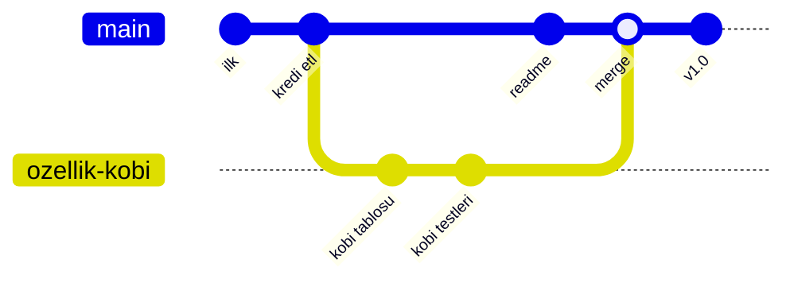

# 3.2 Temel Kavramlar: Repo, Commit, Branch, Merge

## Nedir?
Git'i kullanırken sürekli karşılaşılan dört temel yapı taşı:

| Kavram | Kısaca |
|---|---|
| **Repository (repo)** | Projenin dosyaları ve tüm geçmişi |
| **Commit** | Projenin belirli bir andaki kaydedilmiş görüntüsü |
| **Branch (dal)** | Bağımsız ilerleyen bir çalışma kolu |
| **Merge (birleştirme)** | İki dalın değişikliklerini birleştirmek |

## Hangi problemi çözer?
Bu kavramlar sayesinde ana kod (genellikle `main`) her zaman çalışır hâlde tutulurken, yeni özellikler ve denemeler ayrı dallarda güvenle geliştirilir.

## Nasıl çalışır?

**Commit**
- Her commit'in benzersiz bir kimliği (**hash**) vardır: `a3f9c21...` (kısaca ilk 7 karakter).
- İçinde: değişiklikler, yazar, tarih, mesaj ve **bir önceki commit'e işaretçi** bulunur. Böylece commit'ler bir zincir oluşturur.
- İyi commit mesajı "ne" ve "neden"i anlatır: `Kredi ETL'ine KOBİ tablosu eklendi`, ~~`düzeltme`~~.

**Branch**
- Dal, aslında bir commit'i gösteren **hareketli bir etikettir**; kopyalama yapılmaz, bu yüzden dal açmak anlıktır.
- **HEAD:** "Şu an neredeyim?" sorusunun cevabı; aktif dalı gösterir.

**Merge**



İki tür birleştirme vardır:
- **Fast-forward:** `main` dal açıldıktan sonra hiç ilerlemediyse, etiket ileri kaydırılır. Ek commit oluşmaz.
- **Üç yollu birleştirme (3-way merge):** İki dal da ilerlediyse, Git ortak atayı bulur ve bir **merge commit** oluşturur. Aynı satırlar iki tarafta da değiştiyse **conflict** çıkar ([3.5](05-merge-conflict.md)).

**Rebase** (alternatif): Dalın commit'lerini `main`'in en ucuna yeniden yazar; geçmiş düz bir çizgi olur. Paylaşılmış dallarda kullanılmamalıdır çünkü commit hash'lerini değiştirir.

**Remote ve tracking**
- `origin`: Uzak reponun varsayılan takma adı.
- `origin/main`: Uzaktaki `main`'in yereldeki son bilinen hâli.
- `fetch` bu bilgiyi günceller, `pull` = `fetch` + `merge`.

## Mini örnek
```bash
git switch -c ozellik/kobi        # yeni dal aç ve geç
# ... kod yaz ...
git add . && git commit -m "KOBİ kredi tablosu eklendi"
git switch main                   # ana dala dön
git merge ozellik/kobi            # birleştir
git log --oneline --graph --all   # dalları grafik olarak gör
git branch -d ozellik/kobi        # işi biten dalı sil
```

## Nerede kullanılır?
- Her yeni özellik veya hata düzeltmesi için ayrı dal
- `main`'e doğrudan değil, Pull Request ile birleştirme ([3.6](06-github-pull-request.md))
- Sürümleri işaretlemek için **tag**: `v1.0.0` ([3.3](03-git-komutlari.md))

## Benzerleri ve farkları
| | Merge | Rebase |
|---|---|---|
| Geçmiş | Gerçek olduğu gibi, dallı | Düz, temiz |
| Hash'ler | Değişmez | Değişir |
| Güvenli mi? | Her zaman | Sadece paylaşılmamış dallarda |

**Squash merge:** Daldaki tüm commit'leri tek commit'e sıkıştırarak birleştirir; PR'larda sık kullanılır.

## İlgili sayfalar
- [3.3 Git komutları](03-git-komutlari.md)
- [3.7 Branch stratejileri](07-branch-stratejileri.md)
