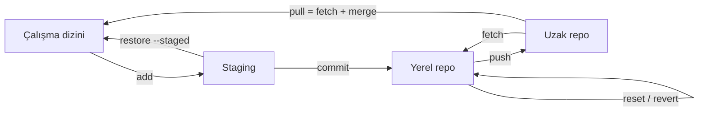

# 3.3 Git Komutları

## Nedir?
Projenin başlangıcından geri alma işlemlerine kadar günlük Git kullanımında gereken komutların açıklamalı listesi. Kavramlar için [3.2](02-temel-kavramlar.md)'ye bakın.

## Hangi problemi çözer?
Git'in yüzlerce komutu vardır ama günlük işlerin %95'i aşağıdaki yaklaşık 25 komutla yapılır.

## Nasıl çalışır?



## Mini örnek

### 0. Kurulum ve ayar
| Komut | Açıklama |
|---|---|
| `git --version` | Git kurulu mu, hangi sürüm? |
| `git config --global user.name "Ad Soyad"` | Commit'lerde görünecek isim |
| `git config --global user.email "ad@ornek.com"` | Commit'lerde görünecek e-posta |
| `git config --global init.defaultBranch main` | Yeni repolarda ana dal adı |
| `git config --list` | Tüm ayarlar |

### 1. Başlangıç
| Komut | Açıklama |
|---|---|
| `git init` | Bulunulan klasörü Git reposuna çevirir (`.git` oluşur) |
| `git clone <url>` | Uzak repoyu tüm geçmişiyle indirir |
| `git clone --depth 1 <url>` | Sadece son hâli indirir (hızlı) |

### 2. Günlük döngü
| Komut | Açıklama |
|---|---|
| `git status` | Değişen, eklenen, silinen dosyalar |
| `git add dosya.py` | Dosyayı staging'e al |
| `git add .` | Tüm değişiklikleri staging'e al |
| `git add -p` | Değişiklikleri parça parça seçerek ekle |
| `git commit -m "mesaj"` | Staging'dekileri kaydet |
| `git commit --amend` | Son commit'i düzelt (henüz push edilmediyse) |
| `git diff` | Staging'e alınmamış değişiklikler |
| `git diff --staged` | Staging'deki, commit'e girecek değişiklikler |

### 3. Geçmiş
| Komut | Açıklama |
|---|---|
| `git log` | Detaylı commit geçmişi |
| `git log --oneline --graph --all` | Tek satırlık, dallı grafik |
| `git log -p dosya.py` | Bir dosyanın değişim geçmişi |
| `git show <hash>` | Bir commit'in içeriği |
| `git blame dosya.py` | Her satırı en son kim değiştirdi |

### 4. Dallar
| Komut | Açıklama |
|---|---|
| `git branch` | Yerel dallar (`*` aktif dal) |
| `git branch -a` | Uzak dallar dahil |
| `git switch dal-adi` | Dala geç (eski yöntem: `git checkout dal-adi`) |
| `git switch -c yeni-dal` | Yeni dal aç ve geç (eski: `git checkout -b`) |
| `git merge dal-adi` | Dalı aktif dala birleştir |
| `git rebase main` | Aktif dalı `main`'in ucuna taşı |
| `git branch -d dal-adi` | Birleştirilmiş dalı sil |
| `git branch -D dal-adi` | Birleştirilmemiş dalı zorla sil |

### 5. Uzak repo
| Komut | Açıklama |
|---|---|
| `git remote -v` | Bağlı uzak repolar |
| `git remote add origin <url>` | Uzak repo ekle |
| `git push -u origin main` | İlk push; dalı uzaktakiyle eşleştirir |
| `git push` | Commit'leri gönder |
| `git fetch` | Uzaktakileri indir, birleştirme |
| `git pull` | İndir ve birleştir |
| `git pull --rebase` | İndir ve kendi commit'lerini üstüne taşı |
| `git push origin --delete dal-adi` | Uzaktaki dalı sil |

### 6. Geçici saklama (stash)
| Komut | Açıklama |
|---|---|
| `git stash` | Bitmemiş değişiklikleri kenara al, dizini temizle |
| `git stash list` | Saklananlar |
| `git stash pop` | Son saklananı geri getir ve listeden sil |
| `git stash apply` | Geri getir, listede bırak |

### 7. Geri alma
| Komut | Açıklama | Risk |
|---|---|---|
| `git restore dosya.py` | Kaydedilmemiş değişiklikleri at | Değişiklik kaybolur |
| `git restore --staged dosya.py` | Staging'den çıkar, değişiklik kalır | Güvenli |
| `git revert <hash>` | Commit'i geri alan **yeni** bir commit oluşturur | Güvenli, push edilmişte kullanılır |
| `git reset --soft HEAD~1` | Son commit'i geri al, değişiklikler staging'de kalsın | Push edilmemişse |
| `git reset --hard HEAD~1` | Son commit'i ve değişiklikleri tamamen sil | **Tehlikeli** |
| `git reflog` | HEAD'in tüm hareketleri; "kaybolan" commit'leri bulur | Can simidi |

### 8. Etiket (tag)
| Komut | Açıklama |
|---|---|
| `git tag v1.0.0` | Mevcut commit'e etiket |
| `git tag -a v1.0.0 -m "İlk sürüm"` | Açıklamalı etiket |
| `git push origin v1.0.0` | Etiketi gönder |
| `git tag` | Etiketleri listele |

## Nerede kullanılır?
Tipik bir günün akışı:
```bash
git switch main && git pull                 # güncel ol
git switch -c ozellik/rasyo-etl             # dal aç
# ... çalış ...
git status && git diff                      # kontrol
git add . && git commit -m "Rasyo ETL eklendi"
git push -u origin ozellik/rasyo-etl        # gönder, sonra PR aç
```

## Benzerleri ve farkları
- **`reset` ile `revert`:** `reset` geçmişi yeniden yazar; sadece push edilmemiş commit'lerde kullanılır. `revert` geçmişi korur; paylaşılmış dallarda tek doğru yoldur.
- **`switch`/`restore` ile `checkout`:** `checkout` hem dal değiştirme hem dosya geri alma işini yapan eski komuttur. Git 2.23 ile bu iki iş `switch` ve `restore`'a ayrıldı.
- **Grafik arayüzler:** VS Code, GitHub Desktop, GitKraken aynı komutları arka planda çalıştırır.

## İlgili sayfalar
- [3.5 Merge conflict](05-merge-conflict.md)
- [Git cheat sheet](../ekler/git-cheatsheet.md)
