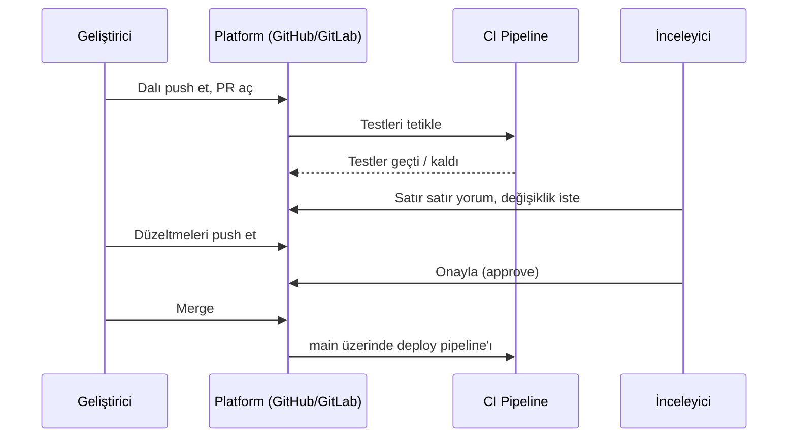

# 3.6 GitHub / GitLab, Pull Request ve Code Review

## Nedir?
**GitHub, GitLab ve Bitbucket**, Git repolarını barındıran platformlardır. Git'in üzerine işbirliği, otomasyon ve güvenlik özellikleri eklerler.

**Pull Request (PR)** — GitLab'da **Merge Request (MR)** — bir daldaki değişikliklerin ana dala alınması için açılan inceleme talebidir.

## Hangi problemi çözer?
- **Kalite:** Kod ana dala girmeden en az bir kişi tarafından incelenir; hatalar erken yakalanır.
- **Bilgi paylaşımı:** Ekip birbirinin kodunu görür; tek kişiye bağımlılık azalır.
- **Denetim izi:** Hangi değişikliğin kim tarafından, kimin onayıyla, hangi iş kaydı için yapıldığı kayıt altındadır. Bankacılıkta dört göz prensibi (four-eyes principle) ve iç denetim için önemlidir.
- **Otomatik kontrol:** PR açılınca testler ve taramalar otomatik koşar.

## Nasıl çalışır?



**Platform özellikleri**

| Özellik | GitHub | GitLab | Bitbucket |
|---|---|---|---|
| İnceleme | Pull Request | Merge Request | Pull Request |
| CI/CD | Actions | GitLab CI/CD | Pipelines |
| İş çalıştırıcı | Runner | Runner | Runner |
| Bağımlılık güvenliği | Dependabot | Dependency Scanning | Snyk entegrasyonu |
| Issue takibi | Issues, Projects | Issues, Boards | Jira entegrasyonu |
| Kurum içi kurulum | GitHub Enterprise Server | GitLab Self-Managed | Bitbucket Data Center |

Bankalar genellikle **kurum içine kurulu** (self-hosted) sürümleri kullanır; kod şirket dışına çıkmaz.

**Branch koruma kuralları (branch protection):** `main`'e doğrudan push yasaklanır; merge için en az N onay ve başarılı CI şartı konur.

## Mini örnek
```bash
git switch -c fix/kredi-tarih-formati
# ... düzelt ...
git commit -am "Kredi ETL'inde tarih formatı düzeltildi"
git push -u origin fix/kredi-tarih-formati
# Terminal, PR açmak için bir link verir; veya GitHub CLI ile:
gh pr create --title "Tarih formatı düzeltmesi" --body "BDDK dosyasında ay adı Türkçe gelince parse hatası veriyordu."
gh pr status
gh pr merge --squash
```

**İyi bir PR açıklaması:**
```markdown
## Ne değişti?
Aylık BDDK dosyasındaki Türkçe ay adları (Ocak, Şubat...) artık doğru parse ediliyor.

## Neden?
Ekim dosyası "Ekim 2026" formatıyla geldi, ETL hata verdi.

## Nasıl test edildi?
- Son 12 ayın dosyalarıyla yerelde çalıştırıldı
- `tests/test_tarih.py` eklendi
```

**İyi code review ipuçları:**
- PR'ları küçük tutun (ideal: 400 satırdan az).
- Kişiyi değil kodu yorumlayın; soru sorarak önerin ("Burada X durumu olabilir mi?").
- Format ve stil tartışmalarını otomatik araçlara bırakın.

## Nerede kullanılır?
- Ekipteki her değişikliğin `main`'e alınmasında
- Tek kişilik projelerde bile: CI'ın koşması ve değişiklik geçmişinin düzenli tutulması için

## Benzerleri ve farkları
- **Doğrudan `main`'e push:** Hızlıdır ama inceleme ve otomatik kontrol yoktur.
- **Pair programming:** İnceleme kod yazılırken eşzamanlı yapılır.
- **Fork tabanlı akış:** Açık kaynakta yaygındır; repoyu kendi hesabınıza kopyalayıp oradan PR açarsınız.

## İlgili sayfalar
- [3.7 Branch stratejileri](07-branch-stratejileri.md)
- [6.4 CI araçları](../06-ci-cd/04-araclar.md)
