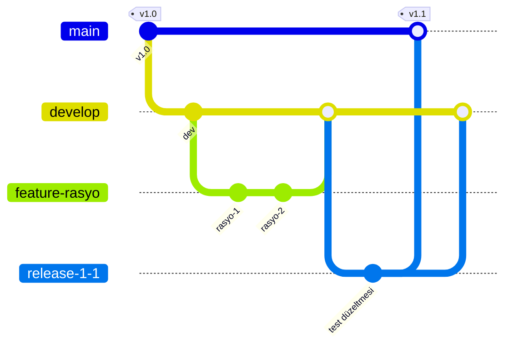
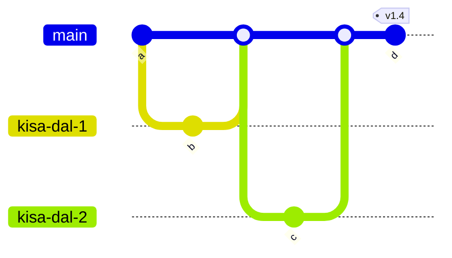

# 3.7 Branch Stratejileri: Git Flow ve Trunk-Based

## Nedir?
**Branch stratejisi (dallanma stratejisi)**, bir ekibin hangi dalları açacağı, ne kadar süre yaşatacağı ve nasıl birleştireceği konusundaki ortak kurallardır.

## Hangi problemi çözer?
Kural olmadan herkes kendi bildiği gibi dal açar: hangi dalın canlıda olduğu belirsizleşir, haftalarca birleştirilmeyen dallar büyük çakışmalar üretir, sürüm çıkarmak kaosa döner.

## Nasıl çalışır?

### Git Flow
Planlı sürümlerle çalışan ekipler için tasarlanmış, çok dallı model.



| Dal | Görevi | Ömrü |
|---|---|---|
| `main` | Canlıdaki kod; her commit bir sürüm | Kalıcı |
| `develop` | Bir sonraki sürümün entegrasyon dalı | Kalıcı |
| `feature/*` | Yeni özellik, `develop`'tan açılır | Günler–haftalar |
| `release/*` | Sürüm hazırlığı ve test | Günler |
| `hotfix/*` | Canlıdaki acil hata, `main`'den açılır | Saatler |

### Trunk-Based Development
Tek ana dal (`main` / trunk) etrafında, çok kısa ömürlü dallarla çalışma.



- Dallar en fazla 1–2 gün yaşar, küçük PR'larla `main`'e birleşir.
- `main` her zaman yayınlanabilir durumdadır; güçlü otomatik testler şarttır.
- Bitmemiş özellikler **feature flag** (özellik anahtarı) ile kapalı tutulur.

### GitHub Flow (sade ara model)
`main` + kısa ömürlü özellik dalları + PR. Trunk-based'in basit hâli; çoğu küçük ekip için yeterli.

## Mini örnek
Dal isimlendirme kuralları (örnek):
```text
feature/kredi-kobi-tablosu
fix/bddk-tarih-parse
hotfix/prod-baglanti-hatasi
release/2.3.0
chore/bagimlilik-guncelleme
```

Commit mesajı standardı (Conventional Commits):
```text
feat: KOBİ kredi tablosu eklendi
fix: Türkçe ay adları parse ediliyor
docs: README güncellendi
refactor: veritabanı bağlantısı ayrı modüle taşındı
```

## Nerede kullanılır?
| Durum | Uygun strateji |
|---|---|
| Ayda bir planlı sürüm, ayrı test dönemi, birden çok sürümün bakımı | Git Flow |
| Sık deploy, güçlü CI/CD, küçük ekip | Trunk-based / GitHub Flow |
| Veri ve ETL projeleri, dashboard'lar | Genellikle GitHub Flow yeterli |
| Regülasyon gereği onaylı sürüm takvimi | Git Flow veya release dallı trunk |

## Benzerleri ve farkları
| | Git Flow | Trunk-based |
|---|---|---|
| Dal sayısı | Çok | Az |
| Dal ömrü | Uzun | Çok kısa |
| Merge conflict | Daha sık ve büyük | Nadir ve küçük |
| Gereksinim | Disiplinli süreç | Güçlü test otomasyonu |
| Sürüm hızı | Yavaş, planlı | Hızlı, sürekli |

Endüstri eğilimi trunk-based yönündedir; ancak doğru strateji ekibin sürüm ihtiyacına göre seçilir.

## İlgili sayfalar
- [3.6 Pull Request](06-github-pull-request.md)
- [6.1 CI/CD nedir](../06-ci-cd/01-ci-cd-nedir.md)
