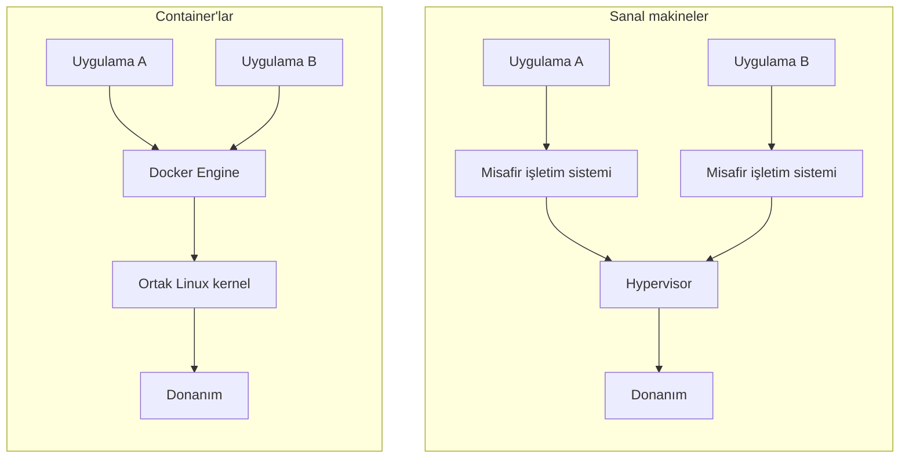

# 4.1 Docker Nedir: Image ve Container

## Nedir?
**Docker**, bir uygulamayı ve çalışması için gereken her şeyi (işletim sistemi kütüphaneleri, Python sürümü, paketler, ayarlar) tek bir pakette toplayıp her ortamda aynı şekilde çalıştıran platformdur.

İki temel kavram:
- **Image (imaj):** Uygulamanın dondurulmuş, değişmez paketi. "Tarif" ve "malzemeler" bir arada.
- **Container (kapsayıcı):** Image'ın çalışan örneği. Aynı image'dan çok sayıda container çalıştırılabilir.

> Benzetme: Image bir **kalıptır**, container o kalıptan dökülmüş **ürün**. Ya da image bir **sınıf** (class), container bir **nesne** (object).

## Hangi problemi çözer?
- **"Benim makinemde çalışıyordu":** Geliştirme, test ve canlı ortam birebir aynı image'ı çalıştırır.
- **Bağımlılık cehennemi:** Sunucuya Python 3.8 lazım olan bir uygulama ile Python 3.12 lazım olan bir uygulama yan yana çalışır.
- **Hızlı kurulum:** PostgreSQL, Redis, Airflow gibi araçlar tek komutla ayağa kalkar.
- **Taşınabilirlik:** Aynı image laptopta, sunucuda ve Kubernetes'te çalışır.

## Nasıl çalışır?

**Container ile sanal makine (VM) farkı**



| | Sanal makine | Container |
|---|---|---|
| İzolasyon | Tam işletim sistemi | Süreç seviyesinde |
| Boyut | GB'lar | MB'lar |
| Açılış süresi | Dakikalar | Saniyeler |
| Kernel | Her VM'in kendi kernel'i | Host'un kernel'i paylaşılır |

Container'lar Linux kernel'inin iki özelliğiyle izole edilir:
- **namespaces:** Her container kendi süreç listesini, ağını ve dosya sistemini görür.
- **cgroups:** CPU ve bellek kullanımına sınır konur.

**Docker bileşenleri**

| Bileşen | Görevi |
|---|---|
| Docker Engine | Container'ları çalıştıran arka plan servisi |
| Docker CLI | `docker` komutu |
| Dockerfile | Image'ın nasıl oluşturulacağını anlatan tarif ([4.2](02-dockerfile.md)) |
| Registry | Image'ların saklandığı depo ([4.7](07-registry-docker-hub.md)) |
| Volume | Kalıcı veri alanı ([4.5](05-volume.md)) |
| Docker Compose | Çoklu container'ı tek dosyadan yönetme ([4.8](08-docker-compose.md)) |

## Mini örnek
```bash
docker run hello-world                    # test image'ı çalıştır

# Kurulum yapmadan PostgreSQL 16
docker run -d --name pg \
  -e POSTGRES_PASSWORD=gizli \
  -p 5432:5432 \
  postgres:16

docker ps                                 # çalışan container'lar
docker logs pg                            # loglar
docker exec -it pg psql -U postgres       # içine gir, psql aç
docker stop pg && docker rm pg            # durdur ve sil
```

## Nerede kullanılır?
- Uygulamaları (API, dashboard, ETL) paketleyip Kubernetes/OpenShift'e göndermek
- Geliştirici makinesinde veritabanı ve servisleri hızlıca açmak
- CI pipeline'larında temiz ve tekrarlanabilir test ortamı

## Benzerleri ve farkları
- **Podman:** Red Hat'in Docker alternatifi; arka plan servisi (daemon) gerektirmez, root olmadan çalışır. Komutları Docker ile neredeyse aynıdır (`podman run ...`). RHEL ve OpenShift dünyasında yaygındır.
- **containerd / CRI-O:** Kubernetes'in container'ları çalıştırmak için kullandığı alt seviye çalışma zamanları (runtime).
- **OCI standardı:** Docker image formatı açık bir standarttır; Docker ile build edilen image Podman'da da, Kubernetes'te de çalışır.
- **Sanal ortam (venv):** Sadece Python paketlerini izole eder; Docker tüm ortamı ([2.1](../02-python-ortam/01-neden-sanal-ortam.md)).

## İlgili sayfalar
- [4.2 Dockerfile](02-dockerfile.md)
- [4.4 Docker komutları](04-docker-komutlari.md)
- [5.1 Kubernetes nedir](../05-kubernetes/01-kubernetes-nedir.md)
