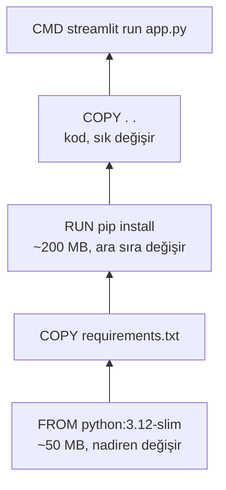

# 4.2 Dockerfile Yazmak, Image Katmanları

## Nedir?
**Dockerfile**, bir image'ın adım adım nasıl oluşturulacağını anlatan metin dosyasıdır. "Yemek tarifi" gibidir: hangi temelden başlanacağı, hangi dosyaların kopyalanacağı, hangi paketlerin kurulacağı ve container açılınca hangi komutun çalışacağı yazılır.

## Hangi problemi çözer?
Ortam kurulumu belgelenmiş, versiyonlanmış ve otomatik hâle gelir. "Sunucuya şunları kurmuştuk" bilgisi kişilerin aklında değil, Git'teki bir dosyada durur.

## Nasıl çalışır?

**Temel talimatlar**

| Talimat | Görevi |
|---|---|
| `FROM` | Başlangıç image'ı (ör. `python:3.12-slim`) |
| `WORKDIR` | Çalışma dizini; sonraki komutlar burada çalışır |
| `COPY` | Bilgisayardan image'a dosya kopyalar |
| `RUN` | Build sırasında komut çalıştırır (paket kurulumu vb.) |
| `ENV` | Ortam değişkeni tanımlar |
| `EXPOSE` | Uygulamanın dinlediği portu belgeler |
| `USER` | Container'ın çalışacağı kullanıcı |
| `CMD` | Container açılınca çalışacak varsayılan komut |
| `ENTRYPOINT` | Sabit ana komut; `CMD` ona argüman olur |

**Katmanlar (layers)**
Her `RUN`, `COPY` ve `ADD` talimatı yeni bir **katman** oluşturur. Katmanlar üst üste biner ve **önbelleğe alınır**.



Bir katman değişirse **o katman ve üstündekiler** yeniden build edilir. Bu yüzden **az değişen adımlar üste, sık değişenler alta** yazılır. Yukarıdaki sırada kod değişince sadece son iki katman yeniden oluşur; paketler önbellekten gelir.

## Mini örnek
Bir Streamlit dashboard'u için `Dockerfile`:
```dockerfile
FROM python:3.12-slim

# Python'un .pyc yazmaması ve logların anında görünmesi
ENV PYTHONDONTWRITEBYTECODE=1 \
    PYTHONUNBUFFERED=1

WORKDIR /app

# Önce sadece bağımlılık listesi -> önbellek dostu
COPY requirements.txt .
RUN pip install --no-cache-dir -r requirements.txt

# Sonra kod
COPY . .

# Root olmayan kullanıcı (güvenlik; OpenShift'te zorunlu sayılır)
RUN useradd --create-home appuser
USER appuser

EXPOSE 8501
CMD ["streamlit", "run", "app.py", "--server.port=8501", "--server.address=0.0.0.0"]
```

Build ve çalıştırma:
```bash
docker build -t kredi-dashboard:1.0 .
docker run -d -p 8501:8501 --name dash kredi-dashboard:1.0
docker history kredi-dashboard:1.0      # katmanları ve boyutlarını gör
```

## Nerede kullanılır?
- Her uygulama reposunun kök dizininde
- CI pipeline'ında otomatik build ([6.2](../06-ci-cd/02-pipeline-asamalari.md))
- OpenShift'te BuildConfig ile cluster içinde build ([5.17](../05-kubernetes/17-openshift-kavramlari.md))

## Benzerleri ve farkları
- **`CMD` ile `ENTRYPOINT`:** `CMD` kolayca ezilebilir (`docker run image baska_komut`). `ENTRYPOINT` sabit kalır. Genellikle `CMD` yeterlidir.
- **`COPY` ile `ADD`:** `ADD` ayrıca URL indirir ve arşiv açar; öngörülebilir olduğu için `COPY` tercih edilir.
- **Temel image seçimi:**
  | Image | Boyut | Not |
  |---|---|---|
  | `python:3.12` | ~1 GB | Her şey var, büyük |
  | `python:3.12-slim` | ~150 MB | Çoğu iş için ideal |
  | `python:3.12-alpine` | ~60 MB | Küçük ama bazı paketler derleme sorunu çıkarır |
  | `registry.access.redhat.com/ubi9/python-312` | — | Red Hat UBI; OpenShift ortamlarında yaygın |
- **Buildpacks / Source-to-Image (S2I):** Dockerfile yazmadan, koddan otomatik image üreten yaklaşımlar.

**İyi pratikler:**
- Sürüm etiketi sabitleyin: `python:3.12-slim`, ~~`python:latest`~~.
- Şifreleri asla Dockerfile'a yazmayın; image katmanlarında kalır.
- `.dockerignore` kullanın ([4.3](03-multi-stage-build.md)).
- Bir container, bir süreç.

## İlgili sayfalar
- [4.3 Multi-stage build](03-multi-stage-build.md)
- [2.5 Bağımlılık dosyaları](../02-python-ortam/05-bagimlilik-dosyalari.md)
