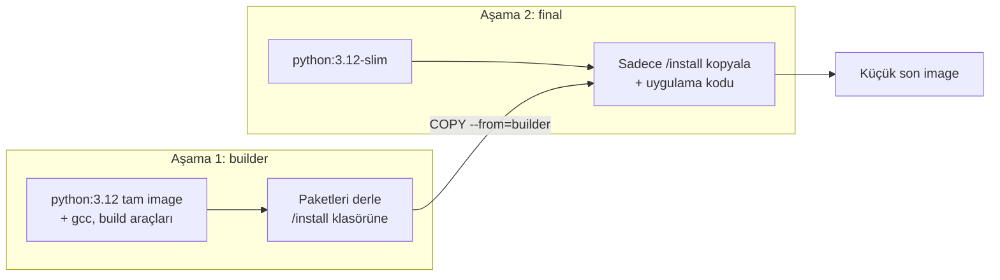

# 4.3 Multi-Stage Build ve .dockerignore

## Nedir?
- **Multi-stage build (çok aşamalı build):** Tek Dockerfile içinde birden fazla `FROM` kullanarak, derleme araçlarını bir aşamada kullanıp son image'a sadece çalışması gerekenleri kopyalama tekniği.
- **`.dockerignore`:** Build sırasında image'a gönderilmeyecek dosyaların listesi. `.gitignore` ile aynı mantık.

## Hangi problemi çözer?
- **Büyük image'lar:** Derleyiciler (gcc), build araçları ve önbellekler son image'da gereksiz yer kaplar. Büyük image yavaş indirilir, yavaş deploy edilir.
- **Güvenlik:** Son image'da ne kadar az araç varsa saldırı yüzeyi o kadar küçüktür.
- **Yanlışlıkla kopyalanan dosyalar:** `.env`, `.git`, veri dosyaları, `.venv` image'a girer; hem büyütür hem şifre sızdırır.

## Nasıl çalışır?



Sadece **son aşama** image'ın kendisi olur; önceki aşamalar build bitince atılır.

## Mini örnek

**Multi-stage Dockerfile**
```dockerfile
# ---------- Aşama 1: derleme ----------
FROM python:3.12 AS builder
WORKDIR /build
COPY requirements.txt .
RUN pip install --no-cache-dir --prefix=/install -r requirements.txt

# ---------- Aşama 2: çalışma ----------
FROM python:3.12-slim
WORKDIR /app
COPY --from=builder /install /usr/local
COPY src/ ./src/
RUN useradd --create-home appuser
USER appuser
CMD ["python", "-m", "src.etl"]
```

**`.dockerignore`**
```gitignore
.git
.gitignore
.venv
__pycache__/
*.pyc
.env
*.csv
*.parquet
data/
tests/
notebooks/
.ipynb_checkpoints/
Dockerfile
docker-compose.yml
README.md
```

Boyut karşılaştırması:
```bash
docker build -t etl:tek-asama -f Dockerfile.basit .
docker build -t etl:cok-asama .
docker images | grep etl
# etl  tek-asama   1.2GB
# etl  cok-asama   240MB
```

## Nerede kullanılır?
- C uzantılı paketler (psycopg2, numpy kaynaktan) kuran Python projeleri
- Derlenen diller (Go, Java, Node.js frontend build'i) — burada fark çok daha büyüktür, ör. Go uygulaması 10 MB'lık bir image'a sığabilir
- Test aşamasını build'e dahil etmek: bir aşamada testler koşar, başarısızsa build durur

## Benzerleri ve farkları
- **Tek aşama + slim image:** Çoğu saf Python projesi için yeterlidir; multi-stage karmaşıklığa değmeyebilir.
- **Distroless image'lar:** Shell bile içermeyen minimal image'lar (Google distroless). En güvenli ama hata ayıklaması zor.
- **`.dockerignore` ile `.gitignore`:** Benzer söz dizimi ama farklı amaç. Bir dosya Git'te olmalı ama image'da olmamalı (ör. `tests/`, `README.md`).

**İpucu:** Build sırasında Docker'a gönderilen "build context" boyutu ilk satırda görünür. Bu sayı beklenenden büyükse `.dockerignore` eksiktir.

## İlgili sayfalar
- [4.2 Dockerfile](02-dockerfile.md)
- [3.4 .gitignore](../03-git/04-gitignore.md)
