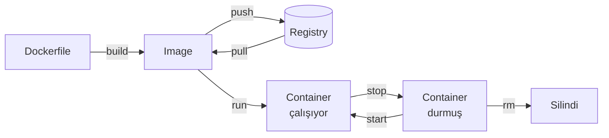

# 4.4 Docker Komutları

## Nedir?
Image ve container yaşam döngüsünü yönetmek, hata ayıklamak ve sistemi temiz tutmak için kullanılan komutların seviyelere göre açıklamalı listesi.

## Hangi problemi çözer?
Docker'ın günlük kullanımı birkaç düzine komutla yapılır. Bu sayfa hızlı başvuru içindir.

## Nasıl çalışır?



## Mini örnek

### 1. Temel: yaşam döngüsü
| Komut | Açıklama |
|---|---|
| `docker run -d --name web -p 8080:80 nginx` | Arka planda (`-d`) çalıştır, isim ver, port yönlendir (host:container) |
| `docker run -it --rm python:3.12 bash` | İnteraktif aç, çıkınca otomatik sil (`--rm`) |
| `docker run -e DB_HOST=db --env-file .env image` | Ortam değişkeni ver |
| `docker ps` | Çalışan container'lar |
| `docker ps -a` | Durmuşlar dahil hepsi |
| `docker stop web` | Nazikçe durdur |
| `docker start web` | Durmuş container'ı başlat |
| `docker restart web` | Yeniden başlat |
| `docker rm web` | Durmuş container'ı sil |
| `docker rm -f web` | Çalışanı zorla sil |

### 2. Image
| Komut | Açıklama |
|---|---|
| `docker build -t ad:etiket .` | Dockerfile'dan image oluştur |
| `docker build -f Dockerfile.prod -t ad:1.0 .` | Farklı Dockerfile kullan |
| `docker images` | Yerel image'lar |
| `docker pull postgres:16` | Registry'den indir |
| `docker tag ad:1.0 registry.sirket.local/ekip/ad:1.0` | Yeni isim/etiket ver |
| `docker push registry.sirket.local/ekip/ad:1.0` | Registry'ye gönder |
| `docker rmi ad:1.0` | Image sil |
| `docker history ad:1.0` | Katmanlar ve boyutları |

### 3. Hata ayıklama ve izleme
| Komut | Açıklama |
|---|---|
| `docker logs web` | Container logları |
| `docker logs -f --tail 100 web` | Son 100 satır + canlı takip |
| `docker exec -it web bash` | Çalışan container'ın içine gir (`bash` yoksa `sh`) |
| `docker exec web env` | İçerideki ortam değişkenleri |
| `docker inspect web` | IP, volume, ayarlar (JSON) |
| `docker stats` | CPU, bellek, ağ kullanımı (canlı) |
| `docker top web` | Container içindeki süreçler |
| `docker cp web:/app/log.txt .` | Container'dan dosya al (tersi de olur) |
| `docker port web` | Port eşleşmeleri |

### 4. Temizlik ve sistem
| Komut | Açıklama |
|---|---|
| `docker system df` | Docker'ın kapladığı disk alanı |
| `docker system prune` | Durmuş container, kullanılmayan ağ ve etiketsiz image'ları sil |
| `docker system prune -a --volumes` | Kullanılmayan **her şeyi** sil (dikkat: volume'ler dahil) |
| `docker image prune` | Etiketsiz (dangling) image'ları sil |
| `docker container prune` | Tüm durmuş container'ları sil |

### 5. Volume ve network
| Komut | Açıklama |
|---|---|
| `docker volume ls` / `create` / `rm` / `inspect` | Volume yönetimi ([4.5](05-volume.md)) |
| `docker network ls` / `create` / `inspect` | Ağ yönetimi ([4.6](06-network.md)) |

## Nerede kullanılır?
Tipik hata ayıklama akışı:
```bash
docker ps -a                       # container ayakta mı, "Exited" mı?
docker logs --tail 50 etl          # neden kapandı?
docker inspect etl | grep -i exitcode
docker run -it --rm --entrypoint bash etl:1.0   # image'ı elle incele
```

## Benzerleri ve farkları
| Docker | Podman | Kubernetes |
|---|---|---|
| `docker ps` | `podman ps` | `kubectl get pods` |
| `docker logs` | `podman logs` | `kubectl logs` |
| `docker exec -it` | `podman exec -it` | `kubectl exec -it` |
| `docker run` | `podman run` | `kubectl run` / Deployment |

**Sık hatalar:**
- `port is already allocated` → host portu kullanımda; farklı port seçin (`-p 8081:80`).
- Container hemen `Exited (0)` oluyor → ana süreç bitmiştir; container, `CMD`'deki süreç çalıştığı sürece yaşar.
- `-p` sırası: **host:container**. `-p 8080:80` → tarayıcıda `localhost:8080`.

## İlgili sayfalar
- [4.1 Docker nedir](01-docker-nedir.md)
- [Docker cheat sheet](../ekler/docker-cheatsheet.md)
