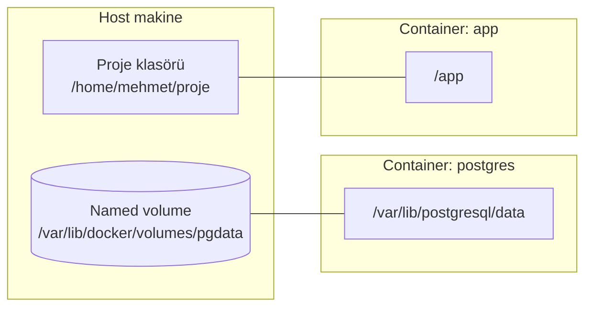

# 4.5 Volume ve Bind Mount: Kalıcı Veri

## Nedir?
Container'lar doğası gereği **geçicidir** (ephemeral): container silindiğinde içinde oluşan dosyalar da kaybolur. Verinin kalıcı olması için container dışındaki bir depolama alanı container'a bağlanır (mount). İki yolu vardır:

- **Named volume:** Docker'ın yönettiği, isimli depolama alanı.
- **Bind mount:** Bilgisayardaki (host) belirli bir klasörün doğrudan container'a bağlanması.

## Hangi problemi çözer?
- Veritabanı container'ı silinip yeni sürümle açıldığında veri kaybolmasın.
- Geliştirme sırasında kod değişiklikleri image'ı yeniden build etmeden container'da görünsün.
- Birden fazla container aynı dosyaları paylaşabilsin.
- Loglar ve çıktılar container dışında saklansın.

## Nasıl çalışır?



| | Named volume | Bind mount | tmpfs |
|---|---|---|---|
| Nerede durur? | Docker'ın alanında | Host'taki belirttiğiniz klasörde | Bellekte |
| Kim yönetir? | Docker | Siz | Docker |
| Taşınabilir mi? | Evet | Hayır (host yoluna bağlı) | — |
| Kalıcı mı? | Evet | Evet | Hayır |
| Tipik kullanım | Veritabanı verisi | Geliştirmede kod, konfigürasyon | Geçici hassas veri |

## Mini örnek

**Named volume (veritabanı için önerilen)**
```bash
docker volume create pgdata
docker run -d --name pg \
  -e POSTGRES_PASSWORD=gizli \
  -v pgdata:/var/lib/postgresql/data \
  postgres:16

docker rm -f pg                        # container silindi
docker run -d --name pg2 \
  -e POSTGRES_PASSWORD=gizli \
  -v pgdata:/var/lib/postgresql/data \
  postgres:16                          # veri yerinde!
```

**Bind mount (geliştirme için)**
```bash
# Bilgisayardaki kod anında container'da görünür
docker run -d -p 8501:8501 \
  -v "$(pwd)":/app \
  kredi-dashboard:1.0

# Sadece okunur bağlama (konfigürasyon)
docker run -v "$(pwd)/config.yaml":/app/config.yaml:ro etl:1.0
```

**Daha açık söz dizimi: `--mount`**
```bash
docker run --mount type=volume,source=pgdata,target=/var/lib/postgresql/data postgres:16
docker run --mount type=bind,source="$(pwd)",target=/app,readonly etl:1.0
```

**Volume yönetimi**
```bash
docker volume ls
docker volume inspect pgdata           # host'ta nerede duruyor?
docker volume rm pgdata                # sil (veri gider!)
docker volume prune                    # hiçbir container'ın kullanmadığı volume'leri sil
```

**Yedek almak**
```bash
docker run --rm -v pgdata:/data -v "$(pwd)":/yedek alpine \
  tar czf /yedek/pgdata.tar.gz -C /data .
```

## Nerede kullanılır?
- PostgreSQL, MongoDB, Redis gibi veritabanı container'ları
- Jupyter container'ında notebook'ların saklanması
- ETL container'ına girdi klasörü bağlamak

## Benzerleri ve farkları
- **Kubernetes'te karşılığı:** PersistentVolume ve PersistentVolumeClaim ([5.10](../05-kubernetes/10-persistent-volume.md)). Mantık aynıdır, ama depolama cluster tarafından sağlanır.
- **Container katmanına yazmak:** Container içinde volume olmayan bir yere yazılan dosya, container silinince kaybolur ve performansı düşüktür.
- **Nesne depolama (S3, MinIO):** Büyük ve paylaşılan veri için volume yerine uygulamanın doğrudan nesne deposuna yazması daha ölçeklenebilirdir.

**Sık hatalar:**
- `docker system prune -a --volumes` veritabanı verisini silebilir.
- Bind mount'ta **izin hataları**: Container içindeki kullanıcının host klasörüne yazma izni olmayabilir ([1.3](../01-linux/03-izinler.md)).
- Windows/macOS'ta bind mount Linux'a göre yavaştır.

## İlgili sayfalar
- [4.8 Docker Compose](08-docker-compose.md)
- [5.10 PersistentVolume](../05-kubernetes/10-persistent-volume.md)
