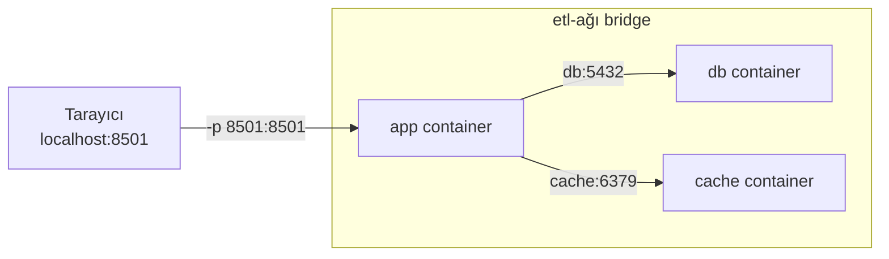

# 4.6 Docker Network

## Nedir?
Docker network, container'ların birbirleriyle ve dış dünyayla nasıl iletişim kuracağını belirleyen sanal ağlardır.

## Hangi problemi çözer?
- Uygulama container'ı, veritabanı container'ına **isimle** ulaşabilsin (`db:5432`), IP adresi ezberlemeye gerek kalmasın.
- Birbiriyle ilgisi olmayan container'lar birbirini göremesin (izolasyon).
- Sadece gerekli portlar dış dünyaya açılsın.

## Nasıl çalışır?

**Ağ sürücüleri (driver)**

| Sürücü | Açıklama | Ne zaman? |
|---|---|---|
| `bridge` | Varsayılan. Host içinde sanal ağ | Tek makinedeki container'lar |
| `host` | Container host'un ağını doğrudan kullanır, izolasyon yok | Performans kritik, nadir |
| `none` | Ağ yok | Tamamen izole işler |
| `overlay` | Birden çok makineye yayılan ağ | Docker Swarm |

**Kullanıcı tanımlı bridge ağı** önemli bir fark yaratır: Bu ağdaki container'lar birbirini **container adıyla** bulur (Docker'ın dahili DNS'i sayesinde). Varsayılan `bridge` ağında bu özellik yoktur.



Yukarıda sadece `app` dışarıya açık; `db` ve `cache` sadece ağ içinden erişilebilir.

**Port yayınlama (publish):** `-p host_port:container_port` ile container'daki port host'a açılır. Aynı ağdaki container'lar birbirine erişmek için port yayınlamaya ihtiyaç duymaz.

## Mini örnek
```bash
docker network create etl-agi

docker run -d --name db --network etl-agi \
  -e POSTGRES_PASSWORD=gizli postgres:16

docker run -d --name app --network etl-agi \
  -e DB_HOST=db -e DB_PORT=5432 \
  -p 8501:8501 kredi-dashboard:1.0

# app container'ından db'ye isimle erişim testi
docker exec -it app python -c "import socket; print(socket.gethostbyname('db'))"

docker network ls
docker network inspect etl-agi        # bağlı container'lar ve IP'leri
docker network connect etl-agi baska  # çalışan container'ı ağa ekle
```

## Nerede kullanılır?
- Uygulama + veritabanı + cache gibi çok container'lı yerel ortamlar
- Docker Compose her proje için otomatik bir ağ oluşturur ve servisler adlarıyla birbirini bulur ([4.8](08-docker-compose.md))

## Benzerleri ve farkları
- **Kubernetes'te karşılığı:** Pod'lar birbirine **Service** adıyla ulaşır (`postgres-svc.namespace.svc.cluster.local`) ([5.7](../05-kubernetes/07-service.md)). Ağ politikaları (NetworkPolicy) ile hangi pod'un hangisiyle konuşacağı kısıtlanır.
- **`localhost` tuzağı:** Container içindeki `localhost`, **container'ın kendisidir**, host makine değildir. Container'dan host'taki bir servise erişmek için Docker Desktop'ta `host.docker.internal` kullanılır.

**Sık hata:** Uygulama `localhost:5432`'ye bağlanmaya çalışıyor ve "connection refused" alıyor. Doğrusu, aynı ağdaki veritabanı container'ının adı: `db:5432`.

## İlgili sayfalar
- [4.8 Docker Compose](08-docker-compose.md)
- [5.7 Service türleri](../05-kubernetes/07-service.md)
- [1.10 localhost ve port dinleme](../01-linux/10-localhost.md)
