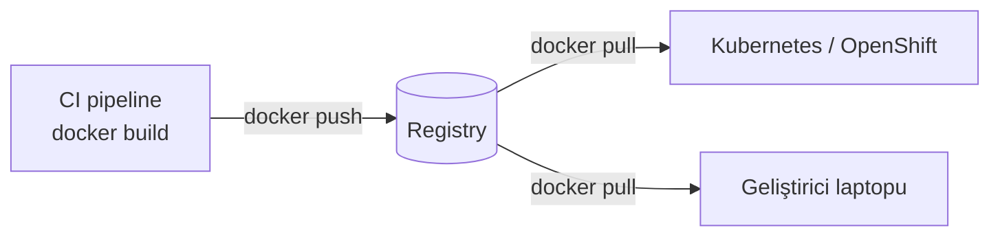

# 4.7 Docker Hub ve Registry Kavramı

## Nedir?
**Registry (kayıt deposu)**, Docker image'larının saklandığı ve paylaşıldığı sunucudur. Kod için GitHub neyse, image için registry odur.

**Docker Hub**, Docker'ın herkese açık varsayılan registry'sidir. `docker pull postgres` yazıldığında image Docker Hub'dan gelir.

## Hangi problemi çözer?
Bir makinede build edilen image'ın başka makinelere (test sunucusu, Kubernetes cluster'ı, başka geliştiricinin laptopu) ulaştırılması gerekir. Registry bu merkezi dağıtım noktasıdır.

## Nasıl çalışır?



**Image adının anatomisi**
```
registry.sirket.local/veri-ekibi/kredi-dashboard:1.4.2
└──────┬─────────────┘└───┬────┘└──────┬──────┘└─┬─┘
    registry adresi    repo yolu      image adı   etiket (tag)
```

- Registry adresi yazılmazsa `docker.io` (Docker Hub) varsayılır: `postgres:16` = `docker.io/library/postgres:16`.
- Etiket yazılmazsa `latest` varsayılır.
- **Digest:** İçeriğin değişmez parmak izi: `postgres@sha256:3c4f...`. Etiket başka image'a taşınabilir, digest asla.

**Etiketleme stratejisi**

| Etiket | Örnek | Not |
|---|---|---|
| Semantik sürüm | `1.4.2` | Canlı ortam için en iyisi |
| Git commit | `a3f9c21` | Hangi koddan build edildiği net |
| Ortam / dal | `dev`, `main` | Değişkendir, takip zor |
| `latest` | `latest` | Prod'da kullanmayın; ne çalıştığı belirsiz |

## Mini örnek
```bash
# Docker Hub
docker login
docker tag kredi-dashboard:1.0 galipsoken/kredi-dashboard:1.0
docker push galipsoken/kredi-dashboard:1.0

# Kurum içi registry
docker login registry.sirket.local
docker tag kredi-dashboard:1.0 registry.sirket.local/veri-ekibi/kredi-dashboard:1.0
docker push registry.sirket.local/veri-ekibi/kredi-dashboard:1.0

# Başka makinede
docker pull registry.sirket.local/veri-ekibi/kredi-dashboard:1.0
```

## Nerede kullanılır?
- CI pipeline'ı image'ı build edip registry'ye push eder; CD aşaması Kubernetes'e bu image'ı çektirir.
- Hazır temel image'lar (python, postgres, nginx) registry'den gelir.

## Benzerleri ve farkları
| Registry | Tür | Not |
|---|---|---|
| **Docker Hub** | Genel, bulut | Ücretsiz katmanda indirme sınırları var |
| **Quay.io** | Red Hat, bulut veya kurum içi | OpenShift dünyasında yaygın |
| **OpenShift dahili registry** | Cluster içinde | ImageStream ile entegre ([5.17](../05-kubernetes/17-openshift-kavramlari.md)) |
| **Harbor** | Açık kaynak, kurum içi | Zafiyet tarama, imzalama |
| **JFrog Artifactory / Nexus** | Kurum içi | PyPI, npm ve Docker'ı tek yerde toplar ([2.6](../02-python-ortam/06-kurum-ici-paket.md)) |
| **GitHub / GitLab Container Registry** | Platforma gömülü | Repoyla yan yana |
| **AWS ECR, Azure ACR, Google Artifact Registry** | Bulut sağlayıcı | Bulut ortamlarında |

**Bankalarda:** İnternetteki Docker Hub'a doğrudan erişim genellikle kapalıdır. Image'lar kurum içi registry'den çekilir; dışarıdan gelen image'lar güvenlik taramasından geçirilip içeri alınır.

**Güvenlik:**
- **Resmi image'ları** (`Docker Official Image`, `Verified Publisher`) tercih edin.
- Image'ları zafiyet tarayıcılarla kontrol edin (Trivy, Harbor, Quay tarayıcısı).
- Şifre içeren image'ı asla public registry'ye göndermeyin.

## İlgili sayfalar
- [4.4 Docker komutları](04-docker-komutlari.md)
- [6.2 Pipeline aşamaları](../06-ci-cd/02-pipeline-asamalari.md)
