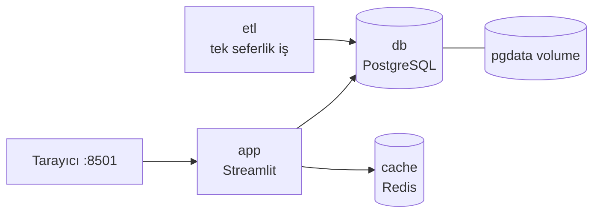

# 4.8 Docker Compose: Çoklu Container

## Nedir?
**Docker Compose**, birden fazla container'dan oluşan bir uygulamayı tek bir YAML dosyasında (`compose.yaml` veya `docker-compose.yml`) tanımlayıp tek komutla ayağa kaldırma aracıdır.

## Hangi problemi çözer?
Bir dashboard; uygulama + PostgreSQL + Redis'ten oluşuyorsa her biri için uzun `docker run` komutları, ağ ve volume tanımları yazmak gerekir. Bunları hatırlamak ve ekipte paylaşmak zordur. Compose tüm sistemi **kod olarak** tanımlar.

## Nasıl çalışır?
- Her container bir **service** olarak tanımlanır.
- Compose proje için otomatik bir ağ oluşturur; servisler birbirine **servis adıyla** ulaşır ([4.6](06-network.md)).
- `depends_on` ile başlangıç sırası, `healthcheck` ile hazır olma kontrolü yapılır.
- Volume'ler, ortam değişkenleri, portlar aynı dosyada durur.



## Mini örnek

`compose.yaml`
```yaml
services:
  db:
    image: postgres:16
    environment:
      POSTGRES_DB: bddk
      POSTGRES_USER: etl
      POSTGRES_PASSWORD: ${DB_PASSWORD}     # .env dosyasından
    volumes:
      - pgdata:/var/lib/postgresql/data
    healthcheck:
      test: ["CMD-SHELL", "pg_isready -U etl -d bddk"]
      interval: 5s
      retries: 10

  cache:
    image: redis:7

  etl:
    build: ./etl
    environment:
      DB_HOST: db
      DB_PASSWORD: ${DB_PASSWORD}
    depends_on:
      db:
        condition: service_healthy

  app:
    build: ./dashboard
    ports:
      - "8501:8501"
    environment:
      DB_HOST: db
      REDIS_HOST: cache
    depends_on:
      - db
      - cache

volumes:
  pgdata:
```

`.env` (Git'e gönderilmez)
```bash
DB_PASSWORD=gizli
```

Komutlar:
```bash
docker compose up -d              # hepsini build et ve başlat
docker compose ps                 # durum
docker compose logs -f app        # bir servisin logları
docker compose exec db psql -U etl -d bddk
docker compose run --rm etl       # tek seferlik işi çalıştır
docker compose up -d --build app  # sadece app'i yeniden build et
docker compose down               # durdur ve sil (volume kalır)
docker compose down -v            # volume'ler dahil sil
```

## Nerede kullanılır?
- Yerel geliştirme ortamı: Yeni gelen ekip üyesi `docker compose up` ile tüm sistemi çalıştırır.
- Entegrasyon testleri: CI'da gerçek veritabanıyla test.
- Küçük, tek sunuculu uygulamalar (iç araçlar, demo ortamları).
- Airflow, Superset gibi çok bileşenli araçların resmi kurulum dosyaları Compose ile gelir.

## Benzerleri ve farkları
| | Docker Compose | Kubernetes |
|---|---|---|
| Ölçek | Tek makine | Çok makineli cluster |
| Kendini iyileştirme | Sınırlı (`restart: always`) | Tam (pod'lar yeniden planlanır) |
| Ölçekleme | Elle | Otomatik (HPA) |
| Öğrenme eğrisi | Kolay | Dik |
| Ne için? | Geliştirme, küçük kurulumlar | Canlı ortam |

- **Kompose:** Compose dosyasını Kubernetes YAML'larına çeviren araç; başlangıç için yararlı, ama üretilen YAML'lar genellikle elden geçirilmelidir.
- **`docker-compose` (tireli) ile `docker compose`:** Eski sürüm ayrı bir Python aracıydı (v1). Yeni sürüm Docker CLI'ın içinde gelir (v2). Yeni projelerde `docker compose` kullanın.

## İlgili sayfalar
- [4.5 Volume](05-volume.md)
- [4.6 Network](06-network.md)
- [5.1 Kubernetes nedir](../05-kubernetes/01-kubernetes-nedir.md)
