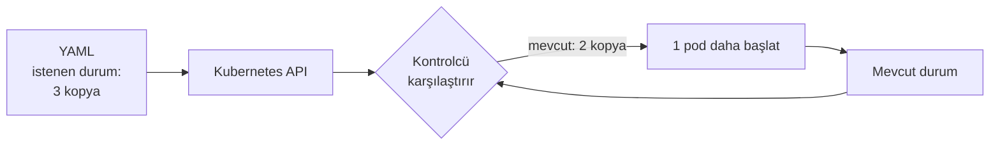

# 5.1 Kubernetes Nedir, Neden Gerekir?

## Nedir?
**Kubernetes (K8s)**, çok sayıda container'ı birden fazla sunucu üzerinde otomatik olarak çalıştıran, izleyen, ölçekleyen ve iyileştiren **container orkestrasyon** platformudur. Google'ın iç sistemi Borg'dan esinlenerek geliştirildi ve 2014'te açık kaynak yapıldı. Bugün CNCF (Cloud Native Computing Foundation) tarafından yönetilir.

"K8s" kısaltması: K + 8 harf + s.

## Hangi problemi çözer?
Docker tek bir makinede container çalıştırmayı çözer. Ama canlı ortamda şu sorular çıkar:

| Soru | Kubernetes'in cevabı |
|---|---|
| Container çökerse kim yeniden başlatacak? | Kendini iyileştirme (self-healing) |
| Sunucu bozulursa container'lar ne olacak? | Başka sunucuya taşınır (rescheduling) |
| Trafik artınca kopya sayısını kim artıracak? | Otomatik ölçekleme (autoscaling) |
| Yeni sürümü kesintisiz nasıl yayına alırız? | Kademeli güncelleme (rolling update) |
| Kötü sürümden nasıl geri döneriz? | Geri alma (rollback) |
| Container'lar birbirini nasıl bulur? | Servis keşfi (service discovery) |
| Şifreler ve ayarlar nasıl verilir? | ConfigMap ve Secret |

## Nasıl çalışır?
Kubernetes'in temel fikri **istenen durum (desired state)** yaklaşımıdır:
1. Siz **ne istediğinizi** YAML ile tanımlarsınız: "Bu image'dan 3 kopya çalışsın."
2. Kubernetes **mevcut durumu** sürekli izler.
3. Fark varsa **düzeltir**: Bir kopya çöktüyse yenisini başlatır.

Bu döngüye **reconciliation loop** (uzlaştırma döngüsü) denir.



Bu yaklaşıma **deklaratif** (bildirimsel) denir: "Şunu yap" değil, "Şöyle olsun" dersiniz.

## Mini örnek
```yaml
# deployment.yaml
apiVersion: apps/v1
kind: Deployment
metadata:
  name: kredi-dashboard
spec:
  replicas: 3
  selector:
    matchLabels:
      app: kredi-dashboard
  template:
    metadata:
      labels:
        app: kredi-dashboard
    spec:
      containers:
        - name: app
          image: registry.sirket.local/veri-ekibi/kredi-dashboard:1.4.2
          ports:
            - containerPort: 8501
```

```bash
kubectl apply -f deployment.yaml      # istenen durumu bildir
kubectl get pods                      # 3 pod çalışıyor
kubectl delete pod kredi-dashboard-xyz   # birini sil...
kubectl get pods                      # ...Kubernetes yenisini başlattı
```

## Nerede kullanılır?
- Mikroservisler, API'ler, web uygulamaları
- Zamanlanmış veri işleri (CronJob)
- ML model servisleri, Spark ve Airflow gibi veri platformları
- Bankalarda genellikle **OpenShift** dağıtımı üzerinden ([5.16](16-openshift-nedir.md))

## Benzerleri ve farkları
| | Docker Compose | Kubernetes | OpenShift |
|---|---|---|---|
| Ölçek | Tek makine | Cluster | Cluster |
| Kurulum | Kolay | Zor | Kurumsal destekli |
| Güvenlik varsayılanları | Gevşek | Orta | Sıkı |
| Arayüz | CLI | CLI + Dashboard | Zengin web konsolu |

Yönetilen (managed) Kubernetes hizmetleri: **EKS** (AWS), **AKS** (Azure), **GKE** (Google). Cluster'ın yönetimini bulut sağlayıcı üstlenir.

Yerelde öğrenmek için: **kind**, **minikube**, **k3d**, Docker Desktop'ın dahili Kubernetes'i veya OpenShift için **OpenShift Local** (CRC).

**Ne zaman Kubernetes gerekmez?** Tek sunucuda çalışan birkaç basit servis için Kubernetes fazla karmaşıktır; Compose veya systemd yeterli olabilir.

## İlgili sayfalar
- [5.2 Mimari](02-mimari.md)
- [5.4 Deployment](04-deployment.md)
- [5.14 kubectl komutları](14-kubectl-komutlari.md)
