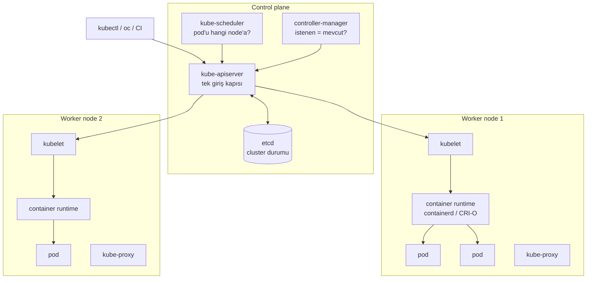

# 5.2 Mimari: Cluster, Node, Control Plane

## Nedir?
Bir Kubernetes **cluster**'ı iki tür makineden oluşur:
- **Control plane (kontrol düzlemi):** Cluster'ın beyni. Kararları verir, durumu saklar.
- **Worker node (çalışan düğüm):** Uygulamaların (pod'ların) gerçekten çalıştığı makineler.

## Hangi problemi çözer?
Mimariyi bilmek, bir sorun olduğunda nereye bakılacağını gösterir: "Pod neden başlamıyor?" sorusunun cevabı scheduler'da, kubelet'te veya registry'de olabilir.

## Nasıl çalışır?



**Control plane bileşenleri**

| Bileşen | Görevi |
|---|---|
| **kube-apiserver** | Her şeyin konuştuğu REST API. `kubectl` komutları buraya gider. Kimlik doğrulama ve yetki kontrolü burada yapılır. |
| **etcd** | Cluster'ın tüm durumunu tutan anahtar–değer veritabanı. Cluster'ın "hafızası"; yedeği kritik. |
| **kube-scheduler** | Yeni pod'un hangi node'da çalışacağına karar verir (kaynak, kısıtlar, affinity). |
| **kube-controller-manager** | Deployment, ReplicaSet, Node gibi kontrolcüleri çalıştırır; istenen durumu sağlar. |
| **cloud-controller-manager** | Bulut ortamında load balancer, disk gibi kaynakları sağlayıcıyla konuşarak oluşturur. |

**Worker node bileşenleri**

| Bileşen | Görevi |
|---|---|
| **kubelet** | Node üzerindeki ajan. API'den gelen pod tanımlarını alır, container'ları başlatır, sağlıklarını raporlar. |
| **container runtime** | Container'ları gerçekten çalıştıran yazılım: containerd, CRI-O (OpenShift). |
| **kube-proxy** | Service'lere gelen trafiği doğru pod'lara yönlendiren ağ kurallarını yönetir. |

**Bir pod'un yolculuğu**
1. `kubectl apply` → API server tanımı alır, etcd'ye yazar.
2. Controller, Deployment için bir ReplicaSet ve pod tanımları oluşturur.
3. Scheduler, pod'a uygun bir node seçer.
4. O node'daki kubelet pod'u görür, runtime'a image'ı çektirip container'ı başlatır.
5. kubelet durumu API'ye bildirir → `kubectl get pods` "Running" gösterir.

## Mini örnek
```bash
kubectl cluster-info                  # API server adresi
kubectl get nodes -o wide             # node'lar, rolleri, IP'leri
kubectl describe node worker-1        # kapasite, üzerindeki pod'lar, olaylar
kubectl top nodes                     # CPU/bellek kullanımı (metrics-server gerekir)
kubectl get pods -n kube-system       # sistem bileşenleri
```

## Nerede kullanılır?
- **Sorun giderme:** Pod `Pending` kalıyorsa scheduler uygun node bulamamıştır (kaynak yetersiz). `ImagePullBackOff` ise kubelet image'ı registry'den çekememiştir.
- **Kapasite planlama:** Node sayısı ve büyüklüğü
- **Yüksek erişilebilirlik:** Canlı ortamda control plane genellikle 3 node'da çalışır (etcd çoğunluk oylaması için tek sayı).

## Benzerleri ve farkları
- **Yönetilen Kubernetes (EKS, AKS, GKE):** Control plane'i sağlayıcı yönetir; siz sadece worker node'ları görürsünüz.
- **OpenShift:** Aynı mimari; node'lar RHEL CoreOS çalıştırır, runtime CRI-O'dur, üstüne ek bileşenler (router, dahili registry, web konsolu) gelir ([5.16](16-openshift-nedir.md)).

## İlgili sayfalar
- [5.3 Namespace ve Pod](03-namespace-pod.md)
- [5.1 Kubernetes nedir](01-kubernetes-nedir.md)
