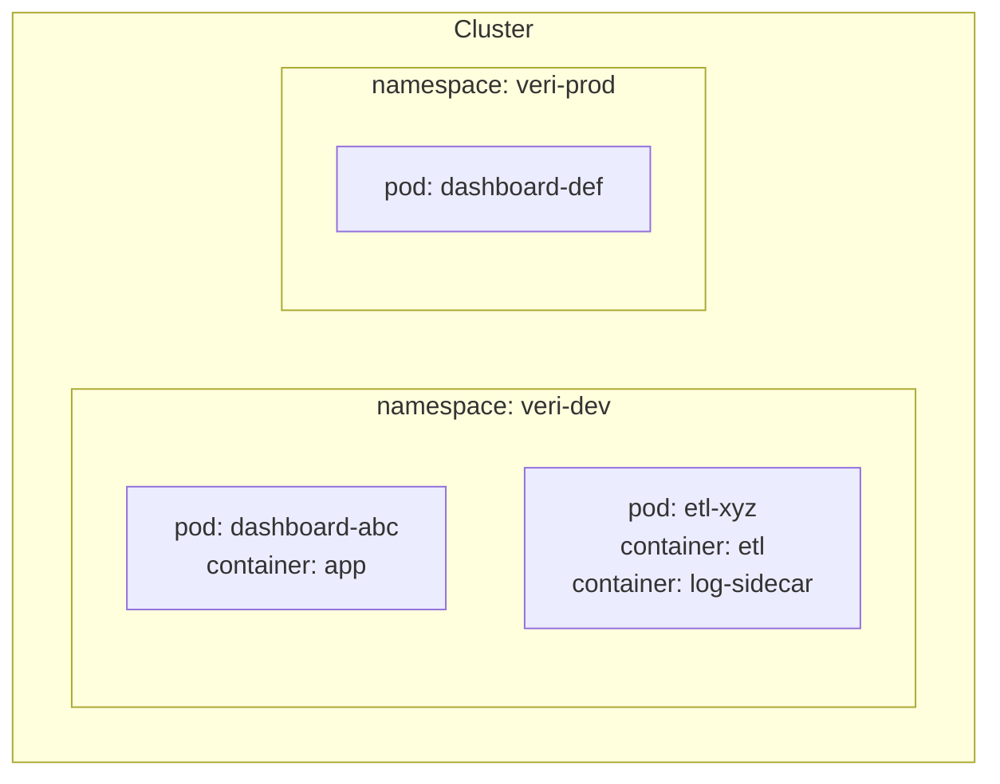

# 5.3 Namespace ve Pod

## Nedir?
- **Pod:** Kubernetes'te çalıştırılabilen **en küçük birimdir**. Bir veya birkaç container'ı sarmalar. Aynı pod'daki container'lar aynı IP adresini ve depolamayı paylaşır.
- **Namespace (isim alanı):** Cluster'ı mantıksal bölümlere ayıran klasör benzeri yapı. OpenShift'te **Project** olarak geçer.

## Hangi problemi çözer?
- **Pod:** Birlikte çalışması gereken container'ları (ör. uygulama + log toplayıcı) tek birim olarak planlar.
- **Namespace:**
  - Ekipleri ve ortamları ayırır (`veri-ekibi-dev`, `veri-ekibi-prod`).
  - Aynı isim farklı namespace'lerde kullanılabilir.
  - Yetki (RBAC) ve kaynak kotası namespace bazında verilir.

## Nasıl çalışır?



**Pod hakkında bilinmesi gerekenler**
- Pod'lar **geçicidir**: Ölen pod yeniden canlanmaz, yerine yeni IP ile yenisi gelir. Bu yüzden pod'lar genellikle doğrudan değil, Deployment gibi üst nesnelerle oluşturulur ([5.4](04-deployment.md)).
- **Sidecar** deseni: Ana container'ın yanında yardımcı container (log gönderici, proxy).
- **Init container:** Ana container'dan önce çalışıp biten hazırlık container'ı (ör. veritabanının hazır olmasını beklemek).

**Pod durumları (phase)**

| Durum | Anlamı |
|---|---|
| `Pending` | Planlanmayı veya image indirmeyi bekliyor |
| `Running` | En az bir container çalışıyor |
| `Succeeded` | Tüm container'lar başarıyla bitti (Job'larda) |
| `Failed` | Container'lardan biri hatayla bitti |
| `Unknown` | Node ile iletişim yok |

Sık görülen hata durumları: `CrashLoopBackOff` (sürekli çöküp yeniden başlıyor), `ImagePullBackOff` (image çekilemiyor), `OOMKilled` (bellek sınırını aştı).

**Label (etiket):** Nesnelere takılan anahtar–değer çiftleri (`app: dashboard`, `env: prod`). Kubernetes nesneleri birbirini label'larla bulur (Service hangi pod'lara trafik gönderecek, Deployment hangi pod'ları yönetecek).

## Mini örnek
```yaml
apiVersion: v1
kind: Pod
metadata:
  name: deneme
  namespace: veri-dev
  labels:
    app: deneme
spec:
  containers:
    - name: python
      image: python:3.12-slim
      command: ["sleep", "3600"]
```

```bash
kubectl create namespace veri-dev
kubectl apply -f pod.yaml
kubectl get pods -n veri-dev
kubectl get pods -A                          # tüm namespace'ler
kubectl get pods -l app=deneme               # label ile filtre
kubectl describe pod deneme -n veri-dev      # olaylar: neden başlamadı?
kubectl logs deneme -n veri-dev
kubectl exec -it deneme -n veri-dev -- bash
kubectl config set-context --current --namespace=veri-dev   # varsayılan namespace
```

## Nerede kullanılır?
- Namespace: Ekip, proje ve ortam ayrımı
- Doğrudan pod: Sadece deneme ve hata ayıklama; canlı ortamda Deployment, StatefulSet veya Job kullanılır

## Benzerleri ve farkları
- **Pod ile container:** Docker'da en küçük birim container'dır; Kubernetes'te pod. Çoğu pod tek container içerir.
- **Namespace ile cluster:** Namespace mantıksal ayrımdır, güçlü güvenlik sınırı değildir. Çok sıkı izolasyon gerekirse ayrı cluster kullanılır.
- **OpenShift Project:** Namespace + ek anotasyonlar + varsayılan yetki ve kotalar ([5.17](17-openshift-kavramlari.md)).

## İlgili sayfalar
- [5.4 Deployment](04-deployment.md)
- [5.13 RBAC](13-rbac.md)
