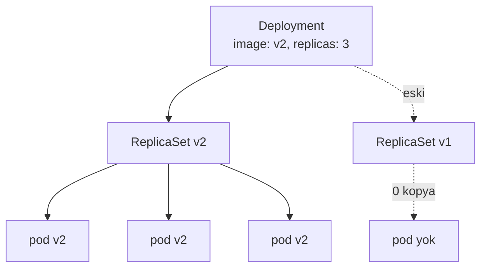

# 5.4 Deployment ve ReplicaSet

## Nedir?
- **ReplicaSet:** Belirli sayıda aynı pod'un her an çalışmasını garanti eden nesne.
- **Deployment:** ReplicaSet'leri yöneten üst nesne. Sürüm güncelleme (rolling update) ve geri alma (rollback) yeteneği ekler.

Durumsuz (stateless) uygulamalar için standart yol Deployment'tır: API'ler, web uygulamaları, dashboard'lar.

## Hangi problemi çözer?
- Pod çökerse veya node bozulursa yerine yenisi başlatılır.
- Kopya sayısı tek komutla artırılıp azaltılır.
- Yeni sürüm, kullanıcıları kesintiye uğratmadan kademeli olarak yayına alınır.
- Sorunlu sürümden önceki sürüme tek komutla dönülür.

## Nasıl çalışır?



**Rolling update (kademeli güncelleme)**
Image değişince Deployment yeni bir ReplicaSet oluşturur ve kademeli olarak:
1. Yeni sürümden bir pod başlatır,
2. Hazır (ready) olunca eskisinden birini kapatır,
3. Tümü yenilenene kadar tekrarlar.

Ayarlar:
- `maxSurge`: Güncelleme sırasında istenen sayının üstünde kaç ek pod olabilir.
- `maxUnavailable`: Aynı anda kaç pod hizmet dışı kalabilir.

Eski ReplicaSet silinmez (0 kopyayla saklanır); rollback bunu kullanır.

**Diğer strateji:** `Recreate` → önce tüm eski pod'ları kapatır, sonra yenileri açar. Kısa kesinti olur; aynı anda iki sürümün çalışmaması gerektiğinde kullanılır.

## Mini örnek
```yaml
apiVersion: apps/v1
kind: Deployment
metadata:
  name: kredi-api
  namespace: veri-prod
spec:
  replicas: 3
  selector:
    matchLabels:
      app: kredi-api
  strategy:
    type: RollingUpdate
    rollingUpdate:
      maxSurge: 1
      maxUnavailable: 0
  template:
    metadata:
      labels:
        app: kredi-api
    spec:
      containers:
        - name: api
          image: registry.sirket.local/veri/kredi-api:1.4.2
          ports:
            - containerPort: 8000
          resources:
            requests: { cpu: "250m", memory: "256Mi" }
            limits:   { cpu: "1",    memory: "512Mi" }
          readinessProbe:
            httpGet: { path: /health, port: 8000 }
```

```bash
kubectl apply -f deployment.yaml
kubectl get deploy,rs,pods -l app=kredi-api

# Yeni sürüm
kubectl set image deployment/kredi-api api=registry.sirket.local/veri/kredi-api:1.5.0
kubectl rollout status deployment/kredi-api      # ilerlemeyi izle

# Geçmiş ve geri alma
kubectl rollout history deployment/kredi-api
kubectl rollout undo deployment/kredi-api                  # bir önceki sürüme
kubectl rollout undo deployment/kredi-api --to-revision=3

# Ölçekleme ve yeniden başlatma
kubectl scale deployment/kredi-api --replicas=5
kubectl rollout restart deployment/kredi-api     # pod'ları sırayla yenile
```

## Nerede kullanılır?
- REST API'ler, Streamlit/Dash dashboard'ları, model servisleri
- nginx gibi web sunucuları
- Durum tutmayan her türlü servis

## Benzerleri ve farkları
| Nesne | Ne için? |
|---|---|
| **Deployment** | Durumsuz, sürekli çalışan servisler |
| **StatefulSet** | Kalıcı kimlik ve disk isteyen servisler (veritabanı) ([5.5](05-statefulset-daemonset.md)) |
| **DaemonSet** | Her node'da bir kopya (log/izleme ajanı) ([5.5](05-statefulset-daemonset.md)) |
| **Job / CronJob** | Bitip sonlanan işler (ETL) ([5.6](06-job-cronjob.md)) |

- **OpenShift DeploymentConfig:** OpenShift'in eski, kendine özgü nesnesi. Yeni projelerde standart Deployment kullanılır; DeploymentConfig artık kullanımdan kaldırılmış (deprecated) durumdadır.
- **İleri stratejiler:** Blue-green ve canary deploy'lar Argo Rollouts gibi ek araçlarla yapılır.

## İlgili sayfalar
- [5.7 Service](07-service.md)
- [5.11 Probe ve kaynak sınırları](11-probe-resources.md)
- [5.12 HPA](12-hpa.md)
