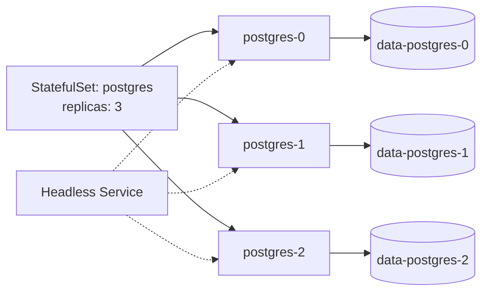
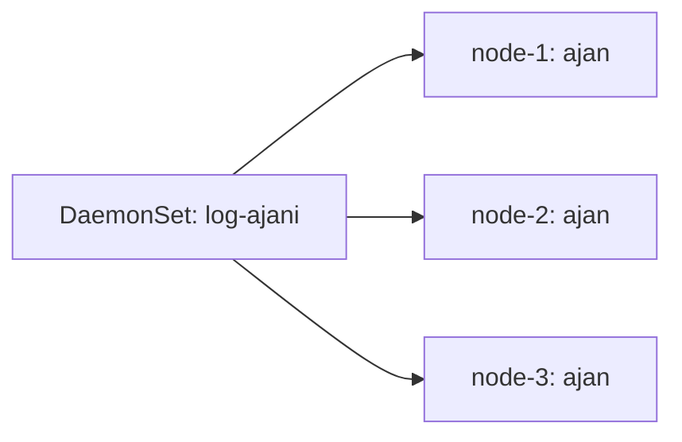

# 5.5 StatefulSet ve DaemonSet

## Nedir?
- **StatefulSet:** Her kopyanın **kalıcı bir kimliği** (sabit isim, sabit disk) olması gereken uygulamalar için Deployment'ın kardeşidir.
- **DaemonSet:** Cluster'daki **her node'da** (veya seçili node'larda) tam olarak bir pod çalıştırır.

## Hangi problemi çözer?
**StatefulSet:** Deployment'taki pod'lar birbirinin aynısıdır ve rastgele isim alır (`api-7f9c-xk2p`). Bir veritabanı cluster'ında ise:
- Her üyenin sabit adı olmalı (`postgres-0` primary, `postgres-1` replica),
- Her üye kendi diskini korumalı; pod yeniden başlasa da aynı diske bağlanmalı,
- Başlama ve kapanma sırası önemli olabilir.

**DaemonSet:** Log toplama, izleme ajanı, ağ eklentisi gibi işler her node'da bir kez çalışmalıdır. Yeni node eklenince ajan otomatik olarak oraya da kurulmalıdır.

## Nasıl çalışır?

**StatefulSet**

- Pod'lar sıralı numara alır: `ad-0`, `ad-1`, `ad-2`. Sırayla oluşturulur, ters sırayla silinir.
- `volumeClaimTemplates` ile her pod'a kendine ait PVC verilir ([5.10](10-persistent-volume.md)).
- **Headless Service** (`clusterIP: None`) ile her pod'un sabit DNS adı olur: `postgres-0.postgres.veri.svc.cluster.local`.

**DaemonSet**


## Mini örnek

**StatefulSet**
```yaml
apiVersion: apps/v1
kind: StatefulSet
metadata:
  name: postgres
spec:
  serviceName: postgres
  replicas: 1
  selector:
    matchLabels: { app: postgres }
  template:
    metadata:
      labels: { app: postgres }
    spec:
      containers:
        - name: postgres
          image: postgres:16
          env:
            - name: POSTGRES_PASSWORD
              valueFrom:
                secretKeyRef: { name: pg-secret, key: password }
          volumeMounts:
            - name: data
              mountPath: /var/lib/postgresql/data
  volumeClaimTemplates:
    - metadata:
        name: data
      spec:
        accessModes: ["ReadWriteOnce"]
        resources:
          requests:
            storage: 20Gi
```

**DaemonSet**
```yaml
apiVersion: apps/v1
kind: DaemonSet
metadata:
  name: log-ajani
spec:
  selector:
    matchLabels: { app: log-ajani }
  template:
    metadata:
      labels: { app: log-ajani }
    spec:
      containers:
        - name: fluent-bit
          image: fluent/fluent-bit:3.0
          volumeMounts:
            - { name: varlog, mountPath: /var/log }
      volumes:
        - name: varlog
          hostPath: { path: /var/log }
```

```bash
kubectl get statefulsets
kubectl get daemonsets -A
kubectl get pvc                    # StatefulSet'in oluşturduğu diskler
```

## Nerede kullanılır?
| StatefulSet | DaemonSet |
|---|---|
| PostgreSQL, MongoDB, Redis | Log toplayıcılar (Fluent Bit, Fluentd) |
| Kafka, ZooKeeper | İzleme ajanları (Prometheus node-exporter) |
| Elasticsearch / OpenSearch | Ağ eklentileri (CNI), güvenlik ajanları |

## Benzerleri ve farkları
- **Deployment + PVC:** Tek kopyalı basit bir veritabanı için de çalışabilir, ama birden fazla kopya ve sabit kimlik gerekirse StatefulSet şarttır.
- **Operator'lar:** Veritabanını Kubernetes'te çalıştırmak yedekleme, failover, sürüm yükseltme gibi işler ister. Bunları otomatikleştiren **Operator**'lar (ör. CloudNativePG, Crunchy Postgres, Strimzi Kafka) StatefulSet'i arka planda kendileri yönetir. OpenShift'te OperatorHub ile kurulur.
- **Yönetilen veritabanı:** Çoğu kurum canlı veritabanlarını Kubernetes dışında (ayrı sunucu veya bulut hizmeti) tutmayı tercih eder.

## İlgili sayfalar
- [5.4 Deployment](04-deployment.md)
- [5.10 PersistentVolume](10-persistent-volume.md)
