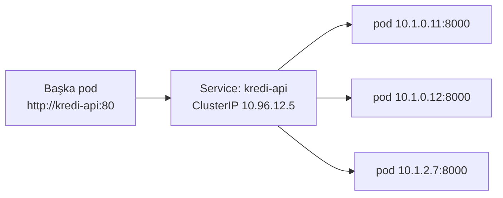
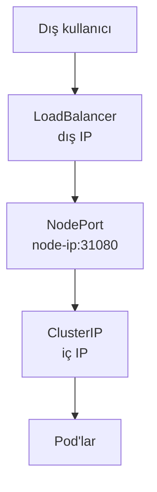

# 5.7 Service Türleri: ClusterIP, NodePort, LoadBalancer

## Nedir?
**Service**, bir grup pod'a **sabit bir adres ve isim** veren, trafiği bu pod'lar arasında dağıtan Kubernetes nesnesidir.

## Hangi problemi çözer?
Pod'lar geçicidir: yeniden başlayınca IP adresleri değişir, sayıları artıp azalır. Uygulamanın "veritabanına hangi IP'den bağlanayım?" sorusuna sabit bir cevap gerekir. Service bu sabit kapıdır.

## Nasıl çalışır?
- Service, **label selector** ile hangi pod'lara trafik göndereceğini bulur (`app: kredi-api`).
- Hazır (ready) olan pod'ların IP'leri **Endpoints** listesine eklenir.
- Her Service cluster içi bir DNS adı alır: `servis-adi.namespace.svc.cluster.local` (aynı namespace'ten sadece `servis-adi` yeterli).
- kube-proxy gelen trafiği bu pod'lara dağıtır.



**Service türleri**

| Tür | Erişim | Ne zaman? |
|---|---|---|
| **ClusterIP** (varsayılan) | Sadece cluster içinden | Servisler arası iletişim (API → veritabanı) |
| **NodePort** | Her node'un IP'si + 30000–32767 arası port | Test, basit dış erişim |
| **LoadBalancer** | Bulut/altyapı tarafından verilen dış IP | Bulutta dışa açık servisler |
| **ExternalName** | Dış bir DNS adına takma ad | Cluster dışındaki veritabanına isimle erişim |
| **Headless** (`clusterIP: None`) | IP yok, DNS doğrudan pod'ları döner | StatefulSet ([5.5](05-statefulset-daemonset.md)) |


Her tür bir öncekinin üzerine kurulur: LoadBalancer bir NodePort, NodePort bir ClusterIP içerir.

**Port kavramları**
- `port`: Service'in dinlediği port (istemcinin kullandığı).
- `targetPort`: Pod'daki container'ın dinlediği port.
- `nodePort`: (NodePort/LoadBalancer'da) node üzerindeki port.

## Mini örnek
```yaml
apiVersion: v1
kind: Service
metadata:
  name: kredi-api
  namespace: veri-prod
spec:
  type: ClusterIP
  selector:
    app: kredi-api
  ports:
    - name: http
      port: 80
      targetPort: 8000
```

```bash
kubectl apply -f service.yaml
kubectl get svc
kubectl get endpoints kredi-api          # hangi pod'lara gidiyor? Boşsa selector yanlış
kubectl describe svc kredi-api

# Yerel bilgisayardan geçici erişim (hata ayıklama)
kubectl port-forward svc/kredi-api 8080:80
curl http://localhost:8080/health

# Cluster içinden test
kubectl run test --rm -it --image=curlimages/curl -- curl http://kredi-api/health
```

## Nerede kullanılır?
- Uygulamanın veritabanına, cache'e veya başka bir API'ye erişmesi (ClusterIP)
- Dış kullanıcıya açılacak HTTP servisleri için ClusterIP + **Ingress** veya OpenShift **Route** ([5.8](08-ingress.md))

## Benzerleri ve farkları
- **Docker network'ünde servis adı** ([4.6](../04-docker/06-network.md)) ile aynı fikir; Kubernetes'te ek olarak yük dağıtımı ve sağlık kontrolü vardır.
- **Service ile Ingress:** Service L4 (TCP/UDP) seviyesinde çalışır. Ingress L7 (HTTP) seviyesinde alan adı ve yol bazlı yönlendirme yapar; birçok servisi tek dış adresten açar.
- **On-prem'de LoadBalancer:** Kurum içi cluster'larda dış IP verecek bir bulut yoktur; MetalLB gibi araçlar veya F5 gibi donanım yük dengeleyiciler kullanılır.

**Sık hata:** `kubectl get endpoints` boş geliyor → Service'in `selector`'ı pod label'larıyla eşleşmiyor veya pod'lar `Ready` değil.

## İlgili sayfalar
- [5.8 Ingress](08-ingress.md)
- [5.11 Readiness probe](11-probe-resources.md)
