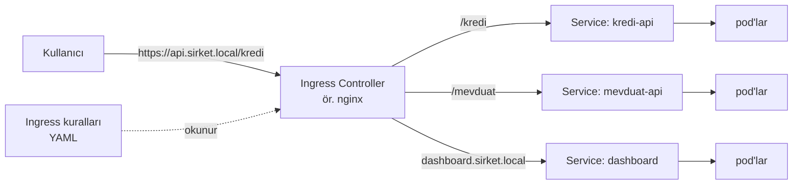

# 5.8 Ingress

## Nedir?
**Ingress**, cluster dışından gelen **HTTP/HTTPS** trafiğini alan adına ve URL yoluna göre doğru Service'e yönlendiren kurallar bütünüdür.

Ingress kendi başına bir şey yapmaz; kuralları uygulayan bir **Ingress Controller** gerekir (ör. ingress-nginx, Traefik, HAProxy). OpenShift'te aynı işi **Route** ve OpenShift Router yapar ([5.17](17-openshift-kavramlari.md)).

## Hangi problemi çözer?
- Her servis için ayrı LoadBalancer ve dış IP açmak pahalı ve yönetilmesi zordur.
- Ingress ile **tek giriş noktasından** birçok servis yayınlanır:
  - `dashboard.sirket.local` → dashboard servisi
  - `api.sirket.local/kredi` → kredi API'si
  - `api.sirket.local/mevduat` → mevduat API'si
- HTTPS sertifikası (TLS) tek yerde yönetilir.

## Nasıl çalışır?



1. Ingress Controller, cluster'a dışarıdan erişilebilen bir pod olarak çalışır (genellikle LoadBalancer veya NodePort Service'i arkasında).
2. Ingress nesnelerini izler ve kendi konfigürasyonunu (ör. nginx.conf) otomatik günceller.
3. Gelen isteğin `Host` başlığına ve yoluna bakarak doğru Service'e iletir.

## Mini örnek
```yaml
apiVersion: networking.k8s.io/v1
kind: Ingress
metadata:
  name: veri-ingress
  namespace: veri-prod
  annotations:
    nginx.ingress.kubernetes.io/proxy-body-size: "20m"
spec:
  ingressClassName: nginx
  tls:
    - hosts: [api.sirket.local]
      secretName: api-tls-cert
  rules:
    - host: api.sirket.local
      http:
        paths:
          - path: /kredi
            pathType: Prefix
            backend:
              service:
                name: kredi-api
                port: { number: 80 }
          - path: /mevduat
            pathType: Prefix
            backend:
              service:
                name: mevduat-api
                port: { number: 80 }
    - host: dashboard.sirket.local
      http:
        paths:
          - path: /
            pathType: Prefix
            backend:
              service:
                name: dashboard
                port: { number: 80 }
```

```bash
kubectl apply -f ingress.yaml
kubectl get ingress
kubectl describe ingress veri-ingress
kubectl get ingressclass                  # hangi controller'lar var?
curl -H "Host: api.sirket.local" http://<ingress-ip>/kredi/health
```

## Nerede kullanılır?
- Web uygulamaları, dashboard'lar ve API'lerin dışarıya (kurum ağına) açılması
- TLS sonlandırma, yönlendirme, basit kimlik doğrulama, istek boyutu sınırları

## Benzerleri ve farkları
| | Ingress | OpenShift Route | Gateway API |
|---|---|---|---|
| Platform | Standart Kubernetes | OpenShift | Yeni Kubernetes standardı |
| Controller | Ayrıca kurulur | Router hazır gelir | Ayrıca kurulur |
| Yetenek | HTTP host/yol | HTTP host/yol, TLS modları | HTTP, TCP, gRPC, rol ayrımı |

- **Gateway API:** Ingress'in halefi olarak geliştirilen, daha esnek ve rol bazlı (altyapı ekibi / uygulama ekibi) yeni standart. Yeni kurulumlarda giderek yaygınlaşıyor.
- **OpenShift'te Ingress:** OpenShift standart Ingress nesnelerini de kabul eder ve arka planda Route'a çevirir.
- **nginx ile ilişkisi:** ingress-nginx controller'ı, arka planda bir nginx'tir; Bölüm 8'deki reverse proxy kavramlarının Kubernetes'e uyarlanmış hâlidir ([8.9](../08-nginx/09-ingress-controller.md)).

## İlgili sayfalar
- [5.7 Service](07-service.md)
- [8.4 Reverse proxy](../08-nginx/04-reverse-proxy.md)
- [8.6 HTTPS ve TLS](../08-nginx/06-https-tls.md)
