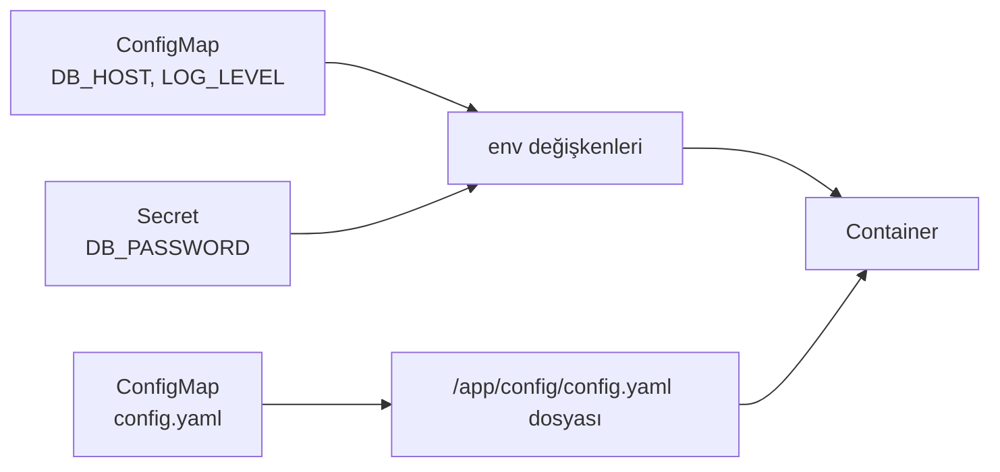

# 5.9 ConfigMap ve Secret

## Nedir?
- **ConfigMap:** Uygulamanın **gizli olmayan** ayarlarını (veritabanı adresi, log seviyesi, özellik anahtarları) tutan nesne.
- **Secret:** **Hassas** bilgileri (şifre, API anahtarı, sertifika) tutan nesne.

İkisi de ayarı image'dan ayırır; aynı image farklı ortamlarda farklı ayarlarla çalışır.

## Hangi problemi çözer?
- Ayarları image'a gömmek, her ortam (dev/test/prod) için ayrı image build etmeyi gerektirir.
- Şifreleri koda veya image'a yazmak güvenlik açığıdır.
- [1.5 Environment variable](../01-linux/05-environment.md) prensibinin Kubernetes karşılığıdır.

## Nasıl çalışır?
Container'a iki şekilde aktarılırlar:
1. **Ortam değişkeni olarak** (`env`, `envFrom`)
2. **Dosya olarak** (volume mount): Her anahtar bir dosya olur.



**Secret hakkında önemli gerçek:** Secret'lar varsayılan olarak sadece **base64 ile kodlanır**, şifrelenmez. base64 bir şifreleme değildir; herkes çözebilir. Güvenlik şunlarla sağlanır:
- RBAC ile Secret okuma yetkisini kısıtlamak ([5.13](13-rbac.md)),
- etcd'de şifreleme (encryption at rest) açmak,
- Secret'ları Git'e düz hâlde koymamak; **Sealed Secrets**, **External Secrets Operator** veya **HashiCorp Vault** gibi araçlar kullanmak.

## Mini örnek

**ConfigMap**
```yaml
apiVersion: v1
kind: ConfigMap
metadata:
  name: etl-config
data:
  DB_HOST: "postgres.veri-prod.svc.cluster.local"
  DB_NAME: "bddk"
  LOG_LEVEL: "INFO"
  config.yaml: |
    kaynaklar:
      - kredi
      - mevduat
    tekrar_deneme: 3
```

**Secret**
```yaml
apiVersion: v1
kind: Secret
metadata:
  name: etl-db-secret
type: Opaque
stringData:                  # düz metin yazılır, Kubernetes base64'e çevirir
  DB_USER: "etl"
  DB_PASSWORD: "gizli"
```

**Pod'da kullanmak**
```yaml
spec:
  containers:
    - name: etl
      image: registry.sirket.local/veri/bddk-etl:2.1.0
      envFrom:
        - configMapRef: { name: etl-config }      # tüm anahtarlar env olur
        - secretRef:    { name: etl-db-secret }
      env:
        - name: OZEL_SIFRE                        # tek anahtar
          valueFrom:
            secretKeyRef: { name: etl-db-secret, key: DB_PASSWORD }
      volumeMounts:
        - name: ayar
          mountPath: /app/config
  volumes:
    - name: ayar
      configMap:
        name: etl-config
        items:
          - { key: config.yaml, path: config.yaml }
```

**Komutlar**
```bash
kubectl create configmap etl-config --from-literal=LOG_LEVEL=INFO --from-file=config.yaml
kubectl create secret generic etl-db-secret --from-literal=DB_PASSWORD='gizli'
kubectl get configmaps,secrets
kubectl get secret etl-db-secret -o jsonpath='{.data.DB_PASSWORD}' | base64 -d   # okuma (yetki varsa)
```

## Nerede kullanılır?
- Veritabanı bağlantı bilgileri, API anahtarları
- Ortama göre değişen ayarlar (dev'de DEBUG, prod'da INFO)
- TLS sertifikaları (`kubernetes.io/tls` türünde Secret)
- Private registry'den image çekmek için kimlik bilgileri (`docker-registry` türünde Secret)

## Benzerleri ve farkları
| | ConfigMap | Secret |
|---|---|---|
| İçerik | Gizli olmayan ayar | Hassas veri |
| Saklama | Düz metin | base64 (+ isteğe bağlı şifreleme) |
| Boyut sınırı | 1 MiB | 1 MiB |
| Git'e konabilir mi? | Evet | Düz hâlde hayır |

- **Değişiklik etkisi:** Ortam değişkeni olarak verilen değerler, pod yeniden başlatılmadan güncellenmez (`kubectl rollout restart`). Dosya olarak bağlananlar bir süre sonra kendiliğinden güncellenir.
- **Vault ve harici secret yöneticileri:** Kurumsal ortamlarda şifrelerin tek doğru kaynağıdır; Kubernetes Secret'ları oradan otomatik senkronize edilir (Bölüm 15).

## İlgili sayfalar
- [1.5 Environment variable'lar](../01-linux/05-environment.md)
- [5.13 RBAC](13-rbac.md)
