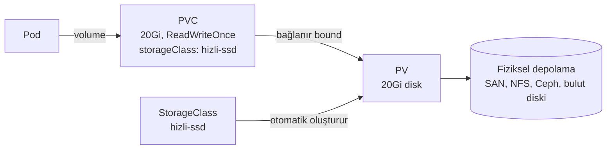

# 5.10 PersistentVolume, PVC ve StorageClass

## Nedir?
Kubernetes'te kalıcı depolama üç kavramla yönetilir:
- **PersistentVolume (PV):** Cluster'daki gerçek bir depolama parçası (bir NFS paylaşımı, bir SAN diski, bir bulut diski).
- **PersistentVolumeClaim (PVC):** Uygulamanın "bana şu büyüklükte, şu türde disk lazım" **talebi**.
- **StorageClass:** Diskin **türünü** ve nasıl otomatik oluşturulacağını tanımlayan şablon (hızlı SSD, ucuz HDD, paylaşımlı dosya sistemi).

## Hangi problemi çözer?
- Pod'lar geçicidir; içlerine yazılan veri pod silinince kaybolur ([4.5](../04-docker/05-volume.md) ile aynı sorun).
- Pod başka node'a taşınsa bile verisine ulaşabilmelidir.
- Geliştirici altyapının detayını (hangi depolama ürünü, hangi IP) bilmeden disk isteyebilmelidir; altyapı ekibi ise ne tür disklerin sunulacağını yönetebilmelidir.

## Nasıl çalışır?



**Dinamik provisioning:** PVC oluşturulunca StorageClass'taki sürücü (CSI driver) diski otomatik oluşturur ve PV'yi yaratır. Günümüzde en yaygın yöntem budur. (Statik yöntemde yönetici PV'leri önceden elle oluşturur.)

**Erişim modları (access modes)**

| Mod | Kısaltma | Anlamı | Örnek |
|---|---|---|---|
| ReadWriteOnce | RWO | Tek node okuyup yazabilir | Veritabanı diski (blok depolama) |
| ReadOnlyMany | ROX | Birçok node sadece okur | Paylaşılan referans verisi |
| ReadWriteMany | RWX | Birçok node okuyup yazar | Paylaşılan dosya klasörü (NFS, CephFS) |
| ReadWriteOncePod | RWOP | Tek pod okuyup yazar | Sıkı tekil erişim |

**Reclaim policy:** PVC silinince disk ne olsun?
- `Delete`: Disk de silinir (dinamik diskte varsayılan).
- `Retain`: Disk kalır, elle temizlenir (önemli veriler için).

## Mini örnek
```yaml
apiVersion: v1
kind: PersistentVolumeClaim
metadata:
  name: jupyter-data
  namespace: veri-dev
spec:
  accessModes: ["ReadWriteOnce"]
  storageClassName: hizli-ssd
  resources:
    requests:
      storage: 50Gi
---
apiVersion: apps/v1
kind: Deployment
metadata:
  name: jupyter
spec:
  replicas: 1
  selector: { matchLabels: { app: jupyter } }
  template:
    metadata: { labels: { app: jupyter } }
    spec:
      containers:
        - name: jupyter
          image: quay.io/jupyter/scipy-notebook:latest
          volumeMounts:
            - name: data
              mountPath: /home/jovyan/work
      volumes:
        - name: data
          persistentVolumeClaim:
            claimName: jupyter-data
```

```bash
kubectl get storageclass                 # hangi disk türleri var? (default işaretli olan)
kubectl apply -f pvc.yaml
kubectl get pvc                          # STATUS: Bound olmalı
kubectl get pv
kubectl describe pvc jupyter-data        # Pending ise nedeni burada
```

## Nerede kullanılır?
- StatefulSet'lerdeki veritabanları ([5.5](05-statefulset-daemonset.md))
- Jupyter / VS Code server gibi kişisel çalışma alanları
- Birden çok pod'un ortak dosya okuduğu durumlar (RWX)

## Benzerleri ve farkları
- **Docker volume:** Tek makinede; PV/PVC ise cluster genelinde ve altyapıdan bağımsız soyutlama.
- **emptyDir:** Pod yaşadığı sürece duran geçici alan; pod silinince gider. Ara dosyalar için.
- **hostPath:** Node'un diskini bağlar; pod başka node'a giderse veri gelmez. Canlı ortamda kaçınılır (DaemonSet'ler istisna).
- **Nesne depolama (S3/MinIO):** Büyük veri setleri ve model dosyaları için PVC yerine çoğu zaman daha uygundur; uygulama doğrudan API ile okur/yazar.

**Sık hata:** PVC `Pending` kalıyor → StorageClass yok/yanlış, istenen erişim modu desteklenmiyor (ör. blok depolamada RWX) veya kota dolu.

## İlgili sayfalar
- [4.5 Docker volume](../04-docker/05-volume.md)
- [5.5 StatefulSet](05-statefulset-daemonset.md)
