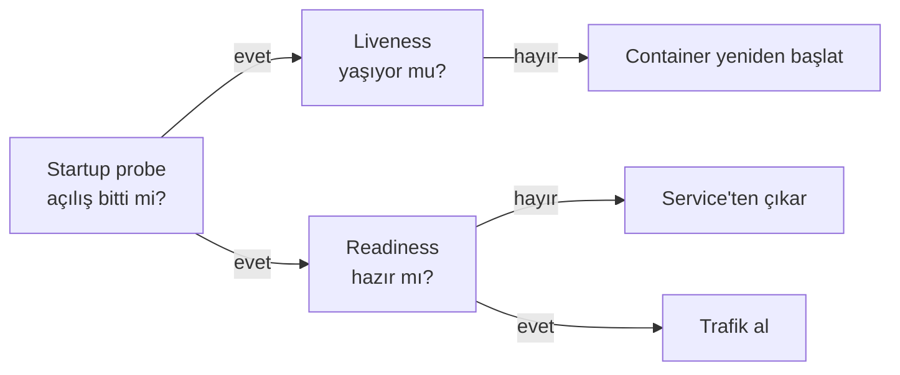

# 5.11 Liveness / Readiness Probe ve Resource Request / Limit

## Nedir?
- **Probe (sağlık kontrolü):** Kubernetes'in container'ın sağlığını düzenli olarak yokladığı kontroller.
  - **Liveness probe:** "Yaşıyor musun?" Başarısız olursa container **yeniden başlatılır**.
  - **Readiness probe:** "Trafik almaya hazır mısın?" Başarısız olursa pod Service'ten **çıkarılır** ama öldürülmez.
  - **Startup probe:** "Açılışın bitti mi?" Yavaş açılan uygulamalarda diğer probe'ları açılış bitene kadar bekletir.
- **Resource request / limit:** Container'ın ne kadar CPU ve bellek **ayırttığı** (request) ve en fazla ne kadar **kullanabileceği** (limit).

## Hangi problemi çözer?
**Probe'lar olmadan:**
- Süreç çalışıyor ama kilitlenmiş (deadlock) bir uygulama "Running" görünür ve trafik almaya devam eder.
- Yeni açılan, henüz modelini belleğe yüklememiş pod'a istek gider ve hata döner.

**Kaynak tanımı olmadan:**
- Bir pod tüm node belleğini yiyip diğerlerini çökertebilir.
- Scheduler pod'u kapasitesi dolu bir node'a yerleştirebilir.

## Nasıl çalışır?

**Probe türleri**

| Yöntem | Nasıl? | Örnek |
|---|---|---|
| `httpGet` | HTTP isteği; 200–399 başarılı | `/health` |
| `tcpSocket` | Porta bağlanılabiliyor mu? | Veritabanı portu |
| `exec` | Container içinde komut; çıkış kodu 0 başarılı | `pg_isready` |
| `grpc` | gRPC sağlık kontrolü | gRPC servisleri |



**Kaynaklar**

| | Request | Limit |
|---|---|---|
| Anlamı | Garanti edilen, ayrılan miktar | Aşılamayan üst sınır |
| Kim kullanır? | Scheduler (yerleştirme kararı) | Kernel (cgroups) |
| CPU aşımında | — | Yavaşlatılır (throttle) |
| Bellek aşımında | — | Container öldürülür: **OOMKilled** |

Birimler: CPU `1` = 1 çekirdek, `250m` = çeyrek çekirdek. Bellek `Mi`, `Gi` (512Mi, 2Gi).

**QoS sınıfları:** Request = limit ise `Guaranteed`; sadece request varsa `Burstable`; hiçbiri yoksa `BestEffort`. Node'da bellek sıkışınca önce BestEffort pod'lar çıkarılır.

## Mini örnek
```yaml
containers:
  - name: model-api
    image: registry.sirket.local/veri/skor-api:3.0.0
    ports: [{ containerPort: 8000 }]
    resources:
      requests:
        cpu: "500m"
        memory: "1Gi"
      limits:
        memory: "2Gi"            # CPU limiti çoğu zaman verilmez (throttle önlemek için)
    startupProbe:
      httpGet: { path: /health, port: 8000 }
      failureThreshold: 30       # 30 x 10 sn = 5 dk açılış süresi
      periodSeconds: 10
    livenessProbe:
      httpGet: { path: /health, port: 8000 }
      periodSeconds: 15
      failureThreshold: 3
    readinessProbe:
      httpGet: { path: /ready, port: 8000 }   # model yüklendi mi, DB bağlı mı?
      periodSeconds: 5
```

```bash
kubectl describe pod skor-api-xyz     # "Liveness probe failed", "OOMKilled" olayları
kubectl top pods                      # gerçek kullanım (metrics-server gerekir)
kubectl get pod skor-api-xyz -o jsonpath='{.status.containerStatuses[0].lastState}'
```

## Nerede kullanılır?
- Her canlı ortam Deployment'ında probe ve kaynak tanımı olmalıdır.
- ML model servislerinde: Readiness, model belleğe yüklenene kadar trafiği engeller.
- Kaynak kotası olan namespace'lerde request/limit tanımı zorunludur (OpenShift'te sık karşılaşılır).

## Benzerleri ve farkları
- **Docker `HEALTHCHECK`:** Benzer fikir ama sadece durumu raporlar; Kubernetes probe'ları aksiyon alır.
- **Liveness ile readiness'i karıştırmak:** Liveness'a dış bağımlılık (veritabanı) kontrolü koymak tehlikelidir: Veritabanı yavaşlayınca tüm pod'lar yeniden başlar ve sorun büyür. Dış bağımlılıklar readiness'e konur.
- **LimitRange ve ResourceQuota:** Namespace bazında varsayılan ve toplam kaynak sınırları.

**Sık hatalar:**
- `OOMKilled` → bellek limiti düşük veya bellek sızıntısı var. Pandas ile büyük dosya okuyan ETL'lerde sık görülür.
- `CrashLoopBackOff` + "Liveness probe failed" → uygulama açılmadan liveness başlıyor; startup probe ekleyin.

## İlgili sayfalar
- [5.12 HPA](12-hpa.md)
- [5.4 Deployment](04-deployment.md)
