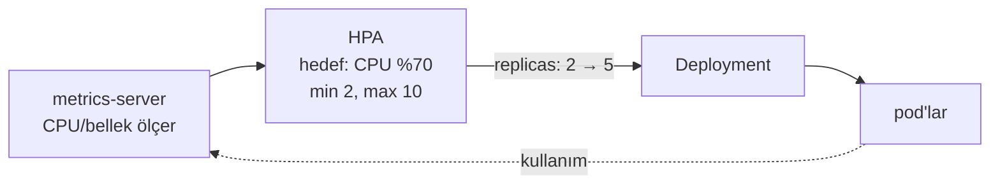

# 5.12 HPA: Otomatik Ölçekleme

## Nedir?
**HorizontalPodAutoscaler (HPA)**, bir Deployment'ın (veya StatefulSet'in) pod sayısını, ölçülen yüke göre **otomatik olarak artırıp azaltan** nesnedir.

"Horizontal" (yatay) ölçekleme: Daha büyük makine değil, **daha çok kopya**.

## Hangi problemi çözer?
- Ay sonu raporlama dönemi gibi yoğun anlarda dashboard veya API yavaşlamasın.
- Gece boşta duran kopyalar kaynak harcamasın.
- Kopya sayısını sürekli elle ayarlamak gerekmesin.

## Nasıl çalışır?



1. **metrics-server** pod'ların CPU ve bellek kullanımını toplar.
2. HPA her ~15 saniyede ölçümü hedefle karşılaştırır.
3. Basitleştirilmiş formül:
   `istenen kopya = mevcut kopya × (mevcut kullanım / hedef kullanım)`
   Örnek: 3 pod, ortalama CPU %140, hedef %70 → 3 × 140/70 = **6 pod**.
4. Ani dalgalanmalara karşı küçülme daha temkinli yapılır (varsayılan olarak 5 dakikalık stabilizasyon penceresi).

**Önemli:** Kullanım oranı, **request**'e göre hesaplanır ([5.11](11-probe-resources.md)). Request tanımlı değilse HPA CPU yüzdesine göre çalışamaz.

## Mini örnek
```yaml
apiVersion: autoscaling/v2
kind: HorizontalPodAutoscaler
metadata:
  name: kredi-api
spec:
  scaleTargetRef:
    apiVersion: apps/v1
    kind: Deployment
    name: kredi-api
  minReplicas: 2
  maxReplicas: 10
  metrics:
    - type: Resource
      resource:
        name: cpu
        target:
          type: Utilization
          averageUtilization: 70
  behavior:
    scaleDown:
      stabilizationWindowSeconds: 300
```

```bash
kubectl apply -f hpa.yaml
kubectl autoscale deployment kredi-api --cpu-percent=70 --min=2 --max=10   # kısa yol
kubectl get hpa                        # TARGETS: 45%/70%, REPLICAS: 2
kubectl describe hpa kredi-api         # ölçekleme olayları
```

## Nerede kullanılır?
- Kullanıcı trafiği dalgalı olan API'ler ve dashboard'lar
- Gerçek zamanlı skorlama servisleri (ör. kredi başvurusu skorlama)
- Kuyruktan iş alan işçi (worker) servisleri (özel metriklerle)

## Benzerleri ve farkları
| Yaklaşım | Neyi ölçekler? |
|---|---|
| **HPA** | Pod sayısı (yatay) |
| **VPA** (VerticalPodAutoscaler) | Pod'un CPU/bellek request'leri (dikey) |
| **Cluster Autoscaler** | Node sayısı (pod'lar sığmayınca yeni node ekler; bulutta) |
| **KEDA** | Olay bazlı: kuyruk uzunluğu, Kafka lag, cron; sıfıra kadar küçültebilir |

- **Özel metrikler:** CPU her zaman en iyi gösterge değildir. Saniyedeki istek sayısı veya kuyruk uzunluğu gibi metrikler Prometheus Adapter veya KEDA ile kullanılabilir.
- **Durumlu uygulamalar:** Veritabanlarını HPA ile ölçeklemek genellikle uygun değildir.
- **Uygulamanın hazır olması:** Ölçeklenebilmesi için uygulamanın **durumsuz** olması (oturum bilgisini pod'da tutmaması) gerekir. Streamlit gibi oturumlu uygulamalarda "sticky session" ayarı gerekebilir.

## İlgili sayfalar
- [5.11 Probe ve kaynaklar](11-probe-resources.md)
- [5.4 Deployment](04-deployment.md)
