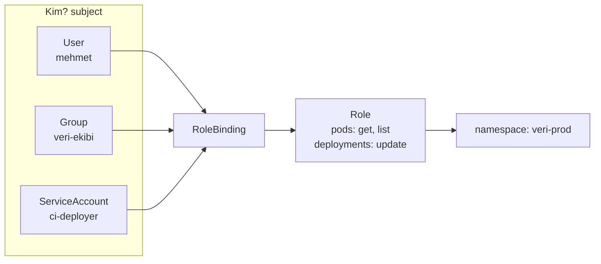

# 5.13 RBAC: Yetkilendirme

## Nedir?
**RBAC (Role-Based Access Control — rol bazlı erişim kontrolü)**, Kubernetes'te **kimin, hangi kaynak üzerinde, hangi işlemi** yapabileceğini belirleyen yetkilendirme sistemidir.

## Hangi problemi çözer?
- Geliştirici sadece kendi ekibinin namespace'inde pod görebilsin, prod'da değişiklik yapamasın.
- CI/CD pipeline'ı deploy yapabilsin ama Secret okuyamasın.
- Bir uygulama pod'u Kubernetes API'sine sadece gerektiği kadar erişebilsin.
- **En az yetki prensibi (least privilege)**: Herkes işini yapmaya yetecek kadar yetkiye sahip olsun, fazlasına değil.

## Nasıl çalışır?

Dört nesne vardır:

| Nesne | Kapsam | Görevi |
|---|---|---|
| **Role** | Tek namespace | İzin listesi: "pod'ları okuyabilir" |
| **ClusterRole** | Tüm cluster | Cluster genelinde izin listesi veya tekrar kullanılabilir şablon |
| **RoleBinding** | Tek namespace | Bir Role'ü (veya ClusterRole'ü) kişiye/gruba/servis hesabına bağlar |
| **ClusterRoleBinding** | Tüm cluster | ClusterRole'ü cluster genelinde bağlar |



**İzin = kaynak (resource) + fiil (verb)**
- Kaynaklar: `pods`, `deployments`, `services`, `secrets`, `configmaps`...
- Fiiller: `get`, `list`, `watch`, `create`, `update`, `patch`, `delete`

**Hazır ClusterRole'ler:** `view` (okuma), `edit` (Secret ve RBAC hariç düzenleme), `admin` (namespace yöneticisi), `cluster-admin` (her şey).

**Kim?**
- **User / Group:** İnsanlar. Kubernetes kullanıcı veritabanı tutmaz; kimlik dışarıdan gelir (LDAP / Active Directory, OIDC). OpenShift'te LDAP grupları senkronize edilerek doğrudan RBAC'ta kullanılır (Bölüm 15).
- **ServiceAccount:** Pod'ların ve otomasyonların (CI/CD) kimliği.

## Mini örnek
```yaml
apiVersion: rbac.authorization.k8s.io/v1
kind: Role
metadata:
  name: deploy-yapabilir
  namespace: veri-prod
rules:
  - apiGroups: ["apps"]
    resources: ["deployments"]
    verbs: ["get", "list", "update", "patch"]
  - apiGroups: [""]
    resources: ["pods", "pods/log"]
    verbs: ["get", "list"]
---
apiVersion: rbac.authorization.k8s.io/v1
kind: RoleBinding
metadata:
  name: ci-deploy
  namespace: veri-prod
subjects:
  - kind: ServiceAccount
    name: ci-deployer
    namespace: veri-prod
roleRef:
  kind: Role
  name: deploy-yapabilir
  apiGroup: rbac.authorization.k8s.io
```

```bash
# Ekibe namespace'te okuma yetkisi (hazır 'view' rolüyle)
kubectl create rolebinding veri-ekibi-view --clusterrole=view --group=veri-ekibi -n veri-prod

# Yetki kontrolü
kubectl auth can-i delete pods -n veri-prod
kubectl auth can-i get secrets -n veri-prod --as=system:serviceaccount:veri-prod:ci-deployer
kubectl get rolebindings -n veri-prod
```

## Nerede kullanılır?
- Ekip ve ortam bazında erişim (dev'de `edit`, prod'da `view`)
- CI/CD servis hesaplarının sınırlandırılması
- Denetim gereksinimleri: kimin neye erişebildiğinin belgelenmesi

## Benzerleri ve farkları
- **Kimlik doğrulama (authentication) ile yetkilendirme (authorization):** "Sen kimsin?" (LDAP, OIDC, sertifika) ile "Ne yapabilirsin?" (RBAC) ayrı sorulardır (Bölüm 15).
- **OpenShift:** Aynı RBAC; ek olarak Project bazında hazır roller ve LDAP grup senkronizasyonu kolaylıkları vardır. `oc adm policy add-role-to-user edit mehmet -n veri-dev`.
- **SecurityContextConstraints (SCC):** OpenShift'te pod'un **nasıl** çalışabileceğini (root olabilir mi, hangi kullanıcı ID'si) kısıtlar; RBAC'tan farklı bir katmandır ([5.17](17-openshift-kavramlari.md)).

## İlgili sayfalar
- [5.9 ConfigMap ve Secret](09-configmap-secret.md)
- [5.17 OpenShift kavramları](17-openshift-kavramlari.md)
