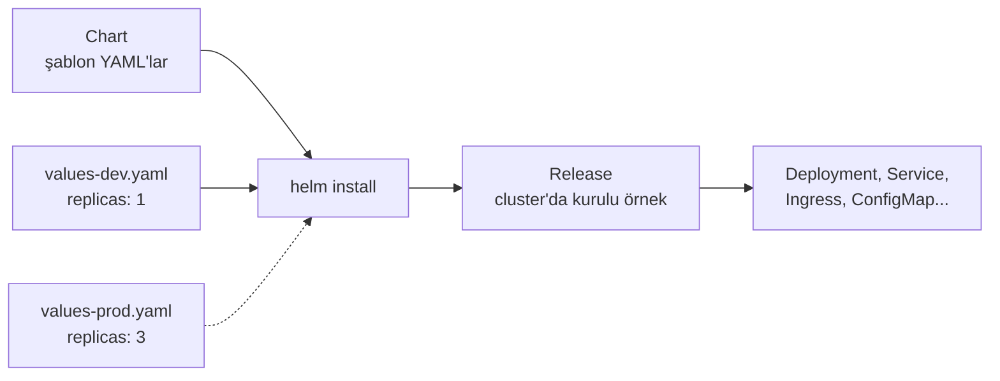

# 5.15 Helm

## Nedir?
**Helm**, Kubernetes'in **paket yöneticisidir**. Bir uygulamanın çalışması için gereken tüm YAML dosyalarını (Deployment, Service, Ingress, ConfigMap...) şablon hâline getirip **chart** adı verilen bir paket olarak sunar.

Linux'ta `apt` neyse, Kubernetes'te Helm odur.

## Hangi problemi çözer?
- Bir uygulama 5–15 YAML dosyasından oluşur; her ortam (dev/test/prod) için kopyalayıp küçük farkları elle değiştirmek hataya açıktır.
- PostgreSQL, Grafana, Airflow gibi hazır araçları Kubernetes'e kurmak için yüzlerce satır YAML yazmak gerekir.
- Kurulumların sürümlenmesi, güncellenmesi ve geri alınması zordur.

## Nasıl çalışır?



| Kavram | Anlamı |
|---|---|
| **Chart** | Paket: şablonlar + varsayılan değerler |
| **Values** | Şablonlara verilen değişkenler (`values.yaml`) |
| **Release** | Bir chart'ın cluster'a kurulmuş, isimli örneği |
| **Repository** | Chart'ların yayınlandığı depo (OCI registry'ler de kullanılabilir) |
| **Revision** | Release'in her güncellemesi; geri alınabilir |

Chart yapısı:
```
kredi-api/
├── Chart.yaml          # ad, sürüm
├── values.yaml         # varsayılan değerler
└── templates/
    ├── deployment.yaml
    ├── service.yaml
    └── ingress.yaml
```

Şablon örneği (`templates/deployment.yaml`):
```yaml
apiVersion: apps/v1
kind: Deployment
metadata:
  name: {{ .Release.Name }}
spec:
  replicas: {{ .Values.replicaCount }}
  template:
    spec:
      containers:
        - name: api
          image: "{{ .Values.image.repository }}:{{ .Values.image.tag }}"
```

## Mini örnek
**Hazır chart kurmak**
```bash
helm repo add bitnami https://charts.bitnami.com/bitnami
helm repo update
helm search repo postgresql
helm show values bitnami/postgresql > pg-values.yaml   # ayarlanabilir değerler
helm install veri-db bitnami/postgresql -n veri-dev -f pg-values.yaml
helm list -n veri-dev
```

**Kendi chart'ını yönetmek**
```bash
helm create kredi-api                                   # iskelet
helm template kredi-api ./kredi-api -f values-prod.yaml # üretilen YAML'ı gör
helm install kredi-api ./kredi-api -f values-dev.yaml -n veri-dev
helm upgrade kredi-api ./kredi-api --set image.tag=1.5.0 -n veri-dev
helm history kredi-api -n veri-dev
helm rollback kredi-api 2 -n veri-dev
helm uninstall kredi-api -n veri-dev
```

## Nerede kullanılır?
- Grafana, Prometheus, Airflow, PostgreSQL gibi araçların kurulumu
- Aynı uygulamanın farklı ortamlara farklı ayarlarla dağıtılması
- CD araçlarının (ArgoCD) deploy ettiği paket formatı ([6.5](../06-ci-cd/05-gitops-argocd.md))

## Benzerleri ve farkları
| Araç | Yaklaşım |
|---|---|
| **Helm** | Şablon + değişken; paket yönetimi ve sürüm geçmişi |
| **Kustomize** | Şablonsuz; temel YAML'ların üzerine ortam bazlı "yama" (overlay). `kubectl apply -k` ile kubectl'e dahildir |
| **Operator** | Uygulamayı yöneten özel kontrolcü; kurulumun ötesinde yedekleme, yükseltme gibi işleri de yapar |
| **OpenShift Template** | OpenShift'in eski şablon mekanizması; yeni projelerde Helm tercih edilir |

**Dikkat:** Dışarıdan alınan chart'ları kurmadan önce `helm template` ile ne kuracağını inceleyin; kurum içinde onaylı chart deposu kullanın.

## İlgili sayfalar
- [5.4 Deployment](04-deployment.md)
- [6.5 GitOps ve ArgoCD](../06-ci-cd/05-gitops-argocd.md)
