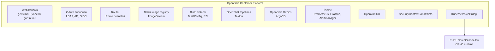

# 5.16 OpenShift: Kubernetes'ten Farkları

## Nedir?
**Red Hat OpenShift**, Kubernetes'in kurumsal bir dağıtımıdır. Çekirdeğinde standart Kubernetes vardır; üzerine güvenlik, geliştirici araçları, web konsolu, dahili registry, CI/CD ve izleme bileşenleri eklenmiş, test edilmiş ve ticari destekle sunulur.

Açık kaynak üst projesi **OKD**'dir.

## Hangi problemi çözer?
Saf Kubernetes bir "çekirdek"tir; canlı ortam için yanına onlarca bileşen seçmek, kurmak ve uyumlu tutmak gerekir (ingress, registry, izleme, log, kimlik doğrulama, güvenlik politikaları). Kurumlar, özellikle bankalar:
- **Tek muhatap** (vendor support) ister,
- **Sıkı güvenlik varsayılanları** ister,
- Kurum içi kimlik sistemleriyle (LDAP/AD) entegrasyon ister,
- Geliştiricilerin Kubernetes detayına boğulmadan uygulama yayınlayabilmesini ister.

## Nasıl çalışır?



**Temel farklar**

| Konu | Kubernetes | OpenShift |
|---|---|---|
| Kurulum ve destek | Topluluk veya bulut sağlayıcı | Red Hat desteği, kurumsal lisans |
| Dışa açma | Ingress + ayrıca kurulan controller | **Route** + hazır Router (Ingress de desteklenir) |
| Registry | Ayrıca kurulur | Dahili registry + **ImageStream** |
| Build | Cluster dışında (CI) | Cluster içinde **BuildConfig**, **S2I** |
| Güvenlik | Root container'lara izin verilebilir | **Varsayılan olarak root yasak**; rastgele kullanıcı ID'si (SCC) |
| Namespace | Namespace | **Project** (namespace + ek yetki ve şablonlar) |
| Kimlik | Harici olarak yapılandırılır | Dahili OAuth; LDAP/AD entegrasyonu hazır |
| Arayüz | İsteğe bağlı Dashboard | Zengin web konsolu |
| CLI | `kubectl` | `oc` (kubectl'in üst kümesi) |
| İşletim sistemi | Herhangi | RHEL CoreOS (otomatik güncellenen, değişmez) |
| CI/CD | Ayrıca kurulur | OpenShift Pipelines (Tekton), OpenShift GitOps (ArgoCD) |
| Ek yetenekler | Ayrıca | OperatorHub, Service Mesh, Serverless, OpenShift AI |

## Mini örnek
Koddan çalışan uygulamaya, Dockerfile bile yazmadan (S2I ile):
```bash
oc login https://api.ocp.sirket.local:6443 -u mehmet
oc new-project veri-dev
oc new-app python:3.11~https://git.sirket.local/veri/kredi-api.git --name=kredi-api
oc logs -f bc/kredi-api            # cluster içinde build'i izle
oc expose svc/kredi-api            # Route oluştur -> dış URL
oc get route kredi-api
```

Aynı iş, standart Kubernetes'te: image'ı CI'da build et, registry'ye push et, Deployment + Service + Ingress YAML'larını yaz, `kubectl apply`.

## Nerede kullanılır?
- Bankalar, telekom, kamu: kurum içi (on-prem) container platformu olarak
- Hibrit bulut: Aynı platform hem veri merkezinde hem AWS/Azure'da (ROSA, ARO)
- **OpenShift AI:** Jupyter, model eğitimi ve model servisini aynı platformda sunar (MLOps, Bölüm 13)

## Benzerleri ve farkları
- **Rancher (SUSE), VMware Tanzu:** Diğer kurumsal Kubernetes platformları.
- **Yönetilen Kubernetes (EKS, AKS, GKE):** Bulutta çalışır; OpenShift'in bulut versiyonları da vardır (ROSA, ARO).
- **Uyumluluk:** OpenShift sertifikalı bir Kubernetes'tir; standart Kubernetes YAML'ları çalışır. Ancak **root olarak çalışmayı bekleyen image'lar** OpenShift'te sorun çıkarır ([5.17 SCC](17-openshift-kavramlari.md)).

**Pratik ipucu:** Docker Hub'daki birçok image (ör. eski nginx) root ve sabit port 80 bekler; OpenShift'te `nginxinc/nginx-unprivileged` veya Red Hat UBI tabanlı image'lar kullanılır.

## İlgili sayfalar
- [5.17 OpenShift kavramları](17-openshift-kavramlari.md)
- [5.18 oc komutları](18-oc-komutlari.md)
