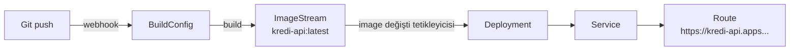

# 5.17 OpenShift Kavramları: Project, Route, BuildConfig, ImageStream, SCC

## Nedir?
OpenShift'in standart Kubernetes'e eklediği ve günlük işte en sık karşılaşılan beş kavram.

| Kavram | Kısaca | Kubernetes'teki en yakın karşılık |
|---|---|---|
| **Project** | Namespace + yetki ve şablonlar | Namespace |
| **Route** | Servisi dışarıya açan URL | Ingress |
| **BuildConfig** | Cluster içinde image üretme tarifi | CI'daki `docker build` |
| **ImageStream** | Image'lara işaret eden takip nesnesi | (doğrudan karşılığı yok) |
| **SCC** | Pod'un hangi güvenlik ayarlarıyla çalışabileceği | Pod Security Admission |

## Hangi problemi çözer?
Bu kavramları bilmek, OpenShift'te "neden root olarak çalışamıyorum?", "uygulamamın URL'si nerede?", "image neden otomatik güncellendi?" gibi soruların cevabıdır.

## Nasıl çalışır?

### Project
- Her Project arka planda bir namespace'tir; `oc new-project` ile oluşturulur.
- Oluşturulurken varsayılan RBAC rolleri, kotalar ve ağ politikaları otomatik eklenebilir (proje şablonu).
- Kullanıcılar genellikle sadece yetkili oldukları Project'leri görür.

### Route
- Bir Service'i dış bir alan adıyla yayınlar: `kredi-api-veri-dev.apps.ocp.sirket.local`
- OpenShift **Router** (HAProxy tabanlı) trafiği karşılar.
- TLS modları:

| Mod | Şifreleme nerede çözülür? |
|---|---|
| `edge` | Router'da; router→pod arası düz HTTP |
| `passthrough` | Pod'da; router şifreli trafiği dokunmadan iletir |
| `reencrypt` | Router'da çözülür, pod'a yeniden şifrelenerek gider |

### BuildConfig ve S2I
- **BuildConfig:** Kaynağın (Git reposu), stratejinin ve çıktının (ImageStream) tanımı.
- Stratejiler:
  - **Docker:** Repodaki Dockerfile ile build
  - **Source-to-Image (S2I):** Dockerfile olmadan; dil için hazır "builder image" kodu alıp çalışır image üretir
- Tetikleyiciler: Git webhook, temel image değişimi, elle.

### ImageStream
- Bir image'ın kendisi değil, ona **işaret eden etiketler** listesidir: `kredi-api:latest → sha256:abc...`
- İç veya dış registry'deki image'ları takip edebilir.
- **Tetikleyici:** ImageStream'e yeni image gelince ona bağlı Deployment otomatik güncellenebilir.



### SecurityContextConstraints (SCC)
- Pod'un **nasıl** çalışabileceğini sınırlar: root olabilir mi, hangi kullanıcı ID'si, host dizinlerine erişim, ayrıcalıklı mod.
- Varsayılan SCC (`restricted-v2`):
  - Container **rastgele, yüksek numaralı bir kullanıcı ID'si** ile çalışır (ör. 1000680000),
  - Root olamaz, 1024 altı portları dinleyemez,
  - Kullanıcının grubu `0` (root grubu) olur.
- Bu yüzden image'lar **herhangi bir kullanıcı ID'siyle** çalışabilecek şekilde hazırlanmalıdır.

## Mini örnek
```bash
# Project
oc new-project veri-dev --display-name="Veri Ekibi Dev"
oc projects

# Route
oc expose svc/kredi-api                                      # HTTP route
oc create route edge kredi-api --service=kredi-api           # HTTPS (edge)
oc get routes

# Build
oc new-build --strategy=docker --binary --name=kredi-api     # yerel dosyadan build
oc start-build kredi-api --from-dir=. --follow
oc get bc,builds

# ImageStream
oc get is
oc tag kredi-api:latest kredi-api:1.4.2                      # etiketle
oc import-image python:3.12 --from=registry.sirket.local/python:3.12 --confirm

# SCC
oc get scc
oc get pod X -o yaml | grep scc                              # pod hangi SCC ile çalışıyor
```

OpenShift uyumlu Dockerfile parçası (rastgele kullanıcı ID'si için):
```dockerfile
RUN chgrp -R 0 /app && chmod -R g=u /app
USER 1001
EXPOSE 8080
```

## Nerede kullanılır?
- **Route:** Dashboard ve API'lerin kurum ağına açılması
- **BuildConfig:** CI sistemi olmayan ekiplerin cluster içinde build alması
- **ImageStream:** Temel image güncellenince uygulamaların otomatik yeniden build edilmesi
- **SCC:** Güvenlik ekibinin container çalışma kurallarını merkezi yönetmesi

## Benzerleri ve farkları
- **Route ile Ingress:** OpenShift ikisini de kabul eder. Taşınabilirlik isteniyorsa Ingress, OpenShift'e özel TLS modları gerekiyorsa Route.
- **BuildConfig ile harici CI:** Birçok kurum build'i Jenkins/GitLab CI'da yapar, OpenShift'i sadece çalıştırma için kullanır. Her iki yaklaşım da geçerlidir.
- **SCC ile Pod Security Admission:** Kubernetes'in yerleşik pod güvenlik standartları (privileged / baseline / restricted) benzer amaç taşır; OpenShift ikisini birlikte uygular.

**Sık hata:** `Permission denied` veya `chown: Operation not permitted` → image root bekliyor. Çözüm SCC'yi gevşetmek değil, image'ı rastgele UID ile çalışacak şekilde düzenlemektir.

## İlgili sayfalar
- [5.16 OpenShift nedir](16-openshift-nedir.md)
- [5.18 oc komutları](18-oc-komutlari.md)
- [5.8 Ingress](08-ingress.md)
