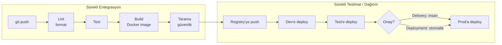

# 6.1 CI ve CD Nedir?

## Nedir?
- **CI (Continuous Integration — Sürekli Entegrasyon):** Geliştiricilerin kodu sık sık (günde birkaç kez) ortak repoya birleştirmesi ve **her birleştirmede otomatik test ve build** çalışması.
- **CD** iki anlamda kullanılır:
  - **Continuous Delivery (Sürekli Teslimat):** Testi geçen her sürüm **yayına hazır** bir paket hâline gelir; canlıya alma bir **insan onayıyla** yapılır.
  - **Continuous Deployment (Sürekli Dağıtım):** Testi geçen her sürüm **otomatik olarak** canlıya alınır, insan onayı yoktur.

## Hangi problemi çözer?
| CI/CD olmadan | CI/CD ile |
|---|---|
| Hatalar haftalar sonra, canlıda bulunur | Hata push'tan dakikalar sonra yakalanır |
| "Entegrasyon cehennemi": haftalarca ayrı geliştirilen kodlar birleşmez | Küçük ve sık birleştirme |
| Deploy elle, belgelere bakarak, korkarak yapılır | Deploy tek tık veya otomatik, her seferinde aynı |
| "Canlıda hangi sürüm var?" bilinmez | Her sürüm Git commit'ine ve image etiketine bağlı |
| Geri dönüş zor | Önceki sürüme hızlı dönüş |

## Nasıl çalışır?



**Temel prensipler**
1. **Her şey kodda:** Pipeline tanımı da Git'te bir dosyadır (`.github/workflows/ci.yml`, `.gitlab-ci.yml`, `Jenkinsfile`).
2. **Bir kez build et, her yerde aynısını kullan:** Dev'de test edilen image'ın aynısı prod'a gider; ortamlar arasında sadece ayarlar değişir.
3. **Hızlı geri bildirim:** CI birkaç dakikada bitmelidir.
4. **Kırık build önceliklidir:** `main` dalının pipeline'ı kırıldıysa önce o düzeltilir.

## Mini örnek
Basit bir GitHub Actions CI tanımı (`.github/workflows/ci.yml`):
```yaml
name: CI
on:
  pull_request:
  push:
    branches: [main]

jobs:
  test:
    runs-on: ubuntu-latest
    steps:
      - uses: actions/checkout@v4
      - uses: actions/setup-python@v5
        with:
          python-version: "3.12"
      - run: pip install -r requirements.txt -r requirements-dev.txt
      - run: ruff check .
      - run: pytest -q
```

Her PR'da bu adımlar çalışır; sonuç PR sayfasında ✅ veya ❌ olarak görünür.

## Nerede kullanılır?
- Uygulamalar (API, dashboard): test → image → deploy
- ETL ve SQL projeleri: SQL lint, birim testleri, test veritabanında çalıştırma
- ML projeleri: kod testi + model eğitimi + model doğrulama (MLOps, Bölüm 13)
- Altyapı kodu (Terraform, Kubernetes YAML): doğrulama ve uygulama

## Benzerleri ve farkları
| | Continuous Integration | Continuous Delivery | Continuous Deployment |
|---|---|---|---|
| Otomatik test | Evet | Evet | Evet |
| Yayına hazır paket | — | Evet | Evet |
| Canlıya otomatik çıkış | — | Hayır (onaylı) | Evet |

**Bankacılıkta:** Değişiklik yönetimi (change management) ve onay süreçleri nedeniyle prod ortamı için genellikle **Continuous Delivery** uygulanır: Her şey otomatik hazırlanır, canlıya geçiş onaylı bir değişiklik kaydıyla yapılır. Dev ve test ortamlarında ise sürekli dağıtım yaygındır.

**DevOps ile ilişkisi:** DevOps, geliştirme ve operasyon ekiplerini yaklaştıran bir kültür ve yöntemler bütünüdür; CI/CD bu kültürün en somut pratiğidir.

## İlgili sayfalar
- [6.2 Pipeline aşamaları](02-pipeline-asamalari.md)
- [6.4 CI/CD araçları](04-araclar.md)
- [0.1 Koddan canlıya](../00-buyuk-resim/01-koddan-canliya.md)
