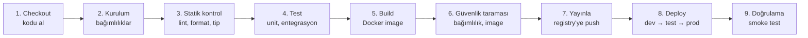

# 6.2 Pipeline Aşamaları: Test, Build, Deploy

## Nedir?
**Pipeline (boru hattı)**, koddan çalışan uygulamaya giden otomatik adımların sıralı tanımıdır. Adımlar **aşamalara** (stage) gruplanır; bir aşama başarısız olursa sonrakiler çalışmaz.

## Hangi problemi çözer?
Her değişikliğin aynı kalite kapılarından geçmesini garanti eder. Bir adım unutulamaz, atlanamaz; sonuçlar kayıt altındadır.

## Nasıl çalışır?



| Aşama | Amaç | Örnek araçlar |
|---|---|---|
| **Checkout** | Kodun ilgili commit'ini almak | Git |
| **Kurulum** | Bağımlılıkları kurmak (önbellekli) | pip, uv, npm |
| **Statik kontrol** | Kodu çalıştırmadan hata ve stil kontrolü | ruff, black, mypy, sqlfluff |
| **Test** | Davranışı doğrulamak | pytest ([6.3](03-otomatik-test.md)) |
| **Build** | Dağıtılabilir paket üretmek | docker build, buildah, Kaniko |
| **Güvenlik** | Açık içeren paket, sızmış şifre, image zafiyeti | pip-audit, Trivy, gitleaks, SonarQube |
| **Yayınla** | Paketi saklamak | Container registry, Artifactory |
| **Deploy** | Ortama dağıtmak | kubectl/oc, Helm, ArgoCD |
| **Doğrulama** | Deploy sonrası temel kontrol | `curl /health`, smoke test |

**Kavramlar**
- **Job / step:** Bir aşamadaki iş ve onu oluşturan komutlar.
- **Runner / agent:** Pipeline adımlarını çalıştıran makine veya container.
- **Artifact:** Bir aşamanın ürettiği ve sonrakine aktarılan dosya (test raporu, paket).
- **Cache:** Bağımlılıkların her seferinde yeniden indirilmemesi için önbellek.
- **Secret / variable:** Registry şifresi, deploy token'ı gibi gizli değişkenler; pipeline loglarında maskelenir.
- **Trigger:** Pipeline'ı başlatan olay (push, PR, tag, zamanlama, elle).
- **Environment / approval:** Prod'a deploy öncesi onay kapısı.

## Mini örnek
GitLab CI ile tam bir pipeline (`.gitlab-ci.yml`):
```yaml
stages: [kontrol, test, build, deploy]

variables:
  IMAGE: $CI_REGISTRY_IMAGE:$CI_COMMIT_SHORT_SHA

lint:
  stage: kontrol
  image: python:3.12-slim
  script:
    - pip install ruff
    - ruff check .

test:
  stage: test
  image: python:3.12-slim
  services:
    - postgres:16                      # test için gerçek veritabanı
  variables:
    POSTGRES_PASSWORD: test
    DB_HOST: postgres
  script:
    - pip install -r requirements.txt -r requirements-dev.txt
    - pytest --junitxml=rapor.xml
  artifacts:
    reports:
      junit: rapor.xml

build:
  stage: build
  image: docker:27
  services: [docker:27-dind]
  script:
    - docker login -u $CI_REGISTRY_USER -p $CI_REGISTRY_PASSWORD $CI_REGISTRY
    - docker build -t $IMAGE .
    - docker push $IMAGE
  only: [main]

deploy-dev:
  stage: deploy
  image: quay.io/openshift/origin-cli:latest
  script:
    - oc login --token=$OCP_TOKEN --server=$OCP_SERVER
    - oc project veri-dev
    - oc set image deploy/kredi-api api=$IMAGE
    - oc rollout status deploy/kredi-api
  environment: dev
  only: [main]

deploy-prod:
  stage: deploy
  script:
    - oc project veri-prod
    - oc set image deploy/kredi-api api=$IMAGE
  environment: prod
  when: manual                        # insan onayı (continuous delivery)
  only: [main]
```

## Nerede kullanılır?
| Proje türü | Tipik pipeline |
|---|---|
| Python ETL | lint → unit test → test DB'de entegrasyon testi → image → CronJob güncelle |
| API / dashboard | lint → test → image → dev → (onay) → prod |
| Python paketi | lint → test → build wheel → Artifactory'ye yayınla |
| SQL / dbt | sqlfluff → dbt test → dbt run |

## Benzerleri ve farkları
- **Tek aşamalı script:** `deploy.sh` tüm adımları yapabilir ama görünürlük, paralellik, onay ve tekrar deneme yoktur.
- **Dockerfile içinde test:** Multi-stage build'de test aşaması konabilir ([4.3](../04-docker/03-multi-stage-build.md)), ama raporlama için pipeline adımı daha uygundur.

**İyi pratikler:**
- Hızlı adımları öne alın (lint saniyeler, testler dakikalar).
- Image'ı Git commit hash'iyle etiketleyin.
- Şifreleri pipeline değişkenlerinde saklayın, asla YAML'a yazmayın.
- Pipeline tanımını da kod gibi PR ile değiştirin.

## İlgili sayfalar
- [6.3 Otomatik testler](03-otomatik-test.md)
- [6.4 Araçlar](04-araclar.md)
