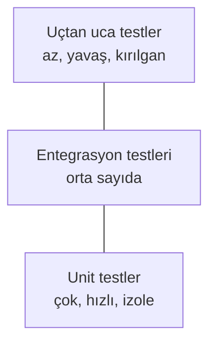

# 6.3 Otomatik Testler: pytest, Unit ve Entegrasyon Testi

## Nedir?
**Otomatik test**, kodun beklenen şekilde davrandığını kontrol eden ve makine tarafından çalıştırılan koddur. Python'da standart araç **pytest**'tir.

## Hangi problemi çözer?
- Bir değişiklik başka bir yeri bozduğunda (regresyon) hemen fark edilir.
- Kodu yeniden düzenlemek (refactor) korkutucu olmaktan çıkar.
- CI'ın "geçti/kaldı" kararını verecek bir ölçüt sağlar.
- Testler, kodun nasıl kullanılacağını gösteren canlı dokümantasyondur.

## Nasıl çalışır?

**Test piramidi**


| Tür | Neyi test eder? | Hız | Örnek |
|---|---|---|---|
| **Unit (birim)** | Tek fonksiyon/sınıf, dış bağımlılık olmadan | Milisaniye | `yoy_degisim()` doğru hesaplıyor mu? |
| **Entegrasyon** | Bileşenlerin birlikte çalışması | Saniye | ETL gerçek PostgreSQL'e doğru yazıyor mu? |
| **Uçtan uca (E2E)** | Tüm sistem, kullanıcı gözünden | Dakika | Dashboard açılıp grafik çiziliyor mu? |

**pytest kuralları**
- Test dosyaları `test_*.py`, test fonksiyonları `test_` ile başlar.
- Kontrol düz `assert` ile yapılır.
- **Fixture:** Testlere hazır veri veya bağlantı sağlayan yeniden kullanılabilir fonksiyonlar.
- **Parametrize:** Aynı testi farklı girdilerle çalıştırma.
- **Mock:** Dış servisleri (API, veritabanı) taklit etme.

## Mini örnek
Test edilecek kod (`metrics.py`):
```python
def yoy_degisim(bu_yil: float, gecen_yil: float) -> float | None:
    """Yıllık yüzde değişim."""
    if gecen_yil == 0:
        return None
    return round((bu_yil - gecen_yil) / gecen_yil * 100, 2)
```

Testler (`tests/test_metrics.py`):
```python
import pytest
import pandas as pd
from metrics import yoy_degisim

def test_artis():
    assert yoy_degisim(110, 100) == 10.0

def test_sifira_bolme():
    assert yoy_degisim(50, 0) is None

@pytest.mark.parametrize("bu, gecen, beklenen", [
    (100, 100, 0.0),
    (90, 100, -10.0),
    (150, 100, 50.0),
])
def test_cesitli(bu, gecen, beklenen):
    assert yoy_degisim(bu, gecen) == beklenen

@pytest.fixture
def ornek_kredi():
    return pd.DataFrame({"donem": ["2025-09", "2026-09"], "bakiye": [100.0, 125.0]})

def test_dataframe(ornek_kredi):
    son, once = ornek_kredi["bakiye"].iloc[1], ornek_kredi["bakiye"].iloc[0]
    assert yoy_degisim(son, once) == 25.0
```

Çalıştırma:
```bash
pip install pytest pytest-cov
pytest                         # tüm testler
pytest -q                      # kısa çıktı
pytest tests/test_metrics.py -k sifira   # isme göre filtre
pytest --cov=. --cov-report=term-missing # kapsam (coverage) raporu
pytest -x                      # ilk hatada dur
```

Entegrasyon testi için gerçek veritabanı: CI'da `services: postgres` ([6.2](02-pipeline-asamalari.md)) veya yerelde `testcontainers` kütüphanesi testi Docker'da geçici bir PostgreSQL ile çalıştırır.

## Nerede kullanılır?
- **ETL:** Dönüşüm fonksiyonları (tarih parse, birim çevirme, metrik hesaplama) unit test ile; yükleme adımı entegrasyon testi ile.
- **API:** Endpoint'lerin doğru durum kodu ve veri döndürmesi (FastAPI `TestClient`, [7.4](../07-api/04-fastapi.md)).
- **ML:** Feature fonksiyonları, modelin beklenen formatta çıktı vermesi, minimum performans eşiği.

## Benzerleri ve farkları
- **unittest:** Python'un dahili test modülü; daha uzun söz dizimi. pytest unittest testlerini de çalıştırır.
- **Veri kalitesi testleri:** Kodu değil **veriyi** test eder (boş değer, tekrar eden kayıt, beklenen aralık): Great Expectations, dbt test, pandera (Bölüm 11).
- **Coverage (kapsam):** Testlerin kodun yüzde kaçını çalıştırdığı. Yüksek kapsam iyi işarettir ama tek başına kalite garantisi değildir.

## İlgili sayfalar
- [6.2 Pipeline aşamaları](02-pipeline-asamalari.md)
- [6.1 CI/CD nedir](01-ci-cd-nedir.md)
