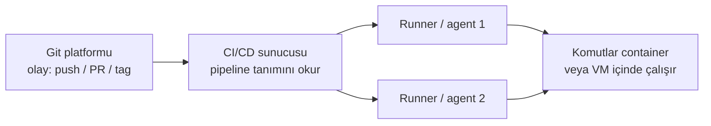

# 6.4 Araçlar: GitHub Actions, GitLab CI, Jenkins, OpenShift Pipelines

## Nedir?
CI/CD pipeline'larını tanımlayan ve çalıştıran yazılımlar. Kavramlar aynıdır (aşama, iş, runner, artifact, secret); söz dizimi ve barındırma modeli farklıdır.

## Hangi problemi çözer?
Kurumun hangi platformu kullandığına göre pipeline'ın nasıl yazılacağını ve araçların güçlü/zayıf yanlarını bilmek, doğru seçim ve hızlı uyum sağlar.

## Nasıl çalışır?



| Araç | Tanım dosyası | Barındırma | Güçlü yanı |
|---|---|---|---|
| **GitHub Actions** | `.github/workflows/*.yml` | GitHub bulut veya Enterprise Server; self-hosted runner | Hazır "action" pazaryeri, GitHub ile tam entegre |
| **GitLab CI/CD** | `.gitlab-ci.yml` | GitLab.com veya self-managed | Tek platformda kod + CI + registry + güvenlik |
| **Jenkins** | `Jenkinsfile` (Groovy) | Kendi sunucunuz | Çok esnek, binlerce eklenti, kurumlarda yaygın |
| **Azure DevOps Pipelines** | `azure-pipelines.yml` | Bulut veya Server | Microsoft ekosistemi |
| **Bitbucket Pipelines** | `bitbucket-pipelines.yml` | Bulut | Jira entegrasyonu |
| **OpenShift Pipelines (Tekton)** | Kubernetes YAML (Task, Pipeline) | Cluster içinde | Kubernetes-native, her adım bir pod |

## Mini örnek
Aynı iş (test + image build), dört araçta:

**GitHub Actions**
```yaml
on: [push]
jobs:
  ci:
    runs-on: ubuntu-latest
    steps:
      - uses: actions/checkout@v4
      - run: pip install -r requirements.txt && pytest
      - run: docker build -t app:${{ github.sha }} .
```

**GitLab CI**
```yaml
test:
  image: python:3.12-slim
  script: [pip install -r requirements.txt, pytest]
build:
  image: docker:27
  services: [docker:27-dind]
  script: [docker build -t app:$CI_COMMIT_SHORT_SHA .]
```

**Jenkins (Declarative Pipeline)**
```groovy
pipeline {
  agent { docker { image 'python:3.12-slim' } }
  stages {
    stage('Test')  { steps { sh 'pip install -r requirements.txt && pytest' } }
    stage('Build') { steps { sh "docker build -t app:${env.GIT_COMMIT} ." } }
  }
  post { failure { echo 'Build kırıldı!' } }
}
```

**Tekton (OpenShift Pipelines)**
```yaml
apiVersion: tekton.dev/v1
kind: Pipeline
metadata:
  name: kredi-api-pipeline
spec:
  workspaces: [{ name: kaynak }]
  tasks:
    - name: clone
      taskRef: { name: git-clone }       # hazır görevler; kuruluma göre resolver ile de çağrılabilir
      workspaces: [{ name: output, workspace: kaynak }]
    - name: test
      runAfter: [clone]
      taskRef: { name: pytest }
      workspaces: [{ name: source, workspace: kaynak }]
    - name: build
      runAfter: [test]
      taskRef: { name: buildah }
      workspaces: [{ name: source, workspace: kaynak }]
```
```bash
tkn pipeline start kredi-api-pipeline --showlog
```

## Nerede kullanılır?
| Durum | Sık görülen tercih |
|---|---|
| Kod GitHub'da | GitHub Actions |
| Kod kurum içi GitLab'da | GitLab CI |
| Köklü kurumsal ortam, karmaşık entegrasyonlar | Jenkins |
| OpenShift merkezli, cluster içinde build | OpenShift Pipelines + OpenShift GitOps |
| Microsoft ağırlıklı kurum | Azure DevOps |

## Benzerleri ve farkları
- **Push tabanlı CD:** Pipeline, deploy komutunu kendisi çalıştırır (`oc set image`, `helm upgrade`). Pipeline'ın cluster'a yazma yetkisi olmalıdır.
- **Pull tabanlı CD (GitOps):** Pipeline sadece Git'teki konfigürasyonu günceller; cluster içindeki ArgoCD değişikliği çekip uygular ([6.5](05-gitops-argocd.md)). Cluster dışa yetki açmaz; bankalarda güvenlik açısından tercih sebebidir.
- **Jenkins ile modern araçlar:** Jenkins güçlüdür ama sunucu, eklenti ve güvenlik güncellemesi bakımı ister. Modern araçlarda pipeline tanımı daha sadedir ve platformla birlikte gelir.

## İlgili sayfalar
- [6.2 Pipeline aşamaları](02-pipeline-asamalari.md)
- [6.5 GitOps ve ArgoCD](05-gitops-argocd.md)
- [3.6 GitHub / GitLab](../03-git/06-github-pull-request.md)
