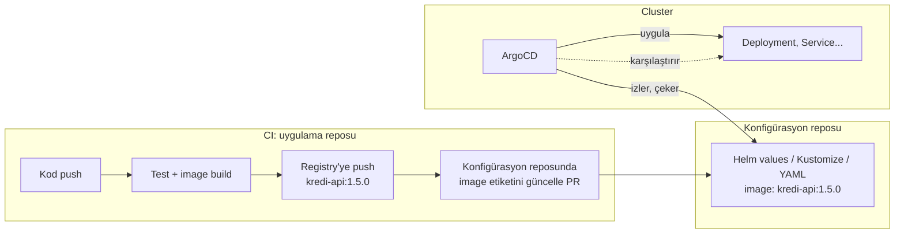

# 6.5 GitOps ve ArgoCD

## Nedir?
**GitOps**, bir sistemin **istenen durumunun tamamen Git'te** tutulduğu ve bir otomasyonun cluster'ı sürekli olarak Git'teki bu durumla eşitlediği işletim modelidir.

**ArgoCD**, Kubernetes için en yaygın GitOps aracıdır. OpenShift'te **OpenShift GitOps** adıyla hazır gelir. Diğer bir örnek **Flux**'tır.

## Hangi problemi çözer?
- **"Cluster'da ne var?" sorusu:** Cevap her zaman Git'tedir. Elle yapılan değişiklikler (drift) tespit edilir ve geri alınır.
- **Denetim:** Her değişiklik bir commit ve PR'dır; kim neyi ne zaman değiştirdi bellidir.
- **Geri alma:** `git revert` = önceki sürüme dönüş.
- **Güvenlik:** CI sistemine cluster'a yazma yetkisi vermek gerekmez; ArgoCD cluster içinden Git'i okur (pull modeli).
- **Felaket kurtarma:** Yeni cluster'a ArgoCD kurulup aynı repo gösterilince her şey yeniden oluşur.

## Nasıl çalışır?



**GitOps'un dört prensibi**
1. **Deklaratif:** Sistem YAML/Helm/Kustomize ile tanımlanır.
2. **Versiyonlu ve değişmez:** Tanım Git'te saklanır.
3. **Otomatik çekilir:** Ajan (ArgoCD) değişiklikleri kendisi çeker.
4. **Sürekli uzlaştırılır:** Fark varsa (drift) düzeltilir veya uyarı verilir.

**ArgoCD kavramları**
| Kavram | Anlamı |
|---|---|
| **Application** | Hangi Git reposu/yolu, hangi cluster/namespace'e uygulanacak |
| **Sync** | Git'teki durumu cluster'a uygulamak |
| **Synced / OutOfSync** | Cluster Git ile aynı mı? |
| **Healthy / Degraded** | Kaynaklar sağlıklı çalışıyor mu? |
| **Auto-sync / self-heal** | Değişiklikleri otomatik uygula, elle yapılan farkları geri al |
| **Prune** | Git'ten silinen kaynakları cluster'dan da sil |

**Repo düzeni:** Uygulama kodu ile ortam konfigürasyonunu ayrı repolarda (veya ayrı klasörlerde) tutmak yaygındır:
```
veri-gitops/
├── kredi-api/
│   ├── base/                  # ortak YAML'lar
│   └── overlays/
│       ├── dev/               # dev'e özel: 1 kopya
│       └── prod/              # prod'a özel: 3 kopya, farklı kaynaklar
└── bddk-etl/
    └── ...
```

## Mini örnek
ArgoCD Application tanımı:
```yaml
apiVersion: argoproj.io/v1alpha1
kind: Application
metadata:
  name: kredi-api-prod
  namespace: openshift-gitops
spec:
  project: default
  source:
    repoURL: https://git.sirket.local/veri/veri-gitops.git
    targetRevision: main
    path: kredi-api/overlays/prod
  destination:
    server: https://kubernetes.default.svc
    namespace: veri-prod
  syncPolicy:
    automated:
      prune: true
      selfHeal: true
```

Yeni sürüm çıkarmak = konfigürasyon reposunda bir satır değiştirmek:
```bash
cd veri-gitops/kredi-api/overlays/prod
kustomize edit set image kredi-api=registry.sirket.local/veri/kredi-api:1.5.0
git commit -am "kredi-api 1.5.0 prod'a"
git push          # PR + onay → merge → ArgoCD otomatik uygular
```

```bash
argocd app list
argocd app get kredi-api-prod
argocd app sync kredi-api-prod
argocd app history kredi-api-prod
argocd app rollback kredi-api-prod 4
```

## Nerede kullanılır?
- Birden fazla ortam ve cluster'ın tutarlı yönetimi
- Prod'a çıkışın PR onayına bağlanması (değişiklik yönetimiyle uyumlu)
- Altyapı bileşenlerinin (izleme, ingress, operator'lar) yönetimi

## Benzerleri ve farkları
| | Push tabanlı CD | GitOps (pull) |
|---|---|---|
| Kim uygular? | CI pipeline | Cluster içindeki ajan |
| Cluster yetkisi | CI'a verilir | Cluster dışına açılmaz |
| Drift tespiti | Yok | Var |
| Gerçeğin kaynağı | Son çalışan pipeline | Git |

- **Flux:** ArgoCD'ye alternatif; daha hafif, arayüzü yok, CLI ve CRD odaklı.
- **Helm ile ilişkisi:** ArgoCD Helm chart'larını ve Kustomize'ı doğrudan destekler ([5.15](../05-kubernetes/15-helm.md)).

**Dikkat:** Secret'lar Git'e düz konamaz; Sealed Secrets, External Secrets Operator veya Vault entegrasyonu kullanılır ([5.9](../05-kubernetes/09-configmap-secret.md)).

## İlgili sayfalar
- [6.4 Araçlar](04-araclar.md)
- [5.15 Helm](../05-kubernetes/15-helm.md)
