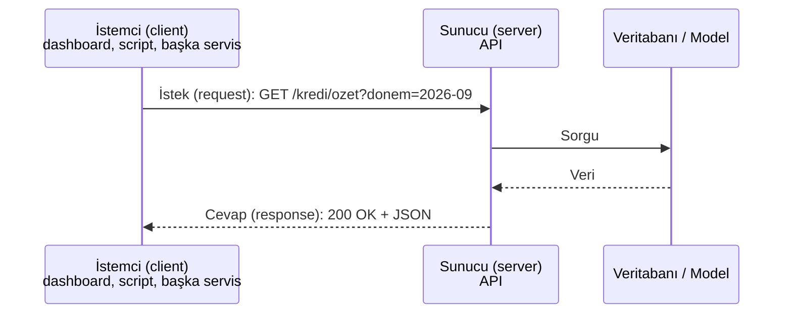

# 7.1 API Nedir, Client–Server Modeli

## Nedir?
**API (Application Programming Interface — Uygulama Programlama Arayüzü)**, bir yazılımın başka bir yazılıma sunduğu **tanımlı iletişim kapısıdır**. "Bana şu formatta istek gönder, sana şu formatta cevap vereyim" sözleşmesidir.

> Benzetme: Restoranda menü bir API'dir. Mutfağın nasıl çalıştığını bilmezsiniz; menüden sipariş verirsiniz (istek), yemeğiniz gelir (cevap).

## Hangi problemi çözer?
- **Ayrıştırma:** Dashboard, veritabanının yapısını bilmeden API'den veri alır; veritabanı değişse de API sözleşmesi sabit kalır.
- **Tekrar kullanım:** Aynı kredi skorlama modeli; web uygulaması, mobil uygulama ve batch süreçleri tarafından aynı API ile kullanılır.
- **Güvenlik ve kontrol:** Veritabanına doğrudan erişim yerine API üzerinden yetkili ve kayıtlı erişim.
- **Entegrasyon:** Farklı dillerde yazılmış sistemler (Java core banking, Python model, JavaScript arayüz) ortak bir dille konuşur.

## Nasıl çalışır?

**Client–server (istemci–sunucu) modeli**


- **İstemci** isteği başlatır; **sunucu** dinler ve cevap verir.
- Web API'lerinde iletişim çoğunlukla **HTTP** üzerinden, veri **JSON** formatında olur ([7.2](02-http.md), [7.3](03-rest-json.md)).
- **Endpoint:** API'nin belirli bir işlevine ait adres: `/kredi/ozet`, `/model/skor`.
- **Durumsuzluk (stateless):** Her istek kendi başına anlaşılır olmalıdır; sunucu önceki isteği hatırlamak zorunda değildir. Bu, ölçeklenmeyi kolaylaştırır ([5.12](../05-kubernetes/12-hpa.md)).

**API türleri (kapsama göre)**
| Tür | Kim kullanır? | Örnek |
|---|---|---|
| İç (internal / private) | Kurum içi sistemler | Kredi skor API'si |
| Partner | Anlaşmalı kurumlar | Açık bankacılık partner API'leri |
| Açık (public) | Herkes | TCMB EVDS, döviz kuru API'leri |

## Mini örnek
Python'dan bir API çağırmak:
```python
import requests

cevap = requests.get(
    "https://api.sirket.local/kredi/ozet",
    params={"donem": "2026-09"},
    headers={"Authorization": "Bearer <token>"},
    timeout=10,
)
cevap.raise_for_status()          # 4xx/5xx ise hata fırlat
veri = cevap.json()
print(veri["toplam_bakiye"])
```

Terminalden:
```bash
curl -s "https://api.sirket.local/kredi/ozet?donem=2026-09" \
     -H "Authorization: Bearer <token>" | jq .
```

## Nerede kullanılır?
- ML modelini servis olarak sunmak (online skorlama)
- Veri ürünlerini (metrik tabloları) uygulamalara açmak
- Dış veri kaynaklarından veri çekmek (ETL'in "Extract" adımı)
- Mikroservislerin birbirleriyle konuşması

## Benzerleri ve farkları
- **Doğrudan veritabanı bağlantısı:** Hızlı ve basit ama istemciyi veritabanı şemasına bağımlı kılar; yetki ve izleme zordur.
- **Dosya alışverişi (SFTP, paylaşımlı klasör):** Batch ve büyük veri için hâlâ yaygın; gerçek zamanlı değil.
- **Mesaj kuyruğu (Kafka, RabbitMQ):** Asenkron; gönderen cevap beklemez (Bölüm 11).
- **Kütüphane API'si:** "API" kelimesi bir Python paketinin fonksiyonları (ör. pandas API'si) için de kullanılır. Bu bölüm ağ üzerinden konuşan **web API'lerini** anlatır.

## İlgili sayfalar
- [7.2 HTTP](02-http.md)
- [7.3 REST ve JSON](03-rest-json.md)
- [7.4 FastAPI](04-fastapi.md)
