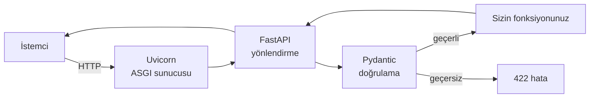

# 7.4 FastAPI ile API Yazmak

## Nedir?
**FastAPI**, Python'da hızlı ve modern web API'leri yazmak için kullanılan bir framework'tür. Python tip ipuçlarını (type hints) kullanarak:
- Gelen veriyi otomatik **doğrular** (Pydantic ile),
- Otomatik **dokümantasyon** üretir (Swagger UI: `/docs`),
- Asenkron çalışmayı destekler.

Örnekler FastAPI ile verilmiştir; anlatılan kavramlar (endpoint, doğrulama, şema, test) diğer framework'ler için de geçerlidir.

## Hangi problemi çözer?
- Bir ML modelini veya veri sorgusunu birkaç satırda HTTP servisine çevirir.
- Hatalı istekleri (eksik alan, yanlış tip) kod yazmadan yakalar ve **422** hatasıyla açıklar.
- API dokümantasyonu her zaman kodla senkron kalır.

## Nasıl çalışır?



- **Uvicorn:** İstekleri karşılayan sunucu (ASGI).
- **Decorator'lar** (`@app.get`, `@app.post`) bir fonksiyonu bir endpoint'e bağlar.
- **Pydantic modeli** istek/cevap gövdesinin şemasını tanımlar.

## Mini örnek
`main.py`:
```python
from fastapi import FastAPI, HTTPException, Query
from pydantic import BaseModel, Field

app = FastAPI(title="Kredi Skor API", version="1.0.0")

class SkorIstegi(BaseModel):
    musteri_id: int
    tutar: float = Field(gt=0, description="Talep edilen kredi tutarı (TL)")
    vade_ay: int = Field(ge=1, le=120)

class SkorCevabi(BaseModel):
    musteri_id: int
    skor: float
    karar: str

@app.get("/health")
def health():
    return {"durum": "ok"}

@app.post("/v1/skor", response_model=SkorCevabi)
def skorla(istek: SkorIstegi):
    # Gerçekte: model = joblib.load(...) ile başlangıçta yüklenir
    skor = min(istek.tutar / 1_000_000, 1.0)
    karar = "onay" if skor < 0.5 else "inceleme"
    return SkorCevabi(musteri_id=istek.musteri_id, skor=round(skor, 3), karar=karar)

@app.get("/v1/kredi/ozet")
def kredi_ozet(donem: str = Query(pattern=r"^\d{4}-\d{2}$")):
    veriler = {"2026-09": 1_250_000.0}
    if donem not in veriler:
        raise HTTPException(status_code=404, detail=f"{donem} dönemi bulunamadı")
    return {"donem": donem, "toplam_bakiye": veriler[donem]}
```

Çalıştırma:
```bash
pip install "fastapi[standard]"
fastapi dev main.py                  # geliştirme (otomatik yeniden yükleme)
# veya: uvicorn main:app --host 0.0.0.0 --port 8000
```
- `http://localhost:8000/docs` → etkileşimli dokümantasyon
- `http://localhost:8000/openapi.json` → makine tarafından okunabilir şema

Deneme:
```bash
curl -X POST localhost:8000/v1/skor -H "Content-Type: application/json" \
     -d '{"musteri_id": 1, "tutar": 250000, "vade_ay": 36}'
curl -X POST localhost:8000/v1/skor -H "Content-Type: application/json" \
     -d '{"musteri_id": 1, "tutar": -5, "vade_ay": 36}'      # 422 döner
```

Test (`tests/test_api.py`):
```python
from fastapi.testclient import TestClient
from main import app

client = TestClient(app)

def test_health():
    assert client.get("/health").json() == {"durum": "ok"}

def test_negatif_tutar():
    r = client.post("/v1/skor", json={"musteri_id": 1, "tutar": -5, "vade_ay": 12})
    assert r.status_code == 422
```

Dockerfile:
```dockerfile
FROM python:3.12-slim
WORKDIR /app
COPY requirements.txt .
RUN pip install --no-cache-dir -r requirements.txt
COPY . .
USER 1001
EXPOSE 8000
CMD ["uvicorn", "main:app", "--host", "0.0.0.0", "--port", "8000", "--workers", "2"]
```

## Nerede kullanılır?
- ML modellerinin online skorlama servisi
- Veri tablolarını dashboard'lara ve diğer ekiplere açan iç API'ler
- Webhook alıcıları (başka sistemlerden gelen bildirimler)

## Benzerleri ve farkları
| Framework | Özellik |
|---|---|
| **FastAPI** | Modern, tip tabanlı, otomatik doküman, hızlı |
| **Flask** | Minimal, esnek, eski ve çok yaygın; doğrulama ve doküman ek paketlerle |
| **Django REST Framework** | Büyük, "her şey dahil"; veritabanı modelleri, admin paneli |
| **Streamlit / Dash** | API değil, kullanıcı arayüzü (dashboard) framework'leri |

- **OpenAPI (Swagger):** FastAPI'nin ürettiği şema standardı. Bu şemadan istemci kodu otomatik üretilebilir ve API ağ geçitlerine (API gateway) aktarılabilir.

## İlgili sayfalar
- [7.5 API güvenliği](05-api-guvenligi.md)
- [6.3 Otomatik testler](../06-ci-cd/03-otomatik-test.md)
- [8.4 Reverse proxy](../08-nginx/04-reverse-proxy.md)
