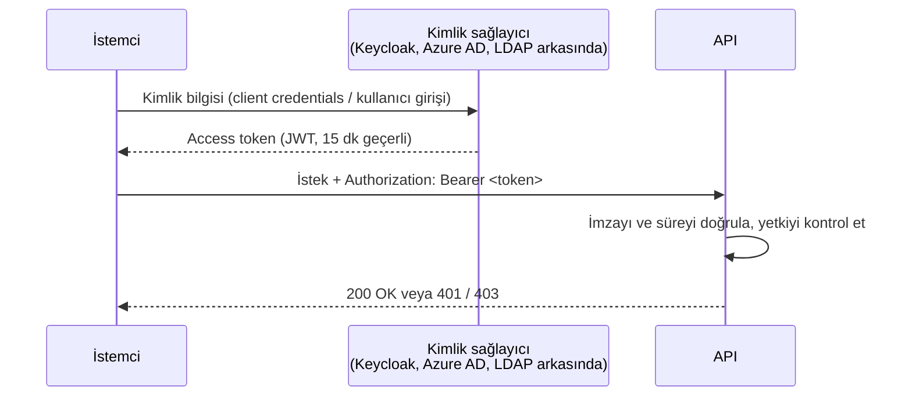

# 7.5 API Güvenliği: API Key, Token, Rate Limit

## Nedir?
API güvenliği; bir API'yi **kimin** çağırabileceğini (kimlik doğrulama), **neyi** yapabileceğini (yetkilendirme), **ne sıklıkla** çağırabileceğini (rate limit) ve trafiğin **korunmasını** (şifreleme) kapsar.

## Hangi problemi çözer?
- Yetkisiz kişilerin müşteri verisine erişmesi
- Bir istemcinin hatalı döngüyle API'yi binlerce istekle boğması
- Şifrelerin veya token'ların ağda okunması
- Kötü niyetli girdilerle (SQL injection gibi) sistemin manipüle edilmesi

## Nasıl çalışır?

**Kimlik doğrulama yöntemleri**

| Yöntem | Nasıl? | Artı | Eksi | Tipik kullanım |
|---|---|---|---|---|
| **API key** | `X-API-Key: abc123` header'ı | Basit | Kullanıcıyı değil uygulamayı tanır; süresiz olabilir | Servisten servise, basit iç API |
| **Basic auth** | `Authorization: Basic base64(kullanici:sifre)` | Çok basit | Her istekte şifre gider | Eski sistemler, sadece HTTPS ile |
| **Bearer token (JWT)** | `Authorization: Bearer eyJ...` | Süreli, içinde kimlik ve yetki bilgisi | Token yönetimi gerekir | Modern API'ler |
| **OAuth 2.0 / OIDC** | Token bir kimlik sağlayıcıdan (Keycloak, Azure AD) alınır | Merkezi kimlik, SSO | Kurulumu daha karmaşık | Kurumsal uygulamalar |
| **mTLS** | İstemci de sertifika sunar | Çok güçlü | Sertifika yönetimi | Bankalar arası, servis ağı |

**JWT (JSON Web Token)** üç parçadır: `başlık.yük.imza`. Yük (payload) kullanıcı ve yetki bilgisini, son kullanma zamanını (`exp`) içerir. İmza, token'ın değiştirilmediğini garanti eder. **Yük şifreli değildir**, sadece base64'tür; içine hassas bilgi konmaz.



**Diğer katmanlar**
- **HTTPS zorunlu:** Token ve veri şifreli taşınmalı ([8.6](../08-nginx/06-https-tls.md)).
- **Rate limiting (hız sınırı):** "İstemci başına dakikada 100 istek". Aşılırsa **429 Too Many Requests**. Genellikle nginx, Ingress veya API gateway'de uygulanır ([8.7](../08-nginx/07-cache-rate-limit.md)).
- **Girdi doğrulama:** Pydantic şemaları, SQL'de parametreli sorgular (asla metin birleştirerek sorgu kurmayın).
- **En az veri:** Cevapta sadece gereken alanlar; TCKN gibi alanlar maskelenir.
- **CORS:** Tarayıcının hangi sitelerden API'ye istek atabileceğini belirler.
- **Loglama ve izleme:** Kim, ne zaman, hangi endpoint'i çağırdı (hassas veri loglanmadan).

## Mini örnek
FastAPI'de API key ve Bearer token kontrolü:
```python
import os
from fastapi import Depends, FastAPI, HTTPException, Security
from fastapi.security import APIKeyHeader, HTTPBearer, HTTPAuthorizationCredentials

app = FastAPI()
api_key_header = APIKeyHeader(name="X-API-Key")
bearer = HTTPBearer()

def api_key_kontrol(key: str = Security(api_key_header)):
    if key != os.environ["SERVIS_API_KEY"]:
        raise HTTPException(status_code=401, detail="Geçersiz API anahtarı")

def token_kontrol(cred: HTTPAuthorizationCredentials = Security(bearer)) -> dict:
    # Gerçekte: PyJWT ile imza, süre (exp) ve audience doğrulanır
    # payload = jwt.decode(cred.credentials, public_key, algorithms=["RS256"], audience="kredi-api")
    payload = {"sub": "mehmet", "roller": ["kredi_okuma"]}
    return payload

@app.get("/v1/kredi/ozet", dependencies=[Depends(api_key_kontrol)])
def ozet():
    return {"toplam": 1_250_000}

@app.delete("/v1/basvurular/{bid}")
def sil(bid: int, kullanici: dict = Depends(token_kontrol)):
    if "kredi_yonetici" not in kullanici["roller"]:
        raise HTTPException(status_code=403, detail="Yetkiniz yok")
    return {"silindi": bid}
```

Parametreli SQL (SQL injection'a karşı):
```python
# YANLIŞ: f"SELECT * FROM musteri WHERE id = {musteri_id}"
cur.execute("SELECT * FROM musteri WHERE id = %s", (musteri_id,))
```

## Nerede kullanılır?
- Model skorlama ve müşteri verisi sunan her API
- Dış dünyaya açılan partner API'leri (açık bankacılık)
- Servisler arası iç trafik (sıfır güven / zero trust yaklaşımı)

## Benzerleri ve farkları
- **401 ile 403:** 401 "Seni tanımıyorum" (kimlik yok/geçersiz). 403 "Seni tanıyorum ama bu işe yetkin yok".
- **API Gateway** (Kong, Apigee, 3scale, Azure API Management): Kimlik doğrulama, rate limit, loglama ve versiyonlamayı uygulamanın önünde merkezi olarak yapar.
- **Kurumsal kimlik:** Token'lar çoğu zaman LDAP / Active Directory'ye bağlı bir kimlik sağlayıcıdan gelir (Bölüm 15).
- **OWASP API Security Top 10:** API'lerde en sık görülen güvenlik açıklarının listesi; tasarım kontrol listesi olarak kullanılır.

## İlgili sayfalar
- [7.4 FastAPI](04-fastapi.md)
- [8.7 Rate limit](../08-nginx/07-cache-rate-limit.md)
- [5.9 Secret](../05-kubernetes/09-configmap-secret.md)
