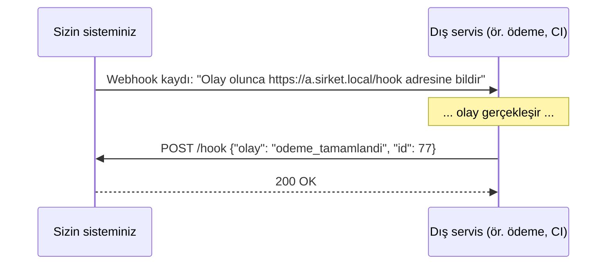

# 7.6 REST Dışı Yaklaşımlar: GraphQL, gRPC, Webhook

## Nedir?
REST en yaygın API tarzıdır ama her ihtiyaca en iyi cevap değildir. Üç önemli alternatif:
- **GraphQL:** İstemcinin hangi alanları istediğini tek bir sorguyla belirttiği sorgu dili.
- **gRPC:** Google'ın geliştirdiği, ikili (binary) formatla ve şemayla çalışan yüksek performanslı RPC (uzak fonksiyon çağrısı) çerçevesi.
- **Webhook:** Bir olay olduğunda sunucunun istemciye **kendisinin** HTTP isteği göndermesi ("bizi arama, biz seni ararız").

## Hangi problemi çözer?
| Sorun | Çözüm |
|---|---|
| REST'te bir ekran için 5 farklı endpoint çağırmak, gereksiz alanları da almak | **GraphQL**: tek istekte tam gereken veri |
| Servisler arası yüksek hacimli, düşük gecikmeli iletişim | **gRPC**: küçük mesajlar, HTTP/2, akış (streaming) |
| "İş bitti mi?" diye sürekli sormak (polling) | **Webhook**: olay olunca haber verilir |

## Nasıl çalışır?

**GraphQL**
- Tek endpoint vardır (genellikle `POST /graphql`).
- Sunucu bir **şema** yayınlar; istemci şemadan istediği alanları seçer.
```graphql
query {
  musteri(id: 123) {
    ad
    segment
    krediler(durum: AKTIF) { tutar vade }
  }
}
```
Cevap tam olarak istenen şekildedir; ne eksik ne fazla.

**gRPC**
- Servis ve mesajlar `.proto` dosyasında tanımlanır; bu dosyadan farklı diller için istemci/sunucu kodu **otomatik üretilir**.
```protobuf
syntax = "proto3";
service SkorServisi {
  rpc Skorla (SkorIstegi) returns (SkorCevabi);
}
message SkorIstegi { int64 musteri_id = 1; double tutar = 2; }
message SkorCevabi { double skor = 1; string karar = 2; }
```
- Mesajlar **Protocol Buffers** ile ikili kodlanır (JSON'dan çok daha küçük ve hızlı).
- HTTP/2 sayesinde tek bağlantıda çoklu istek ve çift yönlü akış.

**Webhook**

- Alıcı tarafta isteğin gerçekten o servisten geldiği **imza** (HMAC) ile doğrulanmalıdır.
- Alıcı hızlı cevap verip asıl işi kuyruğa atmalıdır; gönderici zaman aşımında yeniden dener (bu yüzden işlem idempotent olmalı).

## Mini örnek
Webhook alıcısı (FastAPI) ve imza doğrulama:
```python
import hmac, hashlib, os
from fastapi import FastAPI, Request, HTTPException

app = FastAPI()
GIZLI = os.environ["WEBHOOK_SECRET"].encode()

@app.post("/hook/pipeline")
async def pipeline_bitti(request: Request):
    govde = await request.body()
    beklenen = hmac.new(GIZLI, govde, hashlib.sha256).hexdigest()
    gelen = request.headers.get("X-Signature", "")
    if not hmac.compare_digest(beklenen, gelen):
        raise HTTPException(status_code=401)
    olay = await request.json()
    # asıl işi kuyruğa at, hızlı cevap ver
    return {"alindi": olay.get("id")}
```

## Nerede kullanılır?
| Yaklaşım | Tipik kullanım |
|---|---|
| **REST** | Genel amaçlı iç ve dış API'ler (varsayılan tercih) |
| **GraphQL** | Çok farklı ekran ihtiyacı olan ön yüzler, veri birleştiren katmanlar |
| **gRPC** | Mikroservisler arası iç iletişim, düşük gecikmeli model servisleri |
| **Webhook** | Git/CI bildirimleri, ödeme sonuçları, Slack/Teams entegrasyonları, n8n tetikleyicileri |
| **SOAP** | Eski kurumsal ve bankacılık entegrasyonları |

## Benzerleri ve farkları
| | REST | GraphQL | gRPC | Webhook |
|---|---|---|---|---|
| Format | JSON | JSON | Protobuf (ikili) | JSON (genelde) |
| Şema | İsteğe bağlı (OpenAPI) | Zorunlu | Zorunlu (.proto) | Sağlayıcıya göre |
| Yön | İstemci → sunucu | İstemci → sunucu | İki yönlü akış | Sunucu → istemci |
| Tarayıcı dostu | Evet | Evet | Sınırlı | — |
| Önbellekleme | Kolay (HTTP) | Zor | Zor | — |

- **Mesaj kuyrukları (Kafka, RabbitMQ):** Webhook'a benzer olay odaklı yaklaşım ama araya dayanıklı bir kuyruk girer; mesajlar kaybolmaz, tekrar okunabilir (Bölüm 11).
- **WebSocket / Server-Sent Events:** Sunucudan istemciye sürekli canlı veri akışı (canlı dashboard).

## İlgili sayfalar
- [7.3 REST ve JSON](03-rest-json.md)
- [7.5 API güvenliği](05-api-guvenligi.md)
