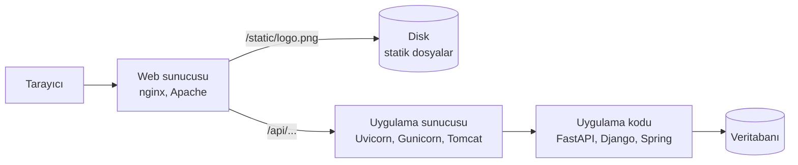

# 8.1 Web Sunucusu Nedir: Statik İçerik ve Uygulama Sunucusu Farkı

## Nedir?
**Web sunucusu**, HTTP isteklerini karşılayıp cevap döndüren yazılımdır. İki farklı iş yaparlar ve bu iki iş genellikle iki ayrı yazılıma verilir:

- **Statik içerik sunmak:** Diskte hazır duran dosyaları (HTML, CSS, JavaScript, resim, PDF) olduğu gibi göndermek.
- **Dinamik içerik üretmek:** Her istekte kod çalıştırıp cevabı o an üretmek (veritabanı sorgusu, model skoru). Bunu **uygulama sunucusu** yapar.

## Hangi problemi çözer?
Uygulama kodu (Python, Java) iş mantığında iyidir ama binlerce eşzamanlı bağlantıyı yönetmek, yavaş istemcileri beklemek, TLS şifrelemesi yapmak ve statik dosya sunmak konusunda verimsizdir. İşleri ayırmak:
- Uygulamayı sadece iş mantığına odaklar,
- Performansı ve güvenliği artırır,
- Ölçeklemeyi kolaylaştırır.

## Nasıl çalışır?



| | Web sunucusu | Uygulama sunucusu |
|---|---|---|
| Örnekler | nginx, Apache httpd, Caddy, IIS | Uvicorn, Gunicorn (Python), Tomcat (Java), Node.js |
| Güçlü yanı | Statik dosya, çok sayıda bağlantı, TLS, proxy | Kod çalıştırma |
| Python dünyasında | nginx | Uvicorn (ASGI: FastAPI), Gunicorn (WSGI: Flask, Django) |

**WSGI ve ASGI:** Python web uygulamalarının uygulama sunucusuyla konuşma standartlarıdır. WSGI eşzamanlı (Flask, Django), ASGI asenkron (FastAPI, Streamlit'in altyapısı) uygulamalar içindir.

## Mini örnek
Statik bir rapor klasörünü yayınlamak:
```bash
# Python'un dahili basit sunucusu (sadece test için!)
python -m http.server 8000 --directory ./raporlar

# nginx ile (container'da)
docker run -d -p 8080:8080 \
  -v "$(pwd)/raporlar":/usr/share/nginx/html:ro \
  nginxinc/nginx-unprivileged
```

Uygulama sunucusu + web sunucusu (tipik canlı kurulum):
```bash
# Uygulama: sadece iç portta, birden çok işçiyle
gunicorn main:app -k uvicorn.workers.UvicornWorker -w 4 -b 127.0.0.1:8000
# Önünde nginx: 443'ü dinler, TLS yapar, /api/ isteklerini 8000'e iletir (8.4)
```

## Nerede kullanılır?
- Statik HTML raporlar, dokümantasyon siteleri (bu kitap gibi), React/Vue ön yüzleri
- Python API'lerinin ve dashboard'ların önünde ters vekil (reverse proxy)
- Dosya indirme sunucuları

## Benzerleri ve farkları
- **nginx ile Apache:** Apache uzun süre lider olan, modül ve `.htaccess` desteği güçlü sunucudur. nginx olay tabanlı mimarisi sayesinde çok sayıda eşzamanlı bağlantıda daha az bellek kullanır ve reverse proxy olarak daha yaygındır.
- **Caddy:** Otomatik HTTPS sertifikası alan modern, sade bir alternatif.
- **Kubernetes'te:** Web sunucusu rolünü çoğunlukla Ingress Controller (çoğu zaman yine nginx) veya OpenShift Router üstlenir ([5.8](../05-kubernetes/08-ingress.md)).
- **Bulut nesne depolama (S3) + CDN:** Statik içerik için sunucusuz alternatif.

## İlgili sayfalar
- [8.2 nginx nedir](02-nginx-nedir.md)
- [8.4 Reverse proxy](04-reverse-proxy.md)
