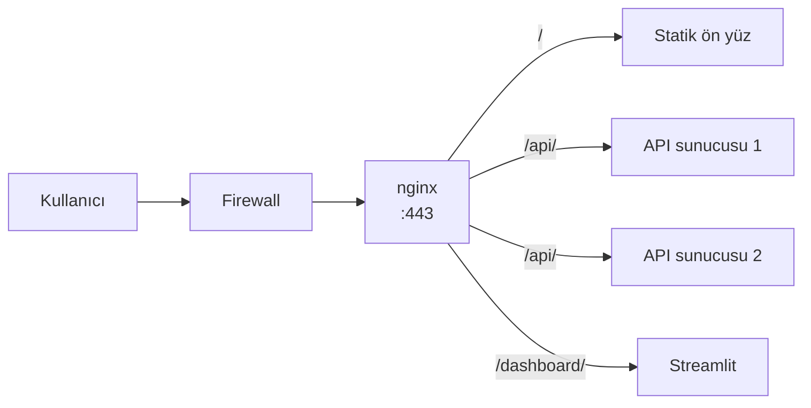

# 8.2 nginx Nedir, Nerede Durur?

## Nedir?
**nginx** ("engine-x" diye okunur), yüksek performanslı, düşük bellek tüketen ve **olay tabanlı** (event-driven) çalışan açık kaynak bir sunucu yazılımıdır. Aynı anda birçok rol üstlenebilir:

| Rol | Ne yapar? |
|---|---|
| **Web sunucusu** | Statik dosyaları çok hızlı sunar |
| **Reverse proxy (ters vekil)** | İstekleri karşılayıp arkadaki uygulamalara iletir ([8.4](04-reverse-proxy.md)) |
| **Load balancer (yük dengeleyici)** | Trafiği birden çok sunucuya dağıtır ([8.5](05-load-balancing.md)) |
| **TLS sonlandırma** | HTTPS şifrelemesini merkezi olarak yapar ([8.6](06-https-tls.md)) |
| **Önbellek (cache)** | Sık istenen cevapları saklar ([8.7](07-cache-rate-limit.md)) |
| **API ağ geçidi (basit)** | Yönlendirme, rate limit, header yönetimi |

## Hangi problemi çözer?
Uygulamaları doğrudan internete veya kurum ağına açmak yerine önlerine güçlü, tek bir kapı koyar. Bu kapı:
- Binlerce yavaş istemciyi uygulamanın yerine bekler,
- Şifrelemeyi yapar,
- Kötü istekleri ve aşırı trafiği filtreler,
- Uygulamaların iç adreslerini gizler.

## Nasıl çalışır?

**Mimari:** Bir **master** süreç konfigürasyonu okur ve **worker** süreçleri yönetir. Her worker, tek iş parçacığında olay döngüsüyle (event loop) binlerce bağlantıyı aynı anda idare eder; her bağlantı için yeni süreç/iş parçacığı açmaz. Bu, düşük bellek ve yüksek eşzamanlılık sağlar.

**Nerede durur?**


Kubernetes/OpenShift dünyasında aynı konumu **Ingress Controller** (çoğu zaman ingress-nginx) veya **OpenShift Router** alır ([8.9](09-ingress-controller.md)). Ayrıca nginx; container içinde ön yüz dosyalarını sunmak veya bir pod'un yanında sidecar proxy olarak da kullanılır.

**Dosya yapısı (Debian/Ubuntu)**

| Yol | İçerik |
|---|---|
| `/etc/nginx/nginx.conf` | Ana konfigürasyon |
| `/etc/nginx/conf.d/*.conf` | Ek site konfigürasyonları |
| `/etc/nginx/sites-available/` ve `sites-enabled/` | Debian'a özgü site yönetimi |
| `/var/log/nginx/access.log` | Erişim kayıtları |
| `/var/log/nginx/error.log` | Hata kayıtları |
| `/usr/share/nginx/html` veya `/var/www/html` | Varsayılan statik dosya dizini |

## Mini örnek
Kurulum ve temel yönetim:
```bash
sudo apt update && sudo apt install nginx      # RHEL: sudo dnf install nginx
sudo systemctl enable --now nginx
curl -I http://localhost                       # "Server: nginx" görünmeli

sudo nginx -t                                  # konfigürasyonu test et (her değişiklikten sonra!)
sudo systemctl reload nginx                    # kesintisiz yeniden yükle
sudo tail -f /var/log/nginx/error.log
nginx -V                                       # sürüm ve derleme modülleri
```

Container ile:
```bash
docker run -d --name web -p 8080:8080 nginxinc/nginx-unprivileged
docker exec web nginx -t
```

## Nerede kullanılır?
- Python API'lerinin ve Streamlit dashboard'larının önünde
- Statik raporlar ve dokümantasyon siteleri
- Kubernetes'te ingress-nginx controller olarak
- React/Vue gibi ön yüz uygulamalarının container içinde sunulması

## Benzerleri ve farkları
| Yazılım | Not |
|---|---|
| **Apache httpd** | Köklü, modül zengin; süreç/iş parçacığı tabanlı |
| **HAProxy** | Yük dengeleme ve TCP proxy'de çok güçlü; OpenShift Router'ın temeli |
| **Traefik** | Container ortamlarını otomatik keşfeden modern proxy |
| **Envoy** | Servis ağı (service mesh, Istio) ve modern API gateway'lerin temeli |
| **Caddy** | Otomatik HTTPS ile sade kurulum |

- **nginx açık kaynak ile NGINX Plus:** Plus, ticari sürümdür (aktif sağlık kontrolleri, gelişmiş izleme paneli, destek).
- **OpenShift'te:** Docker Hub'daki standart `nginx` image'ı root ve port 80 beklediği için çalışmaz; `nginxinc/nginx-unprivileged` (port 8080) veya Red Hat'in `ubi9/nginx` image'ları kullanılır.

## İlgili sayfalar
- [8.3 Konfigürasyon yapısı](03-konfigurasyon.md)
- [8.4 Reverse proxy](04-reverse-proxy.md)
- [8.1 Web sunucusu nedir](01-web-sunucusu-nedir.md)
